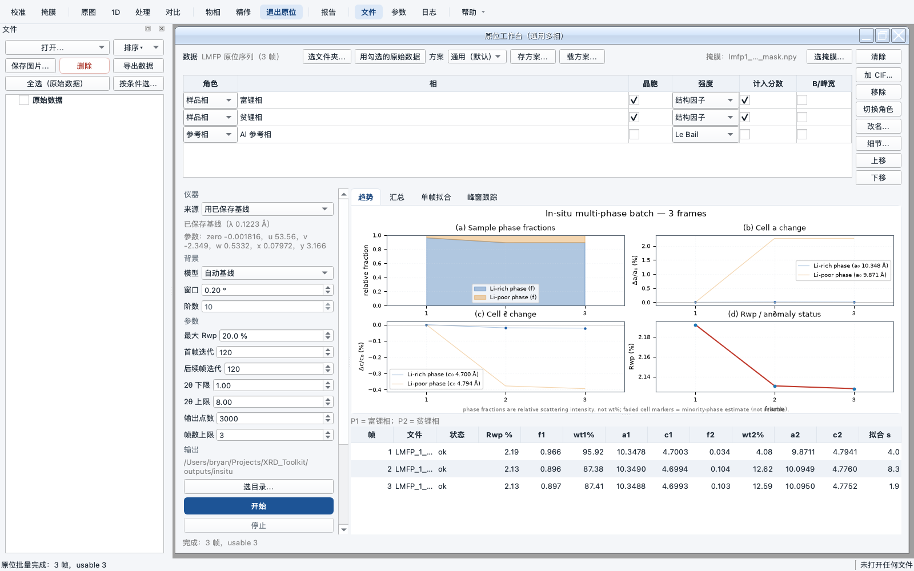
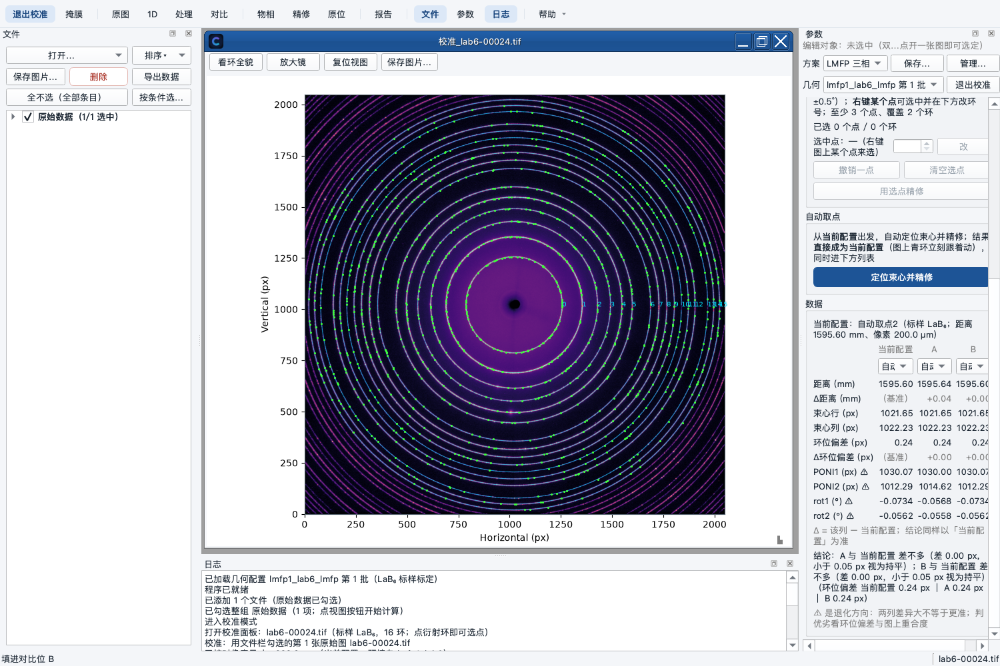
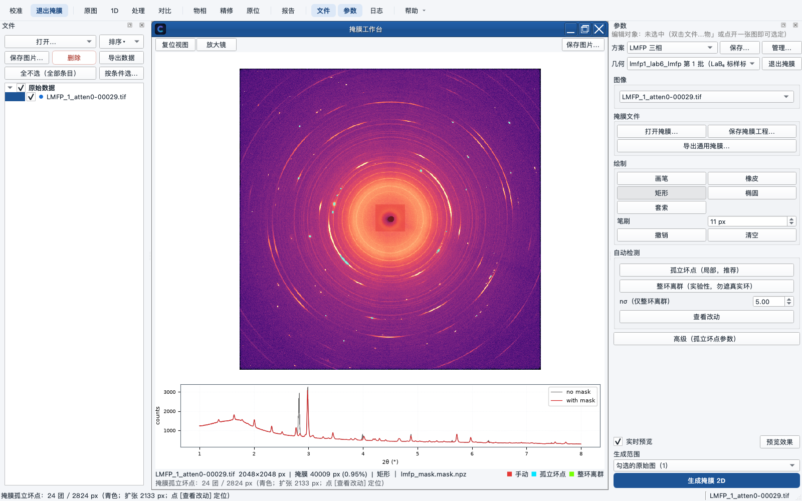
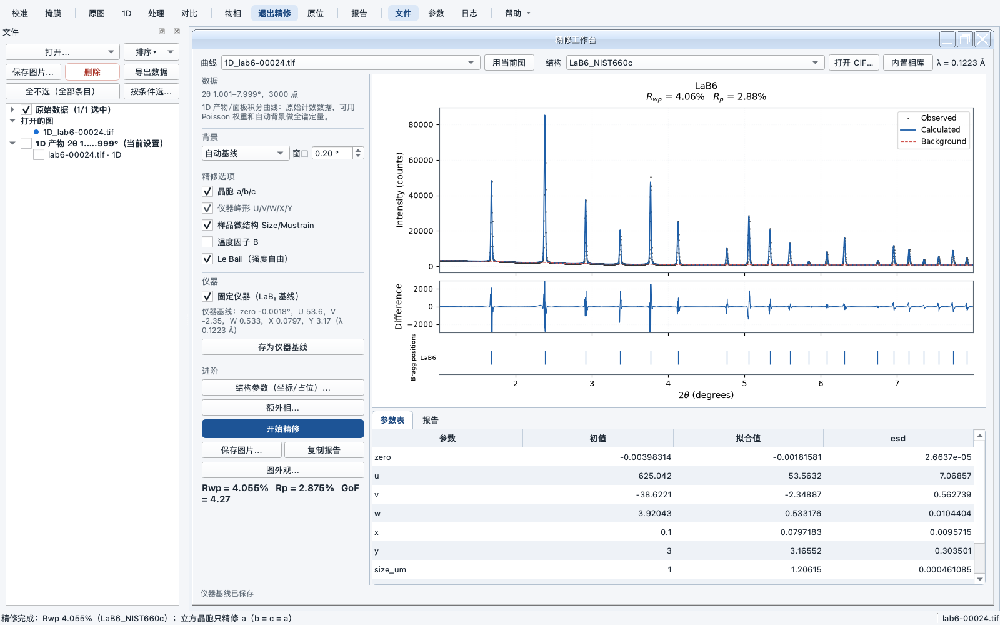

# XRD Toolkit


[](https://github.com/xyyzzc3/xrd_toolkit/releases/latest)


A modular Python toolkit for X-ray diffraction: turn 2D detector images into
calibrated 1D powder patterns, then analyse them — peak finding, profile
fitting, phase screening, Le Bail/Rietveld refinement, CIF simulation and
generic multi-phase in-situ batches. The same engine drives a PySide6 desktop
app and a set of CLI scripts.

[中文 README](docs/README.zh-CN.md) · [User manual (Chinese, illustrated)](docs/使用说明.html) ·
[Long-form notes](docs/NOTES.md) · [Changelog](CHANGELOG.md) ·
[Citation](CITATION.cff) · [Showcase](https://xyyzzc3.github.io/xrd_toolkit/)



## What it does

- **Calibrated 2D → 1D** — geometry refinement against LaB₆ (default), CeO₂,
  Si and other built-in standards; off-centre beams, partial rings and
  36-sector azimuthal analysis. Each run reports ring-position deviation,
  complete-ring count and per-ring lattice dispersion.
- **Mask before integration** — paint/erase the beamstop, module gaps and
  hot pixels, or auto-detect isolated defects; preview the 1D pattern before
  and after; save `.mask.npz` / `.npy` / `.edf` and a traceable Mask 2D product.
- **1D analysis** — empty-scan subtraction, rolling auto baseline with manual
  anchors, smoothing/cropping, robust peak finding, single-peak fits
  (Gaussian / Lorentzian / pseudo-Voigt / split-Pearson VII), Scherrer and
  Williamson–Hall analysis with an optional LaB₆ instrument baseline.
- **Phase screening and cell refinement** — score observed peaks against a
  bundled 41-phase library or your own CIF folder, filter by the periodic
  table, overlay candidates, and refine the cell for all seven crystal systems
  plus the 2θ zero.
- **Full-pattern fitting** — Thompson–Cox–Hastings pseudo-Voigt with
  Caglioti/Lorentzian widths, Le Bail or structural refinement, extra phases,
  atom coordinates/occupancy, instrument baselines and crystalline wt%.
- **In-situ multi-phase batches** — the in-situ page is a generic phase table
  (any CIF list, roles, structure-factor/Le Bail, fraction denominator);
  LMFP is a built-in scheme. Save/load schemes as JSON, choose background
  model/window and instrument source, and read a compact phase-wise result
  table. Four views: trends, summary, single-frame fit, peak-window tracker.
- **Report and presets** — one-click self-contained HTML report; named project
  presets bundle geometry, second phase, in-situ directory/mask, phase library
  and processing settings.
- **Desktop + CLI** — a PySide6 app over the same engine (calibration, mask,
  1D, processing/compare, phase/refine/in-situ workbenches, report), plus
  scripts for calibration, integration, simulation and fitting.

## Download & run

**Latest release** — self-contained apps built by GitHub Actions (links always
point to the newest release):

| Your machine | Download |
|---|---|
| Windows 10/11 | [XRD-Toolkit-windows.zip](https://github.com/xyyzzc3/xrd_toolkit/releases/latest/download/XRD-Toolkit-windows.zip) |
| Mac, Apple Silicon (M1…M4) | [XRD-Toolkit-macos-apple-silicon.zip](https://github.com/xyyzzc3/xrd_toolkit/releases/latest/download/XRD-Toolkit-macos-apple-silicon.zip) |
| Mac, Intel | [XRD-Toolkit-macos-intel.zip](https://github.com/xyyzzc3/xrd_toolkit/releases/latest/download/XRD-Toolkit-macos-intel.zip) |

Unzip → double-click. The builds are unsigned, so the system blocks the first
launch once: Windows *More info → Run anyway*; macOS *right-click → Open*.
Step-by-step instructions (Chinese, illustrated): [使用说明](docs/使用说明.html)
(also shipped in the zip and under Help → 使用说明, F1). Requires macOS 13+ /
Windows 10+; about 150 MB download, 340 MB installed.

## Quick start

1. **Open** — `[打开…]` → pick your `.tif` / `.edf` / `.cbf` images (a folder works too)
2. **Calibrate and mask (optional)** — calibrate on `[校准]` against the selected
   standard (LaB₆ by default) or import a pyFAI `.poni`; use `[掩膜]` to remove
   the beamstop shadow, module gaps and fixed hot pixels
3. **Plot** — check the files → `[1D]` → `[出图（勾选文件）]`
4. **Export** — `[导出数据]` → two-column txt / `.chi` / a combined CSV

The built-in geometry covers the first LMFP batch. Skip step 2 if your data
are already calibrated and clean. The interface is Chinese; figures and
exported data use English labels.

## In-situ workbench

The in-situ page is generic by default: add any CIF list and set each phase's
role, cell/intensity model and whether it counts toward the sample fractions.
The LMFP three-phase scheme (Li-rich / Li-poor / Al reference) fills the same
page in place. Schemes save/load as JSON; each phase has its own B, size,
strain, initial cell, cell bounds and colour. The batch runs with two-start
robust fitting, seed re-locking and anomaly flags; 81 frames take about
3.5 minutes on the development machine. The report section draws its summary
and peak-window figures from the active scheme, and a GSAS-II cross-check
(`scripts/gsas2_insitu_crosscheck.py`) compares cells and fraction trends.
Details: [manual §11](docs/使用说明.html) and
[docs/NOTES.md](docs/NOTES.md) (`#lmfp-in-situ-three-phase-batch`).

## Gallery

<table>
  <tr>
    <td align="center" width="33%">
      <br>
      <sub>Calibration workbench — current geometry, comparison slots and engine metrics</sub>
    </td>
    <td align="center" width="33%">
      <br>
      <sub>Mask workbench — paint/auto-detect defects and preview the 1D pattern</sub>
    </td>
    <td align="center" width="33%">
      <br>
      <sub>Refinement workbench — full-pattern fit, instrument baseline and parameter table</sub>
    </td>
  </tr>
</table>

More screenshots, example fits and simulation figures:
[Showcase](https://xyyzzc3.github.io/xrd_toolkit/) · [`showcase/`](showcase/).

## Install from source

<details>
<summary>Requirements, commands and CLI examples</summary>

```bash
conda env create -f environment.yml    # once
conda activate XRD_Toolkit_Environment
pip install -e .                       # numpy / scipy / matplotlib / fabio / pyFAI / PySide6 / pymatgen
python -m xrd_toolkit.gui              # desktop app
```

```bash
# calibrate + integrate one image
python scripts/calibrate_integrate.py --file data/xxx.tif --wavelength 0.1223 --pixel 200 --dist0 1600
# integrate with an existing geometry, or run sector/waterfall analysis
python scripts/integrate_pattern.py --file data/xxx.tif
python scripts/sector_waterfall.py --file data/xxx.tif --n-sectors 36
# simulate a powder pattern from a CIF
python scripts/simulate_xrd.py data/structures/Si_9008565.cif outputs/sim_Si.png
# fit the LaB6 standard (Le Bail profile + Bragg ticks)
python scripts/simulate_study.py fit
```

Sample data are not in the repository — point `--file` at your own images.
Script outputs and cached products live under `outputs/` (gitignored); the
repository ships code, reference CIFs and standard-sample examples.
</details>

## Tests & repository layout

<details>
<summary>Test commands and source tree</summary>

```bash
python scripts/run_tests.py            # full suite, behind a watchdog
python scripts/run_tests.py --fast     # unit tests + static guards only
python scripts/run_tests.py --jobs 8   # split GUI suite across processes
python scripts/check_gui.py            # real-data GUI chain probe
```

Synthetic-image unit tests (no sample data needed) cover calibration and
integration, background estimators, staged-product caching and GUI wiring;
GUI integration tests use real canvas events.

```
src/xrd_toolkit/   core · services · simulation · gui
scripts/           analysis CLI + self-check tools
packaging/         PyInstaller spec, icons, constraints
tests/             unit + GUI integration tests
data/structures/   reference CIFs (tracked); data/*.tif are local samples
showcase/          curated figures used by the README, manual and site
docs/              manual, long-form notes, Chinese README
```
</details>

## Status

**v0.2.1** (2026-11-19) is the latest release. The generic in-situ page,
saveable schemes, background/instrument options, compact result tables,
initial-cell editing and scheme-driven report figures landed in this release.
Next: configurable in-situ cell-axis and peak-window views, deeper structural
options for in-situ batches, and ML-assisted phase/peak classification
(deliberately last). Experimental validation is covered by the synchrotron
LaB₆ + LMFP work; laboratory-source and Si-standard data remain a separate
dataset task.

## Data, privacy & compliance

All computation happens **on your machine**: the app does not connect to the
network, upload anything or collect telemetry. It is a scientific tool —
verify critical numbers before publication. Licensed MIT; third-party notices
ship in the app (Help → About) and in
[`packaging/THIRD_PARTY_NOTICES.txt`](packaging/THIRD_PARTY_NOTICES.txt).

## Author

BIAN Chenze — MSc in Physics with Data Modelling and Quantum Technologies,
City University of Hong Kong · [GitHub](https://github.com/xyyzzc3)

## License

[MIT](LICENSE)
