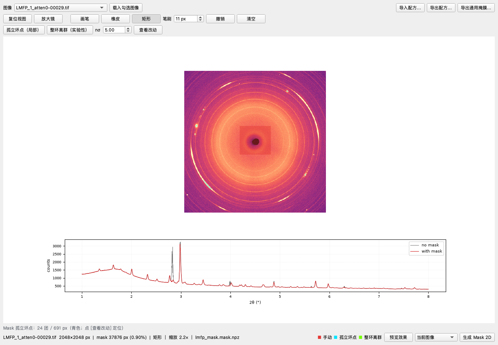
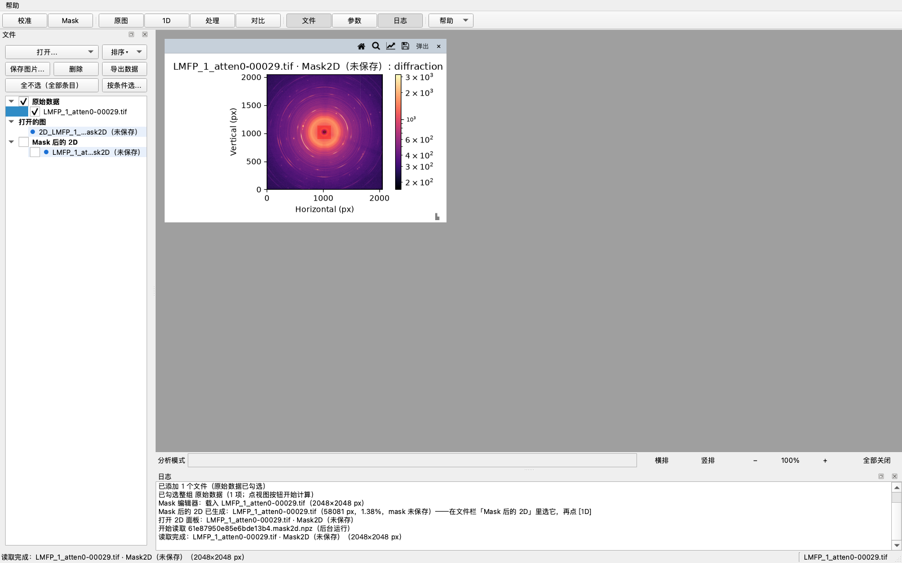

<!-- 临时独立文档：v0.1.6 正式发版时并入 docs/使用说明.md，并删除本文件。 -->
# Mask（遮罩）快速上手

> 适用于当前开发版（v0.1.6 未发布）。Mask 的做法是：
> **在 2D→1D 积分之前**把 beamstop、模块缝、坏点遮掉，并生成一条
> 「Mask 后的 2D」数据；之后再用它做 1D、对比、处理。坏点不会被改写，
> 只是不参与方位角平均。



## 1. 什么时候要 Mask

- 探测器有**固定坏点/热像素团**：会在 1D 上抬起背景或制造假峰；
- **beamstop / 模块缝 / 探测器边缘**：会压低低角强度；
- 明显的固定寄生散射斑点。

**不要**用自动径向 nσ 去遮真实衍射环：它会把强环的方位起伏当成坏点
（真实 LMFP 帧上会沿环误标约 18k px）。径向 nσ 只作实验性参考。

## 2. 打开编辑器

1. 点工具栏 **[Mask]**（在 [校准] 右边），打开独立窗口；
2. 点 **[用勾选第一张]** 直接用文件栏里勾选的第一张原始图，或
   **[打开图像…]** 选一张代表性图像；
3. 窗口底部状态栏会显示：文件名、尺寸、mask 像素数/百分比、当前工具。

## 3. 画 mask

- **画笔 / 橡皮**：按住左键拖；笔刷大小在「笔刷 xx px」里调；
- **矩形**：拖出一个矩形，松开后整块遮掉；
- **撤销**：回退一步（最多 12 步）；**清空**：清掉编辑器里的 mask；
- **自动坏点（局部）**：15×15 局部中值 + 小连通域，专抓孤立亮团/坏点簇，
  不碰真实衍射环（生产路径）；
- **径向 nσ（实验性）**：按径向环带找离群像素；真实环可能被误标，
  跑完要用橡皮/撤销修。

**看大图**：滚轮以光标为中心缩放；中键（Mac 触控板用 ⌥ 或 Shift +
左键）拖动平移；**[全图]**（或 **Home** 键，与主窗口一致）一键复位；
状态栏在放大时显示「缩放 N.N×」。
画错一笔按 **Esc** 只取消这一笔（窗口不会关），再按一次才隐藏编辑器。
遮罩永远是全分辨率，只有显示会按视图降采样（块内取最大 / 任一），
缩到全图时孤立坏点也不会被平均掉。

图中半透明色块 = 将被遮掉的像素，颜色标出来源：

| 颜色 | 来源 |
|---|---|
| 红 | 画笔 / 矩形（手动） |
| 青 | 自动坏点（局部） |
| 绿 | 径向 nσ（实验性） |

橡皮擦掉后就不显示，所以自动检测误标的地方用橡皮修掉即可。
**边缘/beamstop 在 1–8° 积分范围外**时，遮了也不会改变曲线；真正影响
曲线的是范围内的坏点/强寄生斑。

## 4. 生成「Mask 后的 2D」

画好后这样生成：

| 操作 | 作用 |
|---|---|
| **[生成 Mask 2D]** | 只给当前图像生成一条 Mask 2D 数据 |
| **[生成 Mask 2D]** + 勾选「同时预览 1D」 | 生成 + 在下方画 mask 前/后两条 1D 曲线 |
| **[应用到勾选文件（N）]** | 把同一张 mask 生成到文件栏里勾选的每个原始图（同探测器/同形状）；N = 当前勾选的原始图数量 |

生成后：

- 文件栏出现 **「Mask 后的 2D」** 组，条目名形如
  `LMFP_1-00029.tif · Mask2D（mask 文件名）`；
- 同一张图 + 同一 mask 重复生成会复用同一条，不会堆重复条目；
- **原始图不会被改写**，mask 像素仍是原值；Mask 2D 只是“原图 + mask”的
  引用/小 manifest（`<缓存>/masked2d/*.mask2d.npz`），不复制 16 MB 像素。



## 5. 用 Mask 2D 做 2D / 1D

- **双击**「Mask 后的 2D」条目 = 打开 2D 面板（原始像素 + 红色 mask 叠加）；
- **右键 → [打开 1D 图]** = 按这份 mask 积分，1D 产物挂在同一条目下；
- 遮罩与未遮罩的 1D 是**两个不同的源**，可以同时存在、并排对比；
- 对比 / 热图 / 批量处理里，Mask 2D 和原始数据一样可勾选、可出图。

> 标定的环检测仍然用**原图**，不套 mask；mask 只作用于 2D→1D 积分。

## 6. 保存 / 加载 mask

- **[保存 Mask…]**：把当前 mask 存成 `.npy`（bool）或 `.edf`（0/1）；
  默认路径 `outputs/masks/<几何名>_mask.npy`。
- **[加载 Mask…]**：读回 `.npy/.edf`；只接受这两种后缀（选错 `.tif`
  会被拒绝，避免把整张图当 mask）。
- 保存/加载**不会自动生成** Mask 2D；要再点 [生成 Mask 2D]。
- 保存后重新生成同一 raw+mask：只更新文件栏显示标签（用保存的文件名），
  **不重算已有 1D 缓存**。

## 7. 导出

- **导出 1D**：文件头会写 Mask 溯源，例如
  `# mask: sha 1a2b3c4d, 6561 px`；CSV 每列明细也带。
- **导出 Mask 2D 数据**：右键「Mask 后的 2D」→
  **[导出 Mask 2D 数据（.npz：image + mask）…]**。产物自包含：

```python
import numpy as np
z = np.load("xxx_mask2d.npz")
image = z["image"]   # 原始像素（float）
mask  = z["mask"]    # bool；True = 被遮掉
meta  = z["meta"]    # JSON：原始图路径、mask 哈希、像素数、标签
```

坏点仍是 mask，**不填 0/NaN**；换机器、没有原始图也能用。

## 8. 注意事项

- Mask 2D 产物在**缓存目录**里（`<缓存>/masked2d/`）；[删除所有缓存]
  会连它一起清掉。
- 右键删除 Mask 2D（单条/整组）会**连带清掉它名下的 1D/处理产物缓存**；
  原始图与 mask 文件不动。
- mask 形状必须与图像一致；换成不同尺寸/几何的图会报尺寸不一致，
  需要对那张图重新应用/清除 mask。
- 空 mask 不会生成产物（避免一条“什么都没遮”的假数据）。
- mask 是**像素级**的，不保存“圆/多边形”这类形状定义；跨软件复用时
  用导出的 `.npy/.edf` 或 `.npz`。

## 常见问题

**Q：mask 后预览曲线几乎没变？**
A：如果遮的是 beamstop/束心附近，它在 1–8° 积分里贡献很小。把矩形画到
范围内的坏点团或某条环上，再勾着「同时预览 1D」点 [生成 Mask 2D]。

**Q：为什么不能等 1D 出来再扣？**
A：方位角积分把每个 2θ 环带里的像素做平均；坏点/beamstop 一旦进入平均，
1D 曲线已经错了。Mask 必须在积分前生效。

**Q：为什么标定页没有用 mask？**
A：标定是找环/定几何，不是积分；mask 只保护 2D→1D 的强度平均。标定
仍用原图。

**Q：能给整批 81 帧一次生成吗？**
A：可以。先在代表性图上画好 mask，再点 **[应用到勾选文件]**（文件栏
勾选整批原始图）。同一张 mask 会生成到每张图上，1D 再各自计算。
