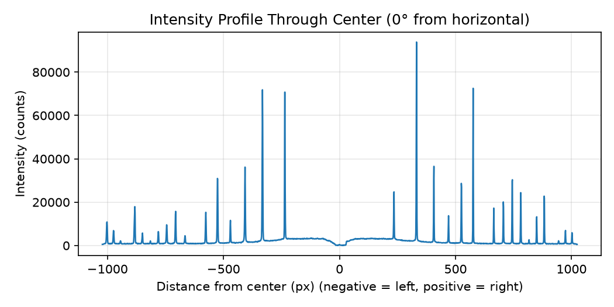
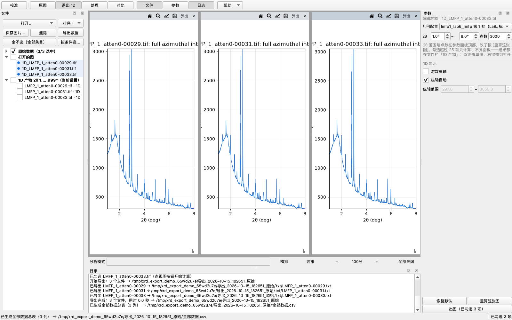
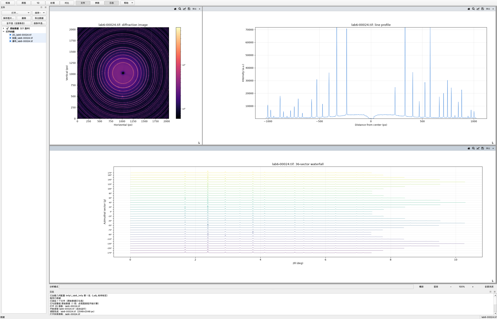
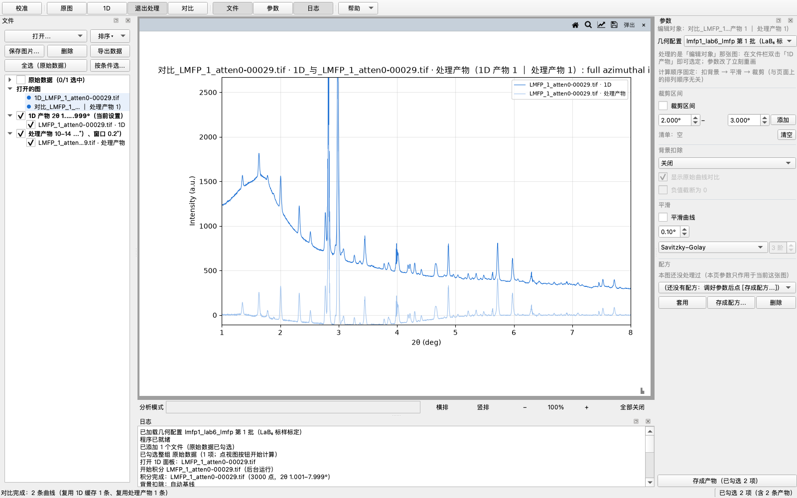
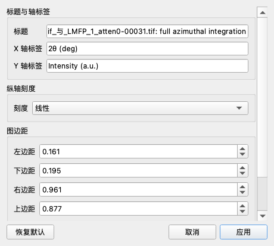

# XRD Toolkit — 详细说明

原先塞在 README 里、把它撑得没人愿意读的那些内容：命令行参数、校准指标怎么判读、背景扣除为什么这么选、批量与产物缓存怎么工作、界面背后的工程细节。短版在 [README.zh-CN.md](README.zh-CN.md) · English: [NOTES.md](NOTES.md)

## 命令行参数

四个处理图像的脚本都支持两种方式选文件：`--file` 指定单个文件；不带 `--file` 则弹出交互菜单，列出 `data/` 里所有数据文件按编号选择（`1,2` 多选、`all` 全选）。（模拟脚本 `simulate_xrd.py` 不选数据文件——位置参数直接给 CIF 路径，见《XRD 模拟》一节。）输出都在 `{输出目录}/{数据名}/` 下，输出目录**默认 = 项目根 `outputs/` 的绝对路径**（2026-10-02 起统一：以前是相对路径，跟着进程工作目录跑，从别的目录启动就落到别处；显式传 `--outdir` 照旧）。三个消费脚本用 `--config 条目名` 选几何配置（默认 `lmfp1_lab6`）；交互模式下选完文件会再弹一个配置菜单（回车 = 默认条目）。txt 的写盘格式与 GUI 导出同源（`services/export.py`，见下文《导出文件格式》）。

<details>
<summary><b>衍射图查看</b> — <code>scripts/view_diffraction.py</code></summary>

```bash
python scripts/view_diffraction.py --file data/xxx.tif --angle 0 --outdir outputs
```

- `--file`：衍射图像路径（.tif / .edf / .cbf）
- `--center`：环圆心坐标 cx,cy，不填则用选中配置的束心
- `--config`：几何配置条目名（config.py 的 `CONFIGS` key，默认 lmfp1_lab6）
- `--angle`：剖面线与水平方向的夹角（度），默认 0
- `--outdir`：PNG 输出目录（默认：项目根 `outputs/`）



</details>

<details>
<summary><b>几何校准 + 1D 图谱（标样，默认 LaB₆）</b> — <code>scripts/calibrate_integrate.py</code></summary>

```bash
python scripts/calibrate_integrate.py --file data/xxx.tif --wavelength 0.1223 --pixel 200 --dist0 1600
```

- `--wavelength`：X 光波长（Å）
- `--pixel`：探测器像素尺寸（µm）
- `--dist0`：探测器距离初值（mm），pyFAI 自动精修出精确值
- `--center`：束心初值 cx,cy（像素，不传则自动定位，精度 <1 px）。偏置束心（部分环）数据必须显式传入：自动定位需要完整环，且该摆法下精修不可靠——距离/倾斜角请用居中标样图像标定
- `--calibrant`：pyFAI 标样名称或常用别名（默认 `LaB6`；小写别名 `lab6`/`ceo2`/`si`/`al2o3`/`agbh` 也认；精确名称区分大小写）。常用：`CeO2`、`Si_SRM640`、`alpha_Al2O3_SRM676`、`AgBh`；LaB₆/Si 有多个 SRM 变体，请按证书选
- `--max-rings`：参与校准的环数（默认 16；按标样反射总数自动夹）
- `--range`：2θ 区间——`full` / `auto`（默认，材料专属标准）/ `lo,hi` 度（如 1.3,7.3）；完整版 txt 永远保存
- `--outdir`：输出目录（默认：项目根 `outputs/`）

流程：LaB₆ 峰位校准（pyFAI `GeometryRefinement`）→ 方位角积分（2D→1D）→ 输出 `calibrated_2th.txt` + `calibrated.png`（红虚线 = 理论峰位）。代码在 `xrd_toolkit/services/integrator.py`。精修完成后会打印一段可直接粘贴进 `config.py` `CONFIGS` 的条目模板，改好 key 即完成新批次登记（脚本自己从不改那个文件）。

</details>

<details>
<summary><b>全角度积分（2D → 1D 标准谱）</b> — <code>scripts/integrate_pattern.py</code></summary>

```bash
python scripts/integrate_pattern.py --file data/xxx.tif
```

用选中的几何做 0°–360° 完整方位角积分，输出标准两列 txt（2θ(deg), intensity）+ PNG。可用 `--dist`、`--poni`、`--wavelength` 覆盖几何；`--range full/auto/lo,hi` 控制画图与 `_auto` 裁剪版 txt 的区间（完整版永远保存）。

</details>

<details>
<summary><b>扇形积分 + 瀑布图</b> — <code>scripts/sector_waterfall.py</code></summary>

```bash
python scripts/sector_waterfall.py --file data/xxx.tif --n-sectors 36
```

把 0°–360° 方位角分成 N 个扇区分别积分（默认 36 个，每 10° 一个），输出每扇区的两列 txt（`outputs/{数据名}/sectors/`）+ 一张原强度堆叠瀑布图（36 条曲线沿 Y 轴错开、**行距统一 = 第二高的那一行的峰 × 0.7**，每条画到自己强度变 0 处——右端阶梯即各扇区衍射环被探测器边缘切掉的位置），用于检查方位均匀性（大晶粒、择优取向会表现为强度集中在少数扇区）。行距刻意**不**按各扇区自己的峰值来：那等于把每行都缩到各自高度，扇区之间的强弱就没法横向比了（用户 2026-09-26 定的规矩："不要按照各自的最高峰归一化，所有的图"）。**2026-10-02 基准从"全场最大"换成"第二高"**（用户："瀑布图……还是不行，改成行间距小一点，让峰明显一点"）：实测这批 LMFP 的 36 个扇区，全场峰值 48230（χ=165° 那个扇区的 2.83° 主峰，是第二名的 3.3 倍），而中位扇区的峰只有 2586 = 全场峰值的 5.4%——按 0.7×全场峰值排行距时，中位那行的峰只占一行高度的 8%，整张图就是一把平线；改成"第二高 × 0.7"后行距 = 10327（全场峰值的 21%），中位行的峰占到 25%、一眼看得见，只有最强的那个扇区会探进上一行（它确实强 3 倍）。忽略**一个**就够，而且均匀样品下第二高 ≈ 最大，老口径的行为原样保留；行数少时（对比图只勾两个文件）同样成立。口径只有一份：`services/stacking.row_step`，GUI 瀑布图 / 对比堆叠 / 本脚本共用。界面里的瀑布图同口径（2026-10-07 起行距还能手动调：「原图」页「瀑布显示」小节勾 [手动行距] 后按倍数缩放自动行距，纯显示、即改即画），另外会把处理链（背景 / 平滑 / 裁剪）逐扇区跑一遍——把压扁其他峰的巨峰裁掉之后，弱扇区才看得清。支持 `--range full/auto/lo,hi`。

</details>

## 校准

[校准] 入口打开校准页：第一栏是**配置条目操作区**——[编辑当前配置…] 加 [加载几何…] / [保存几何…] / [删除] / [保存为配置]——紧跟在参数面板顶部"几何配置"那一行下面，因为这些按钮作用的就是那一行选中的条目。往下依次是两个动作块——**手动选点**（图上点环：≥3 点、覆盖 ≥2 环、±0.5° 自动吸附）在上、**自动取点**（一个按钮：定位束心并精修）在下（2026-10-13 用户定："校准顺序调为手动在上，自动在下"，手动是常用路径），**数据三列表**在页面最下（**当前配置** + 两个对比位 **A** / **B**，三列都可以从"跑过的东西"里选）。**2026-10-05**：两个动作块此前叫「自动 / 手动」、第二个按钮叫 [在当前配置上再精修]——太虚，改名成现在的**自动取点 / 手动选点**、[再精修]（结果名跟着变成 自动取点1、手动选点1…）；同一天像素尺寸确认从**硬门禁**改成**提醒**（没勾也照常跑、照常存——页面上常显橙色「⚠ 未核对」、动作时日志再提醒一遍）；尺度扫描两处缺陷也在同日查修（KeyError: 'poni1_px' 与"赢家尺度"没交给重拟合，见提交 `aaeeafc`）。**2026-10-08**：自动块里的 [再精修] 已删——真 lab6 实测它与 [定位束心并精修] 等价（环位偏差 0.24 vs 0.23 px，在重复跑抖动 0.014~0.029 px 以内），连按两个按钮 = 空转，两个入口收敛成一个；结果名「精修N」与已存配置的 `method=refined` 照常显示，只是不再有新产出。**同日第二笔**：数据框排版改定——「当前配置：…」说明行挪到框顶（先看见"用的哪份几何"，下拉框下面直接就是自己列的数字），三个槽下拉框从独立一行挪进表格、各贴自己那一列的灰字头正下方（用户："三个选择框和对应的当前 A/B 太远了"，实测原布局左偏 31~91 px 且中间隔两行）；下拉框水平 SizePolicy=Ignored，列宽仍由数字定——不然它按最长条目要宽度，会把参数坞从 359 顶宽到 465 px。

当前配置一开始是**从选中条目预填的原始几何**；[编辑…] 可以换成别的条目预填或直接手输，**只要手改过就标成"自定义"**、之后不被自动替换。**每个结果都按自己的名字累积**（原始 / 自动取点1 / 手动选点1 / 精修1 …），并按 A→B→A 轮换填进对比位——除非你手动选过那个槽（选过就**钉住**，新结果不再覆盖它）。

**"用的到底是哪一份"：你按钮跑出来的结果一律成为当前配置**（2026-09-30 改的口径，原话"只要是用户操作的，无论自动手动精修都填入当前，让用户看到变化"）——青环立刻跟着动，日志把"好了/差了多少"写出来（`当前配置 → 手动选点1（环位偏差 0.50 px，比 预填自 lmfp1_lab6 的 0.20 px 差 0.30 px）`）；覆盖你手输/手改的几何时会点明"那份仍在结果列表里，随时能选回来"。原先的「小于 0.05 px 视为持平」判据（要赢过当前配置 **0.05 px** 才替换，理由是同一张图重复跑环位只抖 0.014–0.029 px）现在**只用来分档措辞**（比…好 / 差不多 / 差多少），不再决定换不换——阈值判得再对，青环不动，用户也会以为精修没生效。校准图标题也写明了这一点：`Cyan rings = current config: <哪条结果> · ring deviation X px`。这一页上 Δ 行与结论是**同一个参照**，而且**永远是「当前配置」**：Δ = 该列 − 当前配置（当前配置那一列自己写「基准」，不再是一个看着像"没数据"的破折号；结论 = A、B 两个候选分别 vs 当前配置，两边的名字和数字都写全——"A 比 当前配置 好 0.32 px（环位偏差 当前配置 0.73 px ｜ A 0.41 px）"）。这个参照系来回走过三步：最早两处各说各的（用户 2026-09-27："对比基准和结论表述不清，不知道是谁在和谁比"——那会儿基准只挪 Δ 行，结论写死在"当前配置"上，切基准时结论一个字都不变，即用户 2026-09-28 第 2 条"数据结论不受对比基准的影响"）；随后加过一版「对比基准」下拉框同时管两处；2026-09-30 把下拉框整个删了（用户："直接把对比基准删了，直接出结论当前配置和 a、b 对比分别怎么样，随着用户选择 ab 当前进行变化"）——换掉 A/B 槽里钉的结果，Δ 行与结论立刻跟着变，也就没有"基准选着 A、结论在讲 B"这种要绕一下的表述了。**判环可疑时按尺度重判**（2026-09-30）：点图判环 = 拿当前几何把点换算成 2θ、找最近的理论环（容差 0.5°），而低角侧没有更低的环可判——**距离错一个比例，最里面几个真实环会被压到第 0 环**（用户原话："第 0 青环里面套了两个真实的环，点击真实的环，里面的两个环都会标记为第 0 环"）。现在手动精修前先看一眼：**同一个环号横跨了两个半径**（差 >15%）就扫 7 个距离尺度（0.85–1.20）、各自重判环再拟合，挑**环位偏差最小**的那套，日志写明换成了哪个尺度（只有好过 0.05 px 才换——与采纳判据「小于 0.05 px 视为持平」同一个噪声口径）；没有图像或指标算不出来时不猜、原样不动。**选点不再整幅重画**（2026-10-01，用户报"校准功能卡死两次，都是在选点时"）：一次整幅重绘要 **~0.6 s**（2048² 图像的 LogNorm 上色 + 重采样，探针实测 610 ms/次），原先每点一下都付这份钱、事件循环整个被占住——连点几下就像死机。现在整幅画完拍一帧当底图（挂在 `draw_event` 上，永不过期），选点只**贴图**（restore_region + 画新加的圈和数字 + blit，实测 10 ms）；"要擦掉旧标记"的动作（撤销、改环号）仍旧整幅重画。**贴图时要把所有已记录的选点标记一起重画**（用户当天接着报"圆环会消失"）：底图里没有后来贴上去的标记，"贴回底图"会把先前的点全擦掉——名单 `calib_marker_artists` 由整幅重画重建（`_draw_calib_image`），每次贴图照单全画。**撤销 / 清空 / 右键改环号也走贴图**（用户当天再报"手动选点的撤销和全清都卡了，就是变深色然后卡住"——那时它们还是整幅重画）：标记的 artist 平时设成**不可见**（`_new_marker_artists`），所以整幅重画出来的底图是**干净**的，擦掉旧标记只要"贴回底图 + 只画剩下的"——实测撤销 8 ms、清空 5 ms（原先各是一次 2048² 重过 LogNorm）。`draw_artist` 不看可见性，这是这套做法的支点（探针实拍三个圈都在）。与 plot_panels 框选的 `_blit_take` 同一套路。

**卡死会自己留现场**（2026-10-01）：界面线程停摆超过 8 秒，一条守护线程就用 faulthandler 把**所有线程的 Python 栈**写进 `outputs/hang-<时间>.txt`（同时打在 stderr 上），恢复后再记一条"停了多久"；一直不恢复就每 30 秒补一份（卡久了栈会变，别只留第一帧）。它**只记录、不干预**——不杀任务、不弹窗。加它的原因：用户报"不点像素尺寸、点那几个出图按钮会卡死"，而本地（离屏）把那条路径压了几十次都复现不出来；卡死这种事猜不得，让程序自己留证据。

**崩溃也会自己留现场（2026-10-03）。** 用户在批量处理 1D 时闪退过一次：macOS 崩溃报告显示 SIGSEGV，崩在 PySide 绑定层的对象析构里（`method_dealloc → subtype_dealloc → ~QObject → disconnectNotify → Shiboken 去查 Python 覆写`）。翻历史发现 2026-09-26 有一次**完全相同签名**的崩溃——不是新引入的，是后台任务对象"**在自己的槽回调正在执行时被引用计数析构**"的偶发雷：任务收尾恰恰在 `_on_worker_done` 里丢掉最后引用（`_live_tasks.discard` + 调用方 `window._tasks.remove`），refcount 析构会在 PySide 的 qtPythonMetacall 里同步跑 `~QObject`，此时绑定层的状态是半销毁的。修法：任务与 worker 都改成 **deleteLater 延后销毁**（`_finish` 里投递；worker 的 deleteLater 会投递回**它自己的线程**销毁——跨线程同步析构同样是 Qt 禁忌），`destroyed` 之前由 `_live_tasks` 保活；`discard()` 对已收尾的任务直接无害返回。另加 `watchdog.install_crash_dump()`（建窗时一次）：SIGSEGV / SIGABRT / SIGBUS / SIGFPE 时把所有线程的 Python 栈追加进 `outputs/crash-watch.txt`（chain=True，系统报告与终止照旧）——系统崩溃报告只有 C 栈，Python 那一层原来是黑的。顺带把 `scripts/stress_panels.py` 的看门狗从 40 s 放宽到 120 s：健康路径 10 轮 ≈ 41 s 正好压在旧的阈值上（实跑测出，每轮 4 s 上下），会把"跑得完"误报成"卡住"。

**按钮灰着的时候要说为什么**（2026-10-01，用户："手选完了点击用选点精修无效"）：[用选点精修] 要求"≥3 个点、覆盖 ≥2 个不同的环"，不够格时按钮是灰的——而 Qt 对灰按钮**直接丢掉点击**，日志一个字都不写，于是看起来就是"无效"。现在**环数不够**时那一行会写明门槛并指出出路："已选 5 个点 / 1 个环——至少要 3 个点、覆盖 2 个不同的环才能精修（都判成同一个环号了？右键某个点可以改它的环号）"（探针复现：5 个点全判成同一个环 → 按钮灰、点击无日志，改完就能自解释）。按钮 tooltip 也写门槛。

**后手：右键某个选点 = 选中它，在「手动」小节里改它的环号**（选中点高亮金黄圈，那一行写着"第几个 / 现在判成环几"，数字框 + [改]；位置不动、只改环号；改完按 [用选点精修] 重跑）——自动那套都没救回来时，你自己知道它该是第几环，比再点一遍碰运气可靠。**2026-10-03 从"右键弹输入框"改成"选中 + 面板改"**：用户报"右键改环号后卡死，按键都按不动还变暗"，现场采样 + lldb 查明——macOS 全屏下**对话框开着的时候切去别的应用再切回**，AppKit 的模态收尾没做完（`NSApp.modalWindow` 一直挂着那个输入框），窗口服务器从此把全部输入拦住不给主窗口：进程活着、界面正常渲染、就是收不到点击和键盘（"变暗"= macOS 对非活动窗口的渲染），从外面激活一下才恢复。复现（全屏 + 原生真右键开对话框 + 真 Cmd+Tab 切走切回）命中率 100%，不切走则 100% 不中。改成两步之后这条路上**没有任何模态窗口**，切走切回随便切；顺带解决了这个对话框在离屏测试里会挂住、测试只能替身掉它的老问题。

**页面顺序与下拉重复**（同日）：页面自上而下 = 操作 → 手动 → 自动 → **数据**（先跑、再看结果；用户 2026-09-30："校准数据放最下，跟自动手动换位置"；手动搬到自动上面是用户 2026-10-13 定的："校准顺序调为手动在上，自动在下"）。"当前配置"那个下拉只在**没指向结果**时（手输的自定义 / 预填的条目）才插一个显示项——指向结果时列表里只有它自己（原先会出现两条同名项：用户报"自定义 自定义1，当前选中 2 在选项中还有 2"）。

PONI 与倾斜角标 ⚠——它们与距离/波长退化，差异大不等于更准；自洽残差**不入表**（它量的是迭代收敛，不是准不准）。

图上那圈青线是**当前几何预测的真实环**：每个点都由 pyFAI 的 2θ 场反解而来，倾斜探测器上就以它本来的椭圆样子画出来——用"圆心 + 半径"的正圆近似会整体偏 8–23 px（环的公共圆心是直射束落点，不是 PONI）。点图判环用同一套几何，因此点你看到的那条线不会判成隔壁环号；若当前几何把 16 条环全推出探测器（距离/像素尺寸/波长填错或精修跑出离谱解），面板会在图上打红字、并在日志里明说（连半径范围一起报出来，一眼看得出差几倍），而不是默默画一圈看不见的线。**视野本身永远不动**：始终是图像那一框——衍射图是唯一不动的参照系，青环围着它动。想看环跑到哪去了得自己动手：面板上的 [看环全貌] 开关（默认关，每次开面板都复位）会把视野放大到包住整组环，图像这时会缩成中间一小块——那正是这个开关的用途。**2026-10-13 起还能随手缩放**（用户："校准图添加放大功能"）：面板上多了 [放大镜] 开关——点亮 = 左键拖 = 框选放大、滚轮以光标为中心缩放（每格 10%），未点亮 = 点图选点（按下即记，老行为不动）；点亮后"小位移松开"仍判成一次点击选点（按**按下处**判环，位移阈值 6 px 与普通面板框选同一口径）。框选/滚轮定下的视野记在窗口上（`window.calib_view`，换几何等整幅重画时回放——不弹回图像框），[看环全貌] 一翻面即把它清掉并复位（手势视野永远服从这个开关，免得按钮看着"没反应"）。校准图子窗口**右下角另有那个 ▙ 把手**（与 1D 图同一套抓手：四边 8 px / 四角 24 px 抓取带 + 右下角 18 px 可见把手，按住拖 = 拉伸窗口，图像跟着变大）——用户 2026-10-01：「校准时二维图……没有 1D 图右下角那个标准的缩放，加上这个」（它先前是唯一没有抓手的窗口：校准面板不进 `plot_docks`，抓手那套默认只发给住在那张表里的面板）。**2026-10-14 起校准图也能复位视野**（用户："校准图添加 home 键，还是回到最初的视图"，紧跟着"校准没有 home 键"——别家面板标题栏都有 [复位视图]，校准图此前只有 [看环全貌]，而那是模式）：工具行加了 **[复位视图] 按钮**，鼠标停在校准图上按 **Home 键**同效——只清手势缩放、回到"最初的视野"（开关开着 = 包住环那一框，关着 = 图像那一框），[看环全貌] 开关本身不翻——同普通面板“Home 只动视图、不动设置”的分工（认图靠 `window._hover_panel_key` 的哨兵值 `CALIB_HOVER_KEY`，`_home_key_reset` 转给 `calib_panel.reset_calib_view`）。

**标样可换（2026-10-20）。** `[校准]` 页顶部多了「标样」下拉框 + 「环数」：默认 LaB₆（NIST SRM 660c），内置 CeO₂、Si（SRM 640 各变体）、α-Al₂O₃（SRM 676）、AgBh、Ni、Au、TiO₂、ZnO 等常用标样；环数默认按**完整落在图像内的环数**自动算（LaB₆ 在当前几何下仍是 16），可手改。标样只决定理论 2θ 阶梯，**距离/PONI/倾斜角/像素/波长与它无关**；换标样会清空本次选点和结果、保留当前几何（环号与环位偏差都是相对于那套理论环的，跨标样不可直接比）。保存配置时写入 `calibrant` / `calibrant_n_rings` 溯源字段；旧 `config_user.json` 条目没有这两个键时按 LaB₆ 兼容。`.poni` 格式装不下标样信息，导入/导出按当前选择或 LaB₆ 处理。命令行对应 `--calibrant`。常用标样名区分大小写，选择时请按证书选到具体 SRM 变体（变体间 d 值差几十 ppm）。

**引擎指标。** 每次校准都会在日志里附上：环位偏差中位（px，括号里是精修前初值的同一数字）、所选环数里完整跑出来的条数、以及逐环反推的标样 d 值离散度（立方标样如 LaB₆/CeO₂/Si 时它就是晶格常数 a 的离散度）。它们量的是拟合残差量不到的东西——实测过残差 0.0000°（看着完美）而环位偏 9.6 px 的情况（故意喂一组偏离真环的点），因为残差是迭代自洽量、不是精度指标。环位偏差抓"整体几何错"，d 值离散度抓"某些环与单一几何不符"（环号认错、标样选错/变体不对、探测器畸变、某条峰被顶偏）；距离与波长在标样上一阶简并，所以距离误差几乎不推动离散度，别用它判断距离。

**像素尺寸是道闸，而指标抓不到它填错。** 像素尺寸必须确认过才允许跑校准，而且只有**像素值真的变了**才会再次要求确认。距离、波长、像素尺寸只以**乘积**进入计算：像素填错时环照样严丝合缝，但报出来的距离（以及由它推出的东西）整体错同一个比例。保存也走同一道闸：[保存为配置] 在没确认时只记一行日志、不落盘——条目会被别的批次和命令行脚本原样拿去用。

**参数进出。** 新批次从「当前配置」出发：[编辑…] 里可从另一条条目预填或直接手输（**束心行/列也在这一页改**——用户 2026-09-28 第 2 条之前，对话框里根本没有这两个框，"从条目预填"也只搬 7 个数字、留下旧束心，而束心正是校准最常动的东西），也可用 [加载几何…] 导入 .poni。手输/手改的几何会**进累积结果列表**（「自定义1」「自定义2」…，用户 2026-09-28 第 1 条：改之前它只活在"当前配置"那个变量里，没有户口——A/B 下拉里选不到、切走就找不回来、也不能当对比基准；现在它与自动/手动结果一视同仁，重新选中它还会恢复"自定义"保护标记，免得下一次自动结果把它悄悄替换掉）。[保存为配置] 与 [保存几何…] 保存的都是**当前配置**——预填的、手输的、采纳来的都行——[保存为配置] 写命名条目并写入血缘（`derived_from`、`method`、`created`），存成本地 config_user.json（不进 git）：立即出现在"几何配置"下拉框并自动选中，重启仍在，命令行脚本同样可用 `--config` 选取。几何配置下拉框自己住在**参数面板顶部钉住的一行**里，五个入口页都看得见、也都换得了；悬停它就能看到当前条目的像素尺寸 / 波长 / 距离。分析页与几何有关的部分是**只读**的：只负责选条目。校准页上这个下拉框照样能换（提示里补一句：校准跟的是那一页自己的「当前配置」，不是这里选的条目），因为作用在这条条目上的按钮——[加载几何…]/[保存几何…]/[删除]——就住在校准页。校准模式下同一行还多一个 [返回分析模式] 出口。[保存几何…] 把**当前配置**（校准页表里第一列那个，含手输）写成 pyFAI 通用交换格式 `.poni`（探测器距离、中心点 poni1/poni2 米制坐标、像素尺寸、波长、倾斜角 rot1/rot2；掩膜文件为可选项——引擎尚未支持掩膜且 .poni 格式本身无掩膜字段，故不写），日志里写明存的是哪一份；用户 2026-09-28 第 2 条之前，它存的是参数面板顶部选中条目的几何——手输改完按保存，导出的还是旧条目的数字（"改完保存，文件里是旧的"），现在与 [保存为配置] 同一个口径。[加载几何…] 读 .poni 存成命名条目（与 [保存为配置] 同源）。导入或保存的用户条目可用 [删除] 移除（内置条目置灰不可删）：删除前弹确认框，删后自动回退默认条目。**2026-10-07：保存表单收成一个「条目名称」框**（用户："一个框，预填文件名的不含-后的长数字部分……旧条目也变成一条，key_备注的格式"；问改哪些地方，答"都改，统一"）：进校准时按标样文件名去掉末尾「-数字」段预填（`lab6-00024.tif` → `lab6`；用户自己改过的名字不被覆盖，`calib._refresh_config_name_prefill`），存盘时命令行标识由名字自动洗出来（非字母数字→下划线、数字开头补 `cfg_` 前缀，`config_ops._sanitize_config_key`），备注就是名字本身；**所有条目的显示统一成一条 `key_备注`**（`config.entry_display`，两者相同只写一次）——「几何配置」下拉框、坞顶悬停读数、加载/删除/保存的日志与确认框都走这一条（旧条目 key 与备注照旧分开存、拼成一条显示；下拉框闭合时超长会裁掉尾巴，下拉列表与悬停里看全名）。

## 自动 2θ 区间选择

`--range auto`（默认）用材料专属标准定区间：下界按标准选取（粉末样品：第一个已知峰 − 0.3°；LaB₆ 标样：检测到的光环结束点 − 0.6°，≈ 1.0°），上界自动检测"数据失效点"。

失效判据是**相对弧覆盖率**——环上落在探测器内的方位角比例跌破自身峰值的 50%——所以一套判据适应任何束心摆法：居中摆法约 7.9°（旧的 80% 绝对判据停在约 7.44°），偏置摆法自动后移。单曲线脚本用几何精确值；瀑布图的扇区实测值晚约 0.5°（10° 扇区量化）——两者互相印证，只有真不一致才告警。完整区间版 txt 母版永远保存。

## 偏置束心（部分环）

束心故意打在探测器边缘或角落的数据（每条环只拍到一部分，但因此能看到更高 2θ 的环）全程支持：pyFAI 的径向分箱不可靠时自动切到自研的 numpy 极坐标积分（pyFAI 按探测器中心分箱，合成环上验证过），扇区 χ 标签报实际覆盖的方位范围而不是假的 360°，瀑布统计只对真有信号的扇区取平均。这类数据集的**校准**应当用居中摆法的标样图做（距离/倾斜角是仪器属性）；`--center` 的说明里写了这一点。

## 处理（背景扣除 / 平滑 / 裁剪）

「处理」页三项，**都是可选项**（不勾就是没做），都**改参数即重画**（毫秒级，不需要重新积分），
都能**一键应用到整批**（[批量处理]），处理完的结果进文件栏的「处理产物 …」分组。

**顺序固定：背景扣除 → 平滑 → 裁剪。** 两条边界原因：锚点在裁剪前取样（否则落在裁剪区里的
锚点取到空值，整条基线报废）；平滑看不到空洞（先把完整曲线平滑好、最后挖掉那一段，切口边缘
干净——反过来会遇到"窗口一半是空值"的边缘处理，每张图的边缘都会悄悄不一样）。

| 项 | 做什么 | 参数 |
|:---|:---|:---|
| 背景扣除 | 减掉不含结构信息的加性背景（空扫相减 / 自动基线 / 手动锚点） | 见下一节 |
| 平滑 | 两种方法：**滑动平均**（默认）/ **Savitzky–Golay** | 窗口宽度（**度**，不是点数——换输出点数后"平滑了多宽"不变）；SG 另有多项式阶数（2–3 常用） |
| 裁剪 | 把指定 2θ 区间从曲线里挖掉（图上那段空着） | 起止 2θ + [添加]：**清单里可以放好几段**（例如同时删 2–3° 和 7–8°） |

**两种平滑怎么选（LaB₆ 标样、同一个 0.30° 窗口实测）**：滑动平均把最强峰削掉 **90.6%**、
半高宽从 0.18° 涨到 0.31°；Savitzky–Golay 只削 **82.3%**、半高宽仍是 0.18°。所以**看峰形、
量峰高/半高宽用 SG**；只想让曲线看着干净、不在意峰的绝对值，滑动平均更快更简单。SG 的代价是
接触陡边（低角鼓包）时可能压出轻微负值下冲——看背景水平时留意。

裁剪清单以**列表**为准（窗口级），勾上「裁剪区间」时若清单是空的，就把旁边填的那一段加进去
（填了起止、勾上开关 = 最自然的手势）；想再多删一段就 [添加]，[清空] 一次收回。同一段重复
添加只留一份，起点 ≥ 终点会被拒绝并说清原因。

**裁剪是"挖空"不是"删点"**：落在区间里的强度标成空值（NaN），2θ 网格与各文件长度都不变
（对比 / 热图 / CSV 的对齐逻辑因此不用改）。三个后果都是要的：

- 图上那段**空着**（matplotlib 遇到空值自动断线），纵轴自动范围**跳过它**——这正是"某个巨峰把
  其余部分压扁"时的解法；
- 处理产物里那段同样是空的，**导出的 txt/chi 里那些点不写行**，文件头写明 `processed: …` 与
  `cut: N points removed`；
- CSV 总表里那几格**留空**（不能写 0：0 会被当成真实强度参与后面的计算），表头注明哪几列有裁剪。

**产物键 = 1D 产物键 + 处理链哈希**（背景 + 平滑 + 裁剪一起算）。没开平滑与裁剪时，哈希与
"只有背景扣除"的老产物**逐位一致**——升级不会让以前存的产物失效。组名写清这一组做过什么：
「处理产物 09-25 16:40（锚点 5 个（覆盖 1.29–2.7°）、窗口 2°、平滑 0.15°、删 2–3°）」——锚点那条写着它**实际覆盖的角度范围**，因为范围之外是推出来的、不是点出来的；产物元数据里另有一行机器可读的
链描述（`bg=anchor(n=5)/win=2 → smooth=boxcar/0.15° → cut=2–3°`），拿到任意一份产物都能查清它经历了什么。

**一句话记法**：1D 产物 = 积分的结果，处理产物 = 处理的结果，对比/热图/导出读处理产物（有就用，
并在日志里写明"处理产物 N 条"）。屏幕上看到的曲线与写进文件的那一条，是同一个函数的输出。

**处理页底部三个按钮**（2026-09-28 补上出口，2026-09-30 删掉 [重画]）：**[重算这张图]**（原名
"按 2θ 重算这张图"，与 1D 页同名同动作；按参数面板顶部的 2θ 范围/点数**重新积分**编辑对象那一张——2θ 是**积分期**参数，
处理链只吃"手上那条曲线"，改之前处理页只有"重画"、改了 2θ 没有任何地方能让数据跟上，看着就是
"2θ 无效"）、**[存成产物]**（把编辑对象这张图上眼下这条处理后曲线**落成产物**、进文件栏的
「处理产物 …」分组，单张也有交代——不用"勾上自己再点 [批量处理]"那种绕法）、[批量处理（勾选文件）]。

**"重画"不再有按钮**（2026-09-30）：[重画]（本页）跑的就是"改任一处理控件即重画"那条自动通路，
[只重画，不重算]（原图页）与每张图标题栏的 [复位视图] 同源——两个都是重复入口，一并删掉。新流程
就一句话：**参数实时重画 → 放大镜/滚轮调视野 → [保存图片…]（存的就是屏幕当前画面）**；放大过头了按
该图的 [复位视图] 拉回来（它只动视野、不动设置）。缩放窗口仍然会写回面板快照，所以改参数时的自动
重画**不会**把你放大过的视野重置掉。原图页那两个重复入口 2026-10-01 也一并删了（用户原话：
"都删了，保存图片在图片自身的工具栏有"）：[导出图片…] 与面板 [保存图片…]、关窗存盘询问同源（批量
存图的 `_save_figures` 还在，只是不再占按钮），[清空缓存] 与文件栏右键的「删除所有缓存…」是同
一个功能的两处入口（留右键那处；2026-10-14 起**一击即删**——确认框（那台机器上好几秒才画上屏，
"取消"吃过三回冤枉）→ 再点一次（10-13）→ 直接删（10-14 用户："删除全部缓存，改成就一次"），
见文件栏那节）。原图页现在只有一个产出按钮 [出图]。

**入口按钮的两副面孔**（2026-10-01）：选中的那个入口写**「退出某某」**（[校准] → [退出校准]、
[1D] → [退出1D]……），没选中的写回入口名——文字自己就是"怎么回去"的说明，再点一次即退出。
5707a6f 那版 [校准] 就是这个手感，2026-09-26 换成参数面板顶部常驻的 [退出校准] 时丢了；现在五个
入口统一由 `_highlight_entrance` 换文字与悬停提示。四个分析入口的"退出" = **回到开局那个什么都
没选**：入口全熄灭 + 收起参数面板（[参数] 按钮随时能再展开），图与产物一张不动；[校准] 的退出照旧
= 关校准面板 + 翻回最近用过的分析入口。

**2θ 范围与缓存键是一回事，谁都不许混用**（同一条用户反馈查出来的真 bug）：[批量处理] 取原始
曲线时原先"面板里有就用面板里那条、**完全无视当前 2θ**"——面板按 1–8° 算的、用户改成 2–7° 再
批量，产物会按 2–7° 的键写盘、里面装的却是 1–8° 的数据（键与数据对不上，而且以后按 2–7° 查还会
"命中"它）。现在只认"同一把键"（面板快照里的几何/点数/2θ 重算一把键，与取数的键比对），对不上
就去读 1D 产物，读不到就**跳过并逐条写清原因**（"面板里那条是按 2θ 1–8° 算的，按当前设置还没
算过（现在填的是 2θ 2–7°）"）。

## 背景扣除

参数面板的"背景扣除"小节减掉**不含结构信息**的那部分信号：空气散射、样品非晶漫散射、荧光、探测器暗电流、直射束光晕。这一步在本数据上是必须的：两个样品的背景都朝低角抬升 3.8–5.2 倍（LMFP 1–2° 处 1429 counts，9–10° 处只有 275），所以"减一个常数"根本不行。

三种模式，**全部实时预览**（参数只改画法，缓存里的原始曲线永不被改动，因此不触发重新积分）：

- **空扫相减**——先拍一张没有样品的图逐点减掉，曝光/束流不一致时填归一化系数；
- **自动基线**——滑动窗估计背景水平，窗口宽度应取最宽峰宽的 3–10 倍（改成"窗口内直线拟合"之后可用范围从"1° 附近"放宽到 0.5–3°）。**默认 0.2°**（改动史：1.0° →0.5°→0.3°，2026-09-28 起 0.2°，见本节末尾的来历）：LMFP 数据上 1° 窗口会把 1.6–2.6° 的宽非晶鼓包当结构留下（残留中位 34、最大 527），0.5° 能扣掉（残留中位 −1、最大 322）而巨峰高度几乎不变（2510→2516）；0.1° 也能扣掉，但骑峰更明显（峰下抬高 211 vs 142）；
- **手动锚点**——在 1D 图上点选"只有背景"的位置，锚点之间默认走**保单调平滑**（pchip：过点、光滑、不过冲），另有折线（实验室惯例）与自然样条（可能过冲）可选。**最外侧锚点之外：锚点定电平、自动基线定形状**——基线沿着自动基线那条曲线平移到你最近的那个锚点，不再拉直线出去。旧做法（按末两锚点的斜率线性外推）的斜率来自最后两个锚点，而用户在同一个位置附近点两下是很常见的：两点只差 0.02° 时，十几个 counts 的噪声被除成几百 counts/度，再乘上到数据末端那好几度，基线被凭空抬起几千 counts、整批曲线一起歪（2026-09-27：81 个文件里 68 个中招）。没有自动基线可借时，两端就保持锚点值：低角少扣是看得见、再点一个锚点就能修的；过扣是静默的，而它毁掉的是所有强度。

**自动基线的两阶段与"局部线性"。** 阶段 1 取窗口内的低分位（一个不会被峰抬高、但偏低的下限），阶段 2 掩掉峰点后给出**窗口中心处的水平**——这一步 2026-09-26 从"掩峰后取均值"改成"**窗口内直线拟合**"：陡降段上掩峰会掩掉窗口高的一侧，均值因此落到真值以下，低角系统性扣过头（合成真值实测 −139/−163/−533，窗口 1°/2°/3°），局部线性没有这个偏差（同口径 +3.7/+1.0/−9.3，平均绝对偏差 42→35、63→46、94→67）。实现是向量化的（掩膜是逐点判据 → 前缀和 + 二元正规方程，10 万点 21 ms）。 **2026-10-07 加护栏（用户 (b)：“基线不许高于局部下包络”）**：收尾把基线夹到**窄窗（0.05°）滑动中位**之下——局部直线在**窄谷**（比窗口窄的谷）处会从两翼的背景下穿过去、架在谷底数据上方，把谷压成负值（真数据实测：lab6 环间谷残差 −13~−15、LMFP 右峰翼 −4.9）。护栏后两组数据这些位置回到 ≈0（lab6 左右峰翼中位 −15.2/−12.9 → 0.0/0.0；LMFP 右峰翼 −4.9 → +0.2），背景区中位只从 +0.6 → +1.5（往“少扣一点”的安全方向偏），全曲线 1% 分位 −38 → −12（lab6）/ −18 → −7（LMFP）；纯噪声平背景上基线均值只挪 0.5、波动 +1（σ噪声 = 5，有测试钉着）。包络用**中位**而不是更低分位：分位会把噪声下沿也当上限、平背景上变成系统性过扣——那是拿一个错误换另一个。算法变更照规矩 `BG_ALGO_VERSION` 2 → 3（旧处理产物随之作废、标“旧算法”）。

**2026-10-14 掩膜加保留率下限**（用户："对比图热图在 1.75 附近出现明显断点——批量处理时有些数据被过度处理，相邻数据变化过大"）。逮到的是一只"饿死自锁"：掩膜判据（`y ≤ 上一轮 base + 2σ`）是**双稳态**的——base 一旦瞬时塌下 2σ 以上，窗口里的点会被全判成"峰"剔除、拟合就此饿死（剩点 <3 的窗口直接保留旧值），塌陷冻结、自锁；81 条 LMFP 批次实测锁在数据下 30~70 counts、宽约 0.1°，5 条病态（扣后小包被放大 2~5 倍、最大 +52 counts）+ 约 15 条轻症，在对比/热图上就是 1.72–1.79° 那列“短横线”/相邻曲线一跳几十 counts。现在掩膜带**保留率下限**：任何窗口至少留住 30% 的点参与拟合，不够就把 kσ 带撑大重来（×1.5，最多 6 轮）——饿死时优雅退化成“无掩膜的局部直线”，而不是锁死在塌陷处。实测同批病态行 5→0（最大增量 +52→+23）；1.63°/2.0° 真峰高度与 lab6 环间谷底过扣**基本不动**（峰高中位 271.8 / 305.7，与旧值差 ≤0.1；谷底 14 个点、最负 −76.3），中段残差中位 2.8→1.9、lab6 2.1→1.3。这个自锁依赖真数据的峰密度与噪声配合、合成形状复现不出来，所以单测**直接钉策略本身**（`_mask_with_coverage` 的覆盖率契约），真数据证据在 `AUTO_MIN_KEEP_FRAC` 的注释与本节。`BG_ALGO_VERSION` 3 → 4（旧处理产物随之作废、重算一次）。顺带修正一条旧尾巴：上面的“默认”此前还写着 0.5°——09-28 起就是 **0.2°**。

**纵轴不跟着背景跑。** 扣背景时 1D 面板的自动纵轴范围按**未扣的原始曲线**定（扣后曲线只补上界），所以每加一个锚点、每改一次窗口，框都不动、只有曲线在框里往下走——按扣后曲线算的话整张图会跟着重定比例，看着像"图在动"。


对比面板的纵轴现在同理（2026-09-26，跟在 1D 那次之后）：框由**不跑背景/平滑**的那份曲线定，但**保留归一化**（它本来就要改比例）与**裁剪区间**（剪掉巨峰仍要让纵轴放开）；于是调背景时框不动，唯一的例外是刚开启扣背景那一下下界会落到 0 附近——那是给扣完的曲线腾地方，免得它们贴在框外。
**锚点拟合方式实测**（合成真值：陡降背景 + 6 个峰 + σ=12 噪声，5 个锚点）：保单调平滑平均绝对偏差 6.1，自然样条 16.4，折线 28.8（只有 3 个锚点时 50 / 99 / 118）——所以界面默认给了保单调平滑。

扣背景时 1D 面板会把原始曲线（虚线）和基线（点线）一起画出来，边调边看扣前扣后。锚点按文件各记各的；对比 / 瀑布 / 热图跟随同一套设置（瀑布减的是**扇区均值的共同基线**，这样扇区之间的真实强度差才保留得住），[导出数据] 也可导出扣完背景的曲线。扣完的负值默认保留——噪声地板是真的，强行截断到 0 会把均值抬高约 1σ——想截断有单独的复选项。

SNIP 也实现了并实测过，但它在这些图谱上会过度扣除 43%–98%（把 2.2° 附近的宽非晶鼓包当成峰削掉了），所以界面里不提供。


## 批量、产物与文件栏

**批量。** [打开文件夹] 一键遍历目录（.tif/.tiff/.edf/.cbf 全收，重复自动跳过；把文件夹直接拖进窗口同样生效），任意视图按钮对全部勾选文件一次出图，日志与状态栏进度条同时报进度（完成行末尾的（k/n）；开面板本身每 8 张报一行、期间界面不闷住；**大批量自动合并日志**——开面板一行汇总、每 8 张一行进度、收尾一行带用时与复用缓存张数，81 张不再刷 162 行）。**勾选超过 25 张就一张都不画**（用户 2026-09-26 定，防爆图）——开图是唯一随数量变慢的成本（第 1 张 136 ms、第 100 张 287 ms），每张还占 ≈ 15 MB：这批全部走「只算不画」，算完落盘并进文件栏「1D 产物」，**双击条目看一张、右键分组 [打开整组] 一起看**（整组超过防爆线会先弹确认：每张 ≈ 15 MB）。25 张及以下照旧一次全画。要看整批一眼，用 [热图]/[对比] 一张图放完。**2026-10-08 改**：防爆线 = 24 张全画、25 张起防爆（当晚用户拍板："24 全画"），且**扩到所有视图**：原图的三类（2D/剖面/瀑布）此前是"画前 N 张、其余记日志"，现在同样"超限一张都不画"（用户："原图批量出图没有防爆图"）并指向 [热图]/[对比]；1D 超限照旧全部只算不画、进「1D 产物」。**2026-10-09 又改**：防爆线挪到 **25 张全画、26 张起防爆**（用户："超过一次最多画的 24 张改为最多25"）；同日右键批量打开的入口（[打开勾选的 N 张图] / [打开整组图]）扩成**子菜单选视图**（1D / 2D / 剖面 / 瀑布，没有上限、只弹确认）——原图三类此前连手动全开的路都没有（用户："原图功能无法批量出超过防爆图数字"），非 1D 视图自动跳过产物条目并记日志。[导出数据] 把每个文件的 1D 产物存成两列 txt / `.chi`：**单个数据集 = 光一个文件**（不包文件夹，如 `outputs/lab6-00024_处理产物.txt`），**两个及以上 = 一个 `导出_时间戳_{内容标签}/` 文件夹**（标签 = 原始 / 1D产物 / 处理产物 / 混合，2026-10-03 加；单条导出同名已存在则顺延 `_2`，绝不覆盖）（里面 `全部数据.csv` 大集合 + `txt/` 子目录，每条一个——用户 2026-10-02 定）。可顺带生成全部数据总表（每文件一列强度；2θ 网格不一致时弹窗三选：取公共交集重插值 / 跳过 2θ 网格不同的文件 / 取消）。单个文件失败不中断整批；日志有开始/完成两行，完成行带用时与完整路径。

**导出文件格式（2026-10-02 标准）。** 表头写明这条曲线**是什么、做过什么**（与界面「原始数据 / 1D 产物 / 处理产物」一一对应），而且**永远纯 ASCII**——`° – → 、` 这些字符在 Excel 打开无 BOM 的 UTF-8 时就是乱码（用户报的 CSV 第 2/3 行乱码就是它），链经 `process.chain_ascii` 转写（`°`→`deg`、`→`→`->`、`–`→`-`、`、`→`,`）。曲线文件（txt/chi，CLI 与 GUI 同源，写盘唯一实现在 `services/export.py`）逐字：

```text
# 2theta(deg)  intensity
# data category: Processed
# chain: bg=auto/win=0.18 -> smooth=boxcar/0.15deg -> cut=2.7-3,2.7-3.1deg
# cut: 171 points removed
# points: 4245  range: 1.001-5.900 deg
# config: lmfp1_lab6
# exported: 2026-10-02 22:55:03
```

`data category:` ∈ Raw / 1D product / Processed；没做过处理也照写（`chain: none` + `cut: 0 points removed`），不用猜"是原始还是处理过没写"。大集合 `全部数据.csv` 写 utf-8-sig（BOM：列名可能含中文 `_处理产物`，没 BOM 时 Excel 打开第 1/2 行就是乱码），说明块（`# exported:` + 每列一行明细）在**最上面**，紧跟其后就是 `2theta(deg),列名…` 表头行、再往下就是数据（2026-10-03 用户要求；读法 `pd.read_csv(path, comment='#')`，旧的 `np.loadtxt(skiprows=1)` 不再适用），裁剪处留空。输出目录默认钉在**项目根 `outputs/`**（`xrd_toolkit.paths` 是唯一出处，`XRD_OUTPUTS` 可整体换）——以前导出/存图/.poni/看门狗用相对路径，跟着进程工作目录跑：PyCharm 把工作目录设成 `src/xrd_toolkit/gui` 的那次批量导出，就在源码树里攒出了第二个 outputs（2026-10-02 已合并回一处）。磁盘上的旧文件（`*_处理后/`、旧 `1d_summary.csv`）不追改。完整规范见 [UI_COPY.zh-CN.md](UI_COPY.zh-CN.md) §7。

**选哪些。** 导入默认一个都不勾（200 张数据要自己说了算）：全选/全不选**合成一个按钮**，标签把两个方向的作用范围写明（用户 2026-09-28 第 3 条问过这个不对称：「全选只全选原始数据，全不选会包含产物」）——「全选（原始数据）」勾上原始数据整组（产物分组请点组名自己勾：勾选集是出图/批量处理的输入，顺手全勾会让输入集合翻倍）、「全不选（全部条目）」清掉全树的对号（清是归零，归零就该彻底）。另有 [按条件选…]，支持**区间**（第几个到第几个）、**间隔**（每 N 个选 1 个，可带起始偏移）、**名字包含**（不区分大小写的子串，与另两条是"与"关系），还可以"追加到当前选择"跨几段攒一批；弹窗里有实时预览（将选中 N 个文件）。



**分阶段产物缓存。** 算过的 1D 曲线落盘（`outputs/_stage/`，本地不进 git），**跨会话**再分析同一批数据时直接复用、不用重积分（实测 3 张：1.4 s → 0.4 s；81 张推算 38 s → 10 s）。缓存键 = 文件指纹（名字+大小+修改时间+头部哈希）+ 几何条目 + 2θ 范围 + 点数 + **积分实现版本号**（算法改了旧产物自动作废）；命中会在日志里写明「复用缓存：…」（不许静默复用）；清缓存走文件栏右键的「删除所有缓存…」（2026-10-14 起一击即删，日志写清删了几个）——原图页那个 [清空缓存] 按钮 2026-10-01 删掉了，跟面板的 [保存图片…] 一起（存图本来就有每张图标题栏的 [保存图片…] 和关窗询问）。

**扣背景产物。** 在「扣背景」页点 [批量扣背景（勾选文件）]，把当前图上的锚点用到整批——**锚点只传 2θ 位置，强度到每张图自己的曲线上重新取**（一批数据的背景形状是共同的、绝对强度不是，直接套会把别人的基线抬错几倍）；扣完各存一份，**对比 / 热图默认优先读它**（日志写明「扣背景产物 N 条」，用哪一份看得见）。改背景参数不会失效重算：产物键里含设置哈希，改了就当场重画（毫秒级），设置没变才读产物。

**颜色跟着它所属的那张图走。** 2D 面板的色图原先写死 magma；「外观」里现在给 2D 面板多一个「色图」下拉（按面板记进快照、点 [应用] 重画）。分工一句话：**这张图现在的颜色**在「外观」，**新图默认用什么颜色**（「渐变色系」）在参数页。**2026-10-13 对比配色改版**（用户："对比图的颜色改为一种颜色的渐变过程，用户在 customize 里面可以自行选择……只留渐变顺序，颜色这种选项"；对旧逐条改色的评价："不是每个数据都能改颜色，非常无效"）：对比曲线改成**同一种颜色的深浅渐变**——按文件名尾号从深到浅、第 1 条 = 基色（`_gradient_color`，浅端 = 基色与白混 55% 封顶，保证白底可辨）；单色系五选一（蓝 / 绿 / 橙 / 紫 / 灰，默认蓝 = 原来第一个文件的蓝）；参数坞的下拉管**新图默认**，「外观」里的「渐变色系」单选管**这张图**（同一参数、两处同一件事），1D/剖面单曲线用基色。原来「外观」里的逐曲线色块（含 [恢复默认配色]）整段删除。**2026-10-14 加了第六个色系「彩虹」**（用户："对比图不堆叠时颜色很难区分，要不要改成瀑布图的配色那种"＋"除了不要循环的颜色，按顺序的数据能获得有规律的按顺序颜色就可以"）：与瀑布**同一张色图 viridis 全段等距取样**（深紫→蓝→绿→黄）——颜色仍严格跟文件名尾号走、不循环，但平铺压线时相邻曲线除明暗外还有色相可辨（平铺 8 条对照实测：蓝渐变八条挤成一团，viridis 一条一色）；单曲线取中段青绿。它不是被退休的分类色（红绿蓝随便给），是顺序色；默认仍是蓝（改默认是一行的事，看用户用一阵再说）。**同日再改一处：单色系的跨度加宽**（用户实测 81 条橙色："是对的，但是不明显"——从底到顶只走"基色→55% 白"半段）：第 1 条从基色本身改成**基色与黑混 30%**（`_GRADIENT_DARK_MIX`），最后一条不变（55% 白，最浅仍白底可辨），中间线性过渡；单曲线颜色不变（仍是基色）。**2026-10-15 加了第七个色系「经典色」**（用户："对比图添加论文中常用颜色"）：Okabe–Ito 8 色（色盲友好，期刊图表规范最常点名的那套），顺序按相邻对比度排过（先给用户看过预览图定的就是那个顺序）；前 8 条一色一条、互不重复，**超过 8 条每轮整体压暗一档**（×0.75^轮，`_CLASSIC_DARK_PER_ROUND`，"不循环"精神与彩虹一致）——黑色那格压不动，改往白提亮（`_CLASSIC_DARK_BRIGHT_FLOOR`），免得每轮长得一模一样；单曲线取色 1。它是**固定串色**，不是渐变也不是顺序色，下拉里显示名就叫「经典色」（`_family_label`，其余照旧"X色渐变"）。**同日再补「色标」**（用户："之前说的颜色变化代表从哪个数据到哪个数据，怎么没落地"——颜色按顺序是规则，图上却没有读数，平铺超 12 条又不画图例；随后又指出"现在的描述也不准确"，并要求"可选用、可自改"）：`plot_compare._draw_compare_color_scale`——按当前色系、按真实条数取样的竖渐变条（经典色会显出每轮压暗的分段），下端第一条/上端最末条各带短名；全部图元 `transAxes`、挂 gid `compare_color_scale`（测试按它认领），不落数据坐标、不碰自动量程。**显示 = 「显示色标」开关、默认关**（当天晚三改，用户："把这个改为显示图例的选项，默认不显示"——上午的"自动 >12"三选退休）；**框底说明文字**（键「色标说明」，默认"颜色按文件名尾号顺序"）在面板 [外观…] 里可改、清空=不画（没有参数坞控件——按 10-14"图自己的键"的规矩不参与控件采集）。**方向定成固定横版、位置四选**（键「色标位置」，默认"右上"——2026-10-16 用户："实现色标仅保留横向以及可以选择放在图的哪个角落"，同日再定"色标位置默认右上"；同日的横竖二选在发版前退休）：横卡片（左端 = 尾号最小、右端 = 最大，两端短名、说明横排在条下）可放进图的四个角（右上/右下/左下/左上）；在 [外观…] 里选。**改名**：同日用户"配色的名字改一下，论文色也太难听了"→「经典色」（`_CLASSIC_*` 常量；用户原话引用不动）。**顺序口径三改收定**：用户先指出"勾选顺序"写法不准确，又裁定"识别的不对，应该是文件名最后几位数的顺序"——颜色序号=文件名最后一串数字（`_color_rank_by_number`，00029 最深；文件栏怎么排只动行/图例位置），代码注释/提示/说明书/双语 NOTES 全部按最终口径改齐。**2026-10-08**：「外观」对话框的内容改装进**滚动区**、按钮行钉在滚动区外——当时是对比面板的「逐曲线颜色」每曲线一行、81 条就是 81 行，修前把对话框撑出屏幕、连 [应用] 都点不到（用户："有时包含图例，但是会看不全，添加滚动轮"）；2026-10-13 色块退休后滚动区留着兜底小屏幕。

参数面板顶层固定三行：编辑对象、几何配置、**数据参数（2θ 积分范围 + 输出点数）**。范围原先只在 1D 页，想给对比/热图换范围得先走回 1D 页（用户 2026-09-27：一 d 画图时能选范围，后面处理时没法选范围，比如对比时，参数里加上）——它们本来就是「参与计算的数据参数」，和几何配置同一类，所以并排住在参数面板顶部。**2026-10-03 起只在真按它取数的页显示（1D / 处理 / 绘图）：校准页收起来**（用户随后指出「校准页参数放 2theta 范围干嘛」：校准在原始图上定几何，全程不读 2θ 区间），**对比页也收起来**了——用户："对对比图改 2θ 会影响所有参与对比的图，这不合适"；"对比页不起作用就藏起来"。**2026-10-07 逐页裁完：处理页与原图页也收起来了**（用户当天拍板：处理页不要 2θ/重算——[重算这张图] 随之撤走；原图页只剩 2D / 剖面 / 瀑布，三个都不吃 2θ 范围）——这行从此**只在「1D」页显示**：改范围、[重算这张图]、[出图（勾选文件）] 全在那一页。对比/热图**不再从这行取数**：每个文件按**它自己上次用过的**范围 / 点数取（`plot_views._file_data_params`，与甲的按文件记忆同源），只画**已经算好的**曲线（1D 产物 / 处理产物 / 本会话出过图的 1D 面板；2026-10-16 栅栏起**没算过的不再现场补算**——整批拦下、日志点名"先点 [1D] 出图"，见 `plot_views._ready_curve`）——"看一眼对比"不再重算一整批、也不再把这次的范围写进各文件的记忆。配套：数据键不进对比/热图面板的快照（`plot_compare._aggregate_snapshot`），所以切到对比面板不回放、不写坞顶那行（切回 1D 页不会被染上对比的范围）；`_display_snapshot` 也跟着改成"给了旧快照就按旧快照的键走"，不回填这张图故意不管的键；几何配置那一行则相反，校准页要留着，它是预填起点，也是 [加载几何…]/[保存几何…]/[删除] 的对象。（2026-10-07 补记：**「1D 显示」小节随后又搬回了「1D」页**——原图页改名后屋里只剩 2D/剖面/瀑布，这节留在那儿名不对题（用户："搬回 1d"）；搬回时**改成即改即画**（`_refresh_1d_display`，只作用于编辑对象这一个面板——显示参数每张图各记各的）：它原来要按 [应用显示设置]，而那个按钮住在「原图」页，搬过来就够不着了。同一天原图页的参数按类型行分成三节——**「2D 视图」/「剖面」/「瀑布」**，各节与自己的类型按钮一一对应（用户："绘图页的参数分别对应功能，现在太乱了"）。）原来 1D 页上的**视图 2θ 范围搬去了原图页的「1D 显示」小节**——它本来就是显示参数，而在 1D 页它紧挨着参数面板顶部那行积分范围、长得一模一样（用户当时的话：「1d 参数页两个范围。。。」）；现在 1D 页只剩下一行范围，两个含义各住各的地方：参数面板顶部那行管积分（改了要重积分），视图范围现在**只能靠缩放/平移**（用户的决定：「显示范围用户自己放大就行了」），那对输入框已撤——参数键还在（缩放写回、[恢复默认] 复位），只是不再有控件显示（`_param_box_set` 见不到控件就跳过；`_display_snapshot` 会把没有控件的键从旧快照带过来，免得 [应用] 悄悄丢掉显式视图范围）。热图的显示控件（色图 / 对数强度 / 归一化）现在**改了立刻重画**——原先这几个控件谁都没接，画出来的热图根本改不了颜色。**对比的显示参数（归一化 / 归一化目标 / 渐变色系 / 堆叠显示）2026-10-02 起同样是即改即画**（`_refresh_compare`，照热图那一套接）：起因是用户报"堆叠显示无效"，实测画图那侧一直是好的——卡在**够不着**：那四个控件住在「对比」页，而 [应用显示设置] 与"未应用"灰字只在「原图」页，在对比页勾上 [堆叠显示] 没有任何东西能把改动用出去（也没有灰字提示），看着就是"勾了没反应"。这四项因此从"要按一下才生效"的名单里除名（`_PENDING_GROUPS`），改完立刻按新值重画各对比面板（对比是单槽面板，通常就一张）。顺带修掉 [堆叠显示] 的悬停文案——它还写着"每条曲线按自身峰高抬到自己的行上"，那是 2026-09-26 就被否掉的规矩（实现按全场统一的比例；2026-10-02 起这个比例是"第二高的那一行 × 0.7"，见 services/stacking 与瀑布图那一节）。2D 图上那个白色束心十字（+）**可以关**（用户 2026-10-01 第 7 条：「二维图的圆心用户自己选择是否添加」）：原图页图像参数里的 [显示束心] 勾选框（当时默认勾着，与 CLI 的 view_diffraction 一致），取消勾选 + [应用显示设置] 得到一张干净的衍射图；按面板记（同色图/对比度），只关原图页的 2D 图——校准图不参与。**2026-10-09 默认反过来**：用户："实现默认 2D 图是不显示束心的"——新面板一律不画，要核对束心位置就在图像参数里勾上（开关还在，即改即画）。**2026-10-08**：显示参数清扫——2D 三项（自动对比度 / 显示范围 / 显示束心）、剖面角度、热图范围**全部改成即改即画**（2D 与角度走 `_refresh_image_display` / `_refresh_profile_angle`，作用域 = 编辑对象；热图范围补接 `_refresh_heat`，顺带修掉它"控件在对比页、应用键在原图页"的够不着老毛病）；[应用显示设置] 按钮与「未应用（显示设置）」灰字一并删除，`_PENDING_GROUPS` 只剩「数据」组——显示参数从此没有"按一下才生效"这一态。同日再一笔：**[恢复默认] 从页底动作栏挪到页顶提示行旁**（它复位的是**全部**显示参数——2D / 剖面 / 瀑布 + 住在别页的 1D 显示 / 对比 / 热图 / 背景扣除显示项，放进「2D 视图」节会让人以为只复位那一节；tooltip 补上了范围说明；页底从此没有按钮）。**2026-10-05**：[堆叠显示] 旁加了 **[手动行距]**（勾上后 行距 = 自动行距 × 倍数，0.1–10，默认 1.00）——用户："对比的堆叠添加让用户自己改 y off"；纯显示参数、即改即画，不勾就是原来的自动口径（第二高的行峰 × 0.7）。**2026-10-07 瀑布那侧接上了**：独立的 [手动行距] + 倍数住「原图」页新开的「瀑布显示」小节（键带「瀑布」前缀——两页各一对，各管各的图），即改即画走 `plot_views._refresh_waterfalls`（只写这两个键，不整包套用别的显示参数，免得把编辑对象的配色等串到所有瀑布上）。同日**热图的"2θ 改变视图"加回来了**——用户当时就写明"就是重看，不是重算"：落成「热图显示」小节的 **视图 2θ** 框（绑缩放/平移那两个老键），填数 → 立刻裁剪重画（`plot_compare._refresh_heat_view`，换的只是 xlim，数据一份不动）；图上缩放/平移实时写回这两个框。"跟随积分范围"的 None 语义仍在：`_display_snapshot` 现在**不采集这对框**（框里显示的常是"跟随"折算出来的数，采集会把跟随钉成显式窗口——之后改积分范围重算，旧窗口就把新曲线裁错），用户真填的值由 `_refresh_heat_view` 显式写回；超出某文件已算范围的那一段是空白（画不出来也不重算）。**2026-10-13 补上最后一块：出图前的显示参数**。用户："对比热图页面如果在出图之前调整参数会无效，出图瞬间所有的参数都会恢复默认，怀疑所有实时改变的参数都会有这种情况"——属实，而且比想的更广（除数据组外全军覆没）：没有对应面板时各家即改即画 handler 都早退/空转（改动只留在控件上，没人接），出图时新面板统一从默认起步、焦点一回写就"瞬间恢复默认"。现在加了一个窗口级**「待应用」账本**（`panel_state.pending_display`）：无面板可接的改动记下来，出图（`_data_snapshot` base=None）时叠在默认值上当新面板的起点；**切走作废**——焦点回放把该键刷成与账本不同的值（控件从此显示别的图的设置）就逐键清掉，"切走 = 放弃"；账本**不**在消费处清——一次 [出图] 可能连开好几张，同批该用同一套。顺带对齐了一处不一致：算图期间改参数，对比此前会丢（先查数据后写快照）、热图留得住——现在都先写快照再查数据（`_refresh_compare` / `_apply_view_boxes`），算完那一下自己按新值画。

**改了还没生效的，现在有灰字说**（用户 2026-09-30："参数页显示本图的参数……如果用户改了，添加一个灰字未应用来区分，切图再切回来保持"）：参数面板显示的永远是「编辑对象」那张图的参数；你改了 2θ / 点数（要按 [重算这张图]）之后，那一行会亮一个灰字（2026-10-08 起显示参数全部即改即画、不再进这套，「未应用（显示设置）」灰字已删） **「未应用」**——"图上还是旧的"一眼可见，而不是靠猜。这份改动**按图记着**（记在面板上）：切走再切回来原样还在，灰字照旧亮着；改之前的行为是切图时回放直接把它冲掉、一个字都不提示。灰字量的是"控件值 vs 那张图已生效快照"的差，所以按了生效按钮它自己就灭。另外**"填了数去出图"不算未应用**：你填 2θ=2.5 按 [出图] 出一张新图，2.5 是给那张新图的**指令**、已经被用掉了——不区分的话，切回原来那张图会凭空冒出一个"未应用"（有两条老测试正是这么挂的）。自动开关（纵轴自动 / 自动对比度 / 热图自动范围）勾着时，它那对上下限是程序算完填进控件的展示值、不算用户改动——不排掉的话灰字会永远亮着（探针实测踩到过）。**2026-10-03 补两条**：① 灰字有个"陈旧"毛病——重按 [对比] / [热图] 时编辑对象没变（`_set_focus` 直接 return）、没人刷新，值明明已经被用掉了灰字还亮着（用户："为什么我点击后那个未应用的灰字还在"）；现在取数那条路自己刷（`_run_compare` / `_run_heatmap` 里各补一次 `_refresh_pending_labels`）。② **"2θ 全局统一"被推翻（甲）**：用户"2theta 的值现在全局统一，是不对的……我再次对原始数据进行处理时，默认使用了刚才对比的 2theta 也是不对的"——坞顶那行是"最后一个动过的人"留下的值，新开图直接继承就会把别的图（对比等等）的范围漏进来。现在**新开一张图默认用该文件自己上次用过的范围 / 点数**（`stage_cache.last_range_for`：1D 产物与处理产物台账两个来源取更新的那条，惰性索引按写入代数失效）；从没算过的文件回到出厂默认（`panel_state.DATA_PARAM_DEFAULTS`，1–8 / 3000）。"刚填、还没用掉"的值仍算指令（`_pending_consumed`；回放快照不再误标它——`app._connect_pending_hooks` 尊重 `_param_replaying`），批量（≥2 张）照旧用坞顶那行（一组图总得有一个共同范围）。记忆按盒子的精度存：曲线端点 1.001–7.999 会舍入成 1.0–8.0（该文件多补算一次、此后稳定）。

**扣背景配方按文件记。** [批量处理] 原先只把模式/窗口写进「当时开着」的面板（锚点本来按文件存）：给 A 扣完、批量，再点开 B，它显示「不扣」——B 明明有产物。现在配方落进 `proc_recipes[path]`（每个目标都写，`anchor_source` 记着借的是哪个文件的锚点），处理页把它写成一行字（「本图配方：自动基线、窗口 0.3°、锚点 21 个（覆盖 1.29–2.70°）…（锚点来处：a）」）。**它是记录不是动作**：打开原始条目永远画原始曲线——早先那版会按配方回填快照，于是处理过的文件「点开就是扣过的样子」，用户 2026-09-27 当晚报的就是它（「原始数据现在会被改变…按理来说原始数据应该打不开的，因为是原始 tif」）。想套用要显式按 [套用]，或者去文件栏点「处理产物」那一条看结果。这份形状同时也是**命名配方**的形状：[存成配方…]（原名 [保存为配方…]）把模式 / 窗口 / 锚点**位置** / 平滑 / 裁剪写进 `outputs/recipes.json`（见 services/recipes），以后任何一批都能套——锚点的**强度**永远按每张图自己的曲线重取，这正是 [批量处理] 一直以来的口径。这个按钮 2026-09-28 之前**从来没成功过一次**：`app._save_recipe_dialog` 里调了 `_proc_settings`，而这个名字在 app 模块里从没导入过——每次点击都是 NameError，日志区一个字都没有（用户报"保存无效"，探针当场复现；`outputs/recipes.json` 在那之前根本不存在）。两个显示问题同批修掉：配方下拉/「本图配方」那行原先在**记录配方之前**就填好了（`_sync_bg_rows` 跑在 `_refresh_proc` 前面），于是刚调完参数那一刻下拉里只有占位项、按 [套用] 只得到"先在下拉里选一份配方"——现在记录完就地刷一次；下拉默认选中项是"本图配方（这个文件）"，它**就是**屏幕上这套，按 [套用] 看不出变化是正常的，要看效果请在下拉里挑"已保存：…"。落在某张图 2θ 范围外的锚点会被丢掉并报一行（钳到端点值是错的，而且看不出来）。同一思路往下走一层就是「自动 + 锚点校正」（用户 2026-09-27）：自动基线按你点的锚点做校正——锚点处的残差用保单调插值摊到全曲线，基线严格过你的点、形状仍是自动那份；所以锚点那行现在在 **auto** 模式也露出来，窗口默认也跟着改（1.0° → 0.5° → 0.3°）。**2026-09-28 用户把默认从 0.3° 再收到 0.2°**（原话「默认值 0.3 改成 0.2」）：实测这批 LMFP 上 0.3° 仍偏宽（背景点残差中位 −1.5、1% 分位 −30、峰翼处最狠 −889，窗口越宽峰翼被平掉得越多）。改的是**默认值**、不是算法——`BG_ALGO_VERSION` 没动，按 0.3° 算过的产物键里带着 0.3，照旧命中、照旧在文件栏里列着；新面板从 0.2° 起步。

**产物在文件栏里分组。** 文件栏是一棵树：顶上是「原始数据」组，往下是各阶段分组——**1D 产物按积分设置分组**（用户 2026-09-28 第 4 条：「同一批原始数据出两组 theta 不同的 1d 图会掺在一起，应该有分组区分」）：一组一套设置、组名就写着是哪一套（「1D 产物 2θ 1–8°（当前设置）」「1D 产物 2θ 3–12° · 1000 点 · 几何 lmfp2_lab6」），当前设置那一组排最前；改之前全库只有一组、靠行尾那截「1D（2θ 1–8°）」区分，而尾巴是相对当前设置算的（参数面板顶部范围一改，尾巴会从 A 行跳到 B 行，像两组换了身份）。「扣背景 09-25 14:03（锚点 5 个（覆盖 1.29–2.7°），窗口 2°）…」= 每次 [批量扣背景] 一组（组名带时间与参数，一眼看得出是哪一套参数的结果）。**2026-10-07 起"一批" = 一套参数**（不再是"一次点击一个组"）：批次号 = 处理链参数的哈希、**不含时间戳**——同一套参数不管点几次、隔多久点，都更新同一组（组名里的时间刷新到最近一次保存；重复点**不再冒「· 第 2 组」**，改之前批次号带秒级时间戳，隔一秒再点就长一个）；**换了参数再点就是另一组、各自并存**（用户："每次只有当前配置的一批进入文件栏……不同参数多次点击，那就都进文件栏"）。同号再记时**条目合并保留**——后一次点击不会把先前点进来、产物还在盘上的条目从文件栏抹掉（"除了你自己删，不会少东西"照旧）。**「正在打开」有专门的记号**（用户 2026-09-28 第 5 条：「文件栏背景加深代表这个图正在打开，选中未选中仅用框内的标志表示」）：有条目开着面板 = 整行淡色 + 左侧一个实心小点，勾没勾只看框里的小勾（Qt 的选中底色已取消——原先整行深色是"最后点过的那一行"，含义只能靠猜，而且哪张图开着在文件栏里根本看不出来）。热图的行名会缩成号段（"LMFP_1_atten0-00029.tif" → "00029"）并按面板高度抽稀——81 个长名字会糊成一条黑带还把图挤到右边；对比面板**超过 12 条曲线就不再画图例**（81 行名字比数据还占地方，认曲线改看绘图区横带的悬停读数，圆点颜色跟曲线一致）。**2026-10-08**：图上的"数据名字"共**四处**（平铺图例、堆叠纵轴样品名、热图行名、瀑布 χ 刻度——后两处当晚扩的）改由「对比」页的 **[显示数据名]** 勾选统一管、**默认关**——81 条堆叠的全名实测占掉图宽 29%、糊成黑带，默认关后降到 7%；勾上按"放得下"的条件显示（平铺 ≤12 条画短名图例；堆叠画短名 + 按高度抽稀的刻度，81 条时每 4 行标一个）；**2026-10-12 拆开**（用户："对比热图现在共用一个显示数据名，但是是在对比的板块"→拍板"甲"）：热图行名分出去，「热图显示」小节有了自己的同名勾选（键「热图显示数据名」，默认关、即改即画），两把互不影响——「对比显示」那把管平铺图例/堆叠纵轴名；同日瀑布的 χ 刻度也按"甲"**退出开关**（用户讨论后定："瀑布图只能看一个文件的不同角度，而且现在不知道每条线代表什么"——那是一轴的刻度不是"名字"，默认就画、按面板高度抽稀、**首尾锚定**：最上/最下一行永远有数字）；**当天再修"丢三行"**：用户接着发现瀑布"只有 33 条"——155°/165°/175° 三条曲线整条不见了（先前的"155-175 为什么是空的"说得没错，是行真的空），根因 = 束心附近头几格 2θ 是空箱（亚像素半径没有像素中心落进去，pyFAI dummy=0），而"每条曲线画到第一个 0"的截断逻辑本意是探测器边缘、把**开头的 0** 也当成了到头——现在从第一个非零箱起画（GUI `_draw_waterfall` 与 CLI `sector_waterfall.py` 同款修复；探针加"36 行行行有曲线"真数据回归位）；绘图区一角的 [全部关闭] 一次关掉所有图面板（与单个 × 同一条路径，日志报一行汇总，含几张没存过盘）。

**勾组 = 组里整组勾上**（两态：全勾亮、其余一律空格——半勾那根横线跟空格分不清，用户 2026-09-26 让去掉），整组勾上去 [对比]/[热图] 就是把那一批结果叠成一张图。条目上**双击产物 = 打开这一张的 1D 图**；**双击原始数据 2026-10-08 起 = 打开它本身的 2D 图**（零计算、秒开；用户拍板——"双击必有反应"是比"能出多种图"更硬的习惯，而原始数据的本体就是那张 2D 图；1D / 剖面 / 瀑布仍走顶部类型按钮，右键那条照旧开 1D）。改之前（2026-09-27～10-08）是"双击不出图、只给一句指路"（原话：「原始数据应该双击打不开，因为原始数据可以出各种图」）。同日[打开…] 菜单底部加「最近打开」子菜单（存 `outputs/recent.json`：最多存 8 列 5，点击走与主按钮同一条导入口，失效路径弹出时自动消失）。**同日再一笔**：文件栏加 **[排序▾]**——「导入顺序」（默认；不落盘，每次打开软件回到它）/「名称」（自然序：数字段按数值比，`file_dock._natural_key`）/「修改时间」（新在前，按需 stat、读不到的排最后）；只重排「原始数据」子项（**移动条目对象、不重建**，勾选/高亮/开图记号都留住），**产物分组（1D 与处理）的行序统一改成"文件栏行序"**（处理组原先按路径字符串排，用户拍板同口径）；顺带修 **1D 组"当前设置排最前"的反向 bug**（排序键漏了 `not`，实际排最后——文档一直那么写、从没测试钉住）并补测试。`checked_sources` 与「按条件选…」都按显示顺序，排序会改变出图顺序/导出列序/"第 N 个"指谁——说明书写明。按钮挂在第一行右侧（第三行加第三个按钮会把文件列顶过 320 px 的窄排版红线）。分组右键 = [打开整组 1D 图]（超过防爆线先确认）；原始数据组的整组打开与文件栏空白处的「打开勾选的 N 张图」都带**视图子菜单**（1D / 2D / 剖面 / 瀑布，2026-10-09 起）。右键可以**删产物**：分组上右键 = 删掉这一组（扣背景批次连台账一起清），条目上右键 = 只删这一条——**所有产物都能在文件栏里删**，「1D 产物」组也一样（它的删除入口就在这里，不改设置也能清）。分组只在"有事发生"时重建（导入/删除、批量扣背景、清空缓存），不是定时刷新。**出现新产物 = 上一轮干完了，勾选清零**（用户 2026-10-01 第 8 条，选的"甲"）：重建时比对产物身份 `(kind, key)` 的前后差集，冒出新键就把**全树**的对号清掉（含原始数据组）并在日志里说一句"上一轮的勾选已清空"——对号是出图/批量处理的输入，不能让上一轮的选择继续挂着冒充这一轮；同一个键重新登记（重开会话、重新扫盘）不算新产物，勾选照旧。没有新产物的重建仍然不动勾选（2026-09-28 那条"重建不许改用户在哪儿"照旧，滚动/收起/当前项也都不动）。**「打开的图」**（用户 2026-10-01 第 5 条：「画图出的也放进文件区……对应的主要是现在在左边文件区看不到的内容，比如对比、热图、瀑布之类」）：紧跟「原始数据」下面多一组，把**屏幕上开着的图**逐个列出来（一行 = 一张打开的窗口，跟着面板开关实时增减），**双击/单击 = 提到最前面**并成为编辑对象，右键 = 提到最前面 / 关掉这一张。对比、热图这种"单槽多文件"视图**在这里才看得见**——它们没有对应的文件条目。两条规矩：**校准图不放入**（用户同日定），这些行**不给勾**（"看的东西"不是数据，不进勾选集：没有对号槽，全选/全不选/条件选/组态重算一律跳过它们）。进的是窗口本身、不是存过盘的图片文件——图片没有台账也重算不出来，列它们得另造一本账。**汇总视图不留上一次选择的记忆**：[对比] 与 [热图] 是**单槽面板**，每次按都按**当前**勾选重建（键原来编码了勾选集合，于是改勾选再按 = 又开一张、旧那张还赖在屏幕上，用户看到的是旧画面——「选了 81 条却出来二百多」就是这么来的；2026-09-28 定的规矩：「无论什么时候，都是执行当前勾选，不存在以前勾选影响现在的情况」）。混类勾选时标题直接写明构成；完成日志把来处说准（「复用 1D 缓存 81 条」，不再是看着像自己冒出来的「1D 产物 81 条」）。**盘上有什么，文件栏就显示什么**（2026-09-28）：「1D 产物」组改成**扫盘**建立（不再按当前设置正查键），所以改 2θ 范围不会让那一组空掉——那一组空着被读成"处理产物把我的 1D 文件顶掉了"（其实一份没少、也没删：2θ 范围是产物身份的一半，正查自然查不到）。按**别的设置**算的产物也照样列着，名字里标出不一样的地方（「· 1D（2θ 1–8°）」，完整说法在悬停提示里）；旧背景算法算的那批**标「旧算法，不可信」而不是藏起来**——规矩是"缓存只在用户自己删的时候才变少"。这条规矩的另一半：改动之前的老产物元数据里只有文件名，认人只能退回按名字（新产物记全路径），两个目录里同名的文件因此会含糊——测试改用唯一文件名就是为了这个。

**重建不许改"你在哪儿"**（2026-09-27）：滚动位置、收起的组、产物条目的对号、当前高亮，重建前后都一样。在这之前，重建会把产物条目的对号全部抹掉——勾好一批准备去 [对比]，中途按一次 [1D] 出图，选择就没了。

**文件栏不会再自己滚。** 分开三条路治的：① 重建（上面那条）；② **导入**原本会把当前项设成最后一条新条目、Qt 顺手把它滚进视野（导入 81 个文件，列表就停在最后一批）；③ **高亮跟随对号**原本会跳到"第一条勾选条目"——通常就是最顶上那个文件——于是取消勾选、点组节点、[全选] 都把列表拽回顶端（用户原话："一操作就跳回最顶端"）。现在第 3 条从构造上没了：当前项不是勾选条目时**直接取消高亮**（`setCurrentItem(None)` 不滚动，也不存在"同步放回 vs 下一帧才落地"的竞态——只做滚动条存取的修法留过一个时序漏洞，用户报的"没打字就跳了"就是它）。导入/改名照旧高亮新条目，但列表不动。

**出图按钮上写着"勾选 N 个"**：`[出图（勾选 162 个）]`，类型行下紧跟着一句构成说明"勾选 162 条：原始 81 ｜ 1D 产物 81"，并且**同一文件的原始条目和它自己的 1D 产物同时勾着**时会提醒"同一条曲线会画两遍"。（2026-10-08：原图页底部那个 [出图（勾选 N 个）] 已删——与页顶三个类型按钮同源（同一次 `_select_plot_type` 调用），纯重复；"再出一次" = 再点一次已高亮的类型按钮，tooltip 写明。"勾选 N 个"现在只写在 1D 页的 [出图（勾选文件）] 上；本页摘要句在类型行**下方**，2026-10-08 实测更正。）这就是"选中 81 个图，怎么出来 162 条"的答案：对比没画错，是勾选集有 162 条（为了出 1D 图勾过的 81 个原始文件还留着，再点「1D 产物」组行又加了 81 条）。另外文件栏空白处/「原始数据」组右键多了 **「打开勾选的 N 张图」**——唯一一条**没有张数上限**的批量开图入口（只弹确认），补上视图按钮"超防爆线一张都不画"时缺的那条路；2026-10-09 起它（以及原始数据组的「打开整组图」）带**视图子菜单**（1D / 2D / 剖面 / 瀑布），原图三类超限后从此也有手动全开的路。

**处理页底部那几个按钮的名字**（2026-10-02 第 2、3 条）：用户原话是"[采用这份结果] 和 [保存为配方] 重复"——其实留的是两样东西，[存成产物]（原名 [采用这份结果]）存**数据**（进文件栏「处理产物 …」组，能去对比/热图/导出），[存成配方…] 存**设置**（可套到别的批次），只是两个旧名字都像"保存"；各改一个字把差别写在脸上，两个 tooltip 也互相点名（"存的是数据；要存「这套设置」用下面的 [存成配方…]"）。**配方小节整个挪到处理页最下方**（用户同日第 3 条"配方位置 最下方？"）：一份配方管的是**整条链**（背景 + 平滑 + 裁剪），原先夹在背景扣除与平滑之间，看着像只管背景，而你在它下面改的平滑/裁剪其实也会被存进去——顺序跟含义反着；现在先摆好整条链，再在页脚存下来。**锚点删单个**（同日第 2 条）：**右键点锚点圆圈 = 删掉那一个**，不需要点亮 [拾取锚点]（原先只有"拾取开着 + 左键点圆 8 px 内"这条隐形窄路）。右键在 1D 图上本来是空的（校准图那边右键选点改环号），只删不加、误伤的代价是重新点一个；命中判定与左键删除同一套 8 px，且只认**看得见**的锚点（模式 = 手动锚点 / 自动+锚点校正时圆圈才画着，见 `_anchors_visible`）。**2026-10-05 两条**：处理页顶部常显一行指路——"处理对象就是上面的「编辑对象」：在文件栏双击「1D 产物」（或点开一张 1D 图）即可选定"（用户："没选中面板就显示没选中……让用户看明白"；双击 1D 产物本来就打开面板并设为编辑对象）；**单张 1D 算完当场就把「1D 产物」列进文件栏**——原先刷新只挂在批量收尾里（`_batch_step`），单张要等下一次别的动作才"忽然出现"（用户："打开单张进行 1d 处理后在文件栏不显示，如果再打开另一张，就显示了"）；单张这条走 `refresh_groups_quiet`——产物照常列出、但**不算"新产物"、不清勾选**，否则用户刚勾的文件会被顺手清掉、连"再点一次 [1D] 看缓存"都做不了（2026-10-05 上线时被 4 条测试同时挡下）。**2026-10-07 页面顺序改成 裁剪 → 扣背景 → 平滑**（用户："最上方是裁剪-扣背景-平滑的顺序"——他就是这么用的：先把压扁其余的巨峰裁掉，再估背景，最后平滑）：**只是排版**，页顶加了一行灰字写明"计算顺序固定：先扣背景，再平滑，最后裁剪"——计算次序在 `services/process.apply_chain` 里是固定的（交换会改变数据），不受页面顺序影响；配方小节仍在最下方。**2026-10-08**：全站灰字做了一轮精简（九处，含本句引用的两处——「处理对象就是上面的…」→「处理的是「编辑对象」那张图…」；「…（本页从上往下的顺序只管操作顺手，不是计算次序）」→「（与页面上的排列顺序无关）」）；同轮修掉窄坞下的文字裁切：动态长文本（锚点计数、裁剪清单）实测把处理页内容顶到 301px > 坞最小 280px，而页面滚动区是 ScrollBarAlwaysOff、右缘直接被裁——改成省略号 + 悬停看全（`_ElideLabel(min_cap=…)`）。

**两类产物待遇不同。** 「1D 产物」就是那条原始积分曲线（只是钉在某一份缓存上），跟原始文件一个待遇：锚点、自动基线照用，也能整组进 [批量扣背景]（扣出来的结果挂在**那一份 1D 的键**下面——勾的是哪一条就扣哪一条）；「扣背景产物」才是"已完成"的：面板上强制「不扣」。**但"换套参数重做"现在有路**（用户 2026-09-28 第 3 条："套用别的配方的处理图不能二次处理了，修正"）：在产物的 1D 面板上按 [套用] 或 [存成产物] 时，程序**就地把它换成它底下的原始 1D 曲线**（血缘 = 产物元数据里的 `base_key`，老产物退回台账里那一批的几何/点数/2θ 范围去读 1D 缓存），配方/处理链按那条源曲线重做——所以既做得到、又不会在扣完的曲线上再扣一遍（二次相减会让曲线整体往下掉一截，看着还挺像"扣得更干净"）。[批量处理] 勾到 "处理产物" 条目时走同一条路（按各自的源曲线重做，日志里写明几条是这样来的）。找不到源曲线（缓存被清过、老产物又没记血缘）时会明确拒绝并说清原因。产物条目出 1D 图 / 导出走的正是那一份产物，不重算。

## 界面工程细节

- **独立图面板**——每张图是一个 MDI 子窗口，互不牵连：可自由缩放（每次拖动记住这张图自己的画布比例）、弹出成独立系统窗口、按各自比例横排/竖排平铺；绘图区支持 Ctrl+滚轮缩放（Excel 式）。
- **每面板一行标题栏**——面板顶上一行就是它全部的壳：复位视图（回到这张图本来的样子：缩放/平移不算，重算才刷新）/ 放大镜 / 外观…（标题、轴标签、纵轴线性/对数、图边距）/ 保存图片… + [弹出]/[关闭]。**Home 键**（2026-09-27）与它等效，作用于鼠标最后停过的那张图。这里有个坑值得记：防手势那个标记是**一次性**的，而"重画把用户缩放过的窗口再套一遍"正是点锚点在做的事——点第二个锚点时缩放窗口就被写成了"家"，复位视图从此只能回到那个放大的窗口。现在：**重画时若套用的是面板自己的视图覆盖（= 用户缩放过的窗口），一律按"手势视图"处理，不许改"家"**（`_refresh_home`）。复位视图本身仍是纯看图动作：只设坐标范围（`set_xlim`/`set_ylim`），不重画、不碰任何参数。按住这一行拖 = 移动面板、双击 = 占满绘图区（原生标题栏被换成自绘的一行，整块壳从 83 px 瘦到 26 px，同样的面板高度里画布多拿 57 px）；弹出成独立窗口时系统标题栏回来管窗口管理，这一行继续提供按钮；**当前编辑对象**的那块用更深的底色标出（活动/非活动的老惯例）。
- **面板手势**——左键拖动平移；放大镜点亮后：滚轮以光标为中心缩放（每格 10%）、**左键拖框放大**（选框是自己画的，松开只改坐标范围，绝不碰数据；范围会写进该面板的快照，重画时按它摆回去、而不是被自动缩放顶掉——热图这两半原本都缺，于是它的缩放每次重画都丢；2D / 剖面 / 瀑布 也从不记——它们的轴是像素与样品行，没有 2θ / 强度那样的语义参数，走一对通用键「视图 x 范围」「视图 y 范围」，2026-09-28 一并修）；悬停时**绘图区横带**实时显示数据点读数（2026-10-07 从状态行搬来，见「窗口布局」）；面板每条边都有抓握缩放手柄。
- **实时参数面板**——每个面板的数据与显示参数集中一栏（提示气泡全覆盖，分组重置/应用，面板快照）；数据组的 2θ 范围直接约束积分本身（npt 个采样点摊在区间内），缩放/平移则实时写回视图范围。





**值得跑的几个检查。** `python scripts/check_env.py` 一条命令回答"现在能不能跑"（解释器、依赖、安装指向、GUI 导入、测试与数据）——**搬动或重命名过项目文件夹之后**要重跑 `pip install -e .`，因为可编辑安装记的是绝对路径。`python scripts/check_gui.py` 用真数据把界面走一遍（真积分 + 真鼠标事件：悬停/锚点点选/滚轮缩放/对比/热图）：单元测试全绿也可能藏着"点了没反应"的接线断点，它在画布回调那一层验。`python scripts/show_gui.py` 开真窗口走三步固定动作、每步存一张图到 `outputs/gui_shots/`，然后把窗口留在屏幕上给你自己点（`--headless --exit` 是不开窗口的自动变体）。

**两处死锁都已修。** offscreen 的 GUI 套件曾经在一个进程里面板建够多之后会死锁：一是 matplotlib 工具栏在自己的构造函数里递归（面板工具栏改成自绘），二是 PySide6 侧的一次锁序反转——主线程握 GIL 等一把 Qt 内部锁，而工作线程持着那把锁、在销毁每任务线程时要 GIL（后台任务改用长驻工作线程）。`scripts/stress_panels.py` 就是当初挂死的那个压力探针，现在是回归检查；`scripts/run_tests.py` 给套件带看门狗，万一再卡住会打印所有线程的 Python 栈并以非 0 退出。

## 能做什么（详版）

（2026-10-03 从 README 搬来——README 保持"下载者读得完"的篇幅，深度内容全在这份长文里。）

- **2D → 1D 积分**——0°–360° 完整方位角积分，输出标准两列 txt（2θ(deg), intensity），供寻峰、拟合、PDF 分析使用。
- **LaB₆ 标样几何校准**——pyFAI `GeometryRefinement` 对 NIST SRM 660（a = 4.156 Å）标定，初值用 FFT 互相关自动定位直射束位置（精度 < 1 px）。实测：距离精修到 1595.80 mm（条目 `lmfp1_lab6`）。每次校准还报**三个拟合残差量不到的引擎指标**：环位偏差中位、16 条环里完整跑出来的条数、逐环反推的晶格常数离散度——实测过残差 0.0000° 而环位偏 10 px 的情况。
- **自动 2θ 区间**——`--range auto`（默认）：下界按材料专属标准取，上界按"数据失效点"自动判定，判据是**相对弧覆盖率**（环落在探测器内的方位比例跌破自身峰值的 50%，居中摆法约 7.9°）而不是一个写死的阈值，因此束心摆在哪儿都适用。
- **扇形积分 + 瀑布图**——默认 36 扇区各自积分，原强度堆叠瀑布图一眼看出择优取向 / 大晶粒，并把探测器切环的几何画出来。所有行共用一个行高（全场峰值 × 0.7，**不**按各扇区自己的峰值缩放，所以峰更高就真的是更强的扇区）；界面版还会逐扇区跑处理链——把压扁其他峰的巨峰裁掉，弱扇区就看得清了。
- **偏置束心（部分环）**——束心打在探测器边缘或角落的数据全程支持；pyFAI 分箱不可靠时自动切到自研的 numpy 极坐标积分（合成环上验证过）。
- **背景扣除**——空扫相减（可填曝光/束流归一化系数）、自动基线（滑动窗 + 窗口内直线拟合：陡降背景上低角不再扣过头）、手动锚点（在图上点只有背景的位置，锚点之间默认走保单调平滑，过点、不过冲），三种都实时预览：原始曲线（虚线）、基线（点线）叠在扣除结果上；**调参时纵轴不跟着动**（按未扣的原始曲线定框），只有曲线在框里往下走。锚点在**自动基线**模式下同样生效（同一批数据里背景的形状是共同的、绝对强度不是）：**锚点定电平、自动基线定形状**——你点过的那段严格过点，没点到的角度就沿着自动基线那条会弯的曲线平移过去，不再从两个几乎重合的锚点拉一条直线出去（那样会把整批曲线抬歪几千 counts）。产物组名里记着**锚点覆盖的角度范围**，"哪些是点过的、哪些是推出来的"一眼可查。负值默认保留（噪声地板是真的，截到 0 会把均值抬高约 1σ）。SNIP 也实现并实测过，因过度扣除 43%–98% 而不放进界面。
- **批量与分阶段产物**——文件夹一键导入、整批积分（**超过 25 张就一张都不画**：全部后台算完落盘、结果列进文件栏，双击**产物**看一张、右键整组打开（可按视图选；双击**原始数据** = 打开它本身的 2D 图，2026-10-08 起）），一张图就能对比或看热图。1D 曲线与扣背景曲线按阶段缓存（`outputs/_stage/`，键 = 文件指纹 + 几何 + 设置，跨会话复用），并在文件栏里显示成**分组**：扣完背景的那一批，两下点击就进对比图，不用重积分。
- **桌面界面**——MDI 图面板（可弹出、可平铺）、实时参数面板、悬停读数、框选放大、单条曲线自定义配色、PNG/TIF 导出。

## XRD 模拟（CIF → 理论粉末谱）

（2026-10-10 随 RY04 第六周并入仓库；不碰实验数据、也不在界面里，纯命令行 + 库。）
`xrd_toolkit.simulation` 从晶体结构文件（CIF）算理论粉末 XRD：布拉格定律 + 结构因子，
公式全手写（`simulation/core.py` 不依赖 pymatgen），另有 pymatgen `XRDCalculator`
参考版并存——Si / LaB₆ / Al₂O₃ 三个材料逐峰对过答案（max Δ2θ = 0.0000°，
`scripts/simulate_xrd.py --compare` 可随时现场复核）。出谱走
`scripts/simulate_xrd.py <cif> <png>`：`--annotate` 标峰位 (hkl)、六方**默认三位
卡片式**（如 (104)、(116)，六方取代表一律规范正指数写法 h ≥ k ≥ 0，与 PDF 卡片
行号一致；2026-10-17 用户："hkl 就显示三位，图上不要写四位"——`--four-index`
才切四位 `(h k i l)`）、`--wavelength` 换波长（默认 Cu Kα 1.5406 Å）、
`--two-theta` 改区间。
参考结构在 `data/structures/`（COD 公有领域），展示图在 `showcase/simulation/`。
pymatgen 是**可选依赖**（`pip install 'xrd-toolkit[simulation]'`）：只有 `--compare` /
`--pymatgen` 两条路才需要它，主程序与其余功能不受影响。单元测试 16 项（峰位 / 波长
效应 / 消光 / 散射因子自检 / 多重性 / 指数代表与排版 / 两版一致性）。

## 脚本一览

| 脚本 | 作用 |
|---|---|
| `scripts/view_diffraction.py` | 衍射图查看器（对数色标、线剖面、标定过的束心标记） |
| `scripts/calibrate_integrate.py` | 标样几何校准（pyFAI，默认 LaB₆）+ 方位角积分（2D→1D） |
| `scripts/integrate_pattern.py` | 全角度积分：2D 图 → 标准 1D 谱 |
| `scripts/sector_waterfall.py` | 扇形积分（36 扇区）+ 瀑布图 + 方位均匀性统计 |
| `scripts/simulate_xrd.py` | CIF → 理论粉末 XRD 谱（布拉格 + 结构因子，手写版；`--compare` 对 pymatgen 参考版复核） |
| `scripts/fit_lmfp.py` | LaB₆ 仪器定标 + LMFP 全谱拟合（Le Bail + Al/LiF 相、坏点掩膜；`--no-lif`、`--no-hot-mask`、`--exclude-al`） |
| `scripts/analyze_pattern.py` | 只给 TIFF + 配置的自动相筛选 + 全谱拟合/报告 |
| `scripts/simulate_study.py` | 教学/模拟图：basic / instrument / microstructure / compare / fit / keys |
| `scripts/gsas2_crosscheck.py` | GSAS-II 对拍模拟（在单独的 `gsas2` 环境里跑） |
| `scripts/fit_peaks.py` | 单峰四线型拟合（Gaussian/Lorentzian/pseudo-Voigt/split-Pearson VII）+ Scherrer/W-H（标样扣仪器宽度） |
| `scripts/check_env.py` | 环境自检——"跑不起来"时先跑它 |
| `scripts/check_gui.py` | 界面链路探针——真数据 + 真画布事件把界面走一遍 |
| `scripts/show_gui.py` | 真窗口看一眼——真数据走三步，窗口留给你自己点 |
| `scripts/run_tests.py` | 带看门狗的全量测试 |
| `scripts/stress_panels.py` | 面板压力探针——两处 offscreen 死锁的回归检查 |

## 界面（详版）

（2026-10-03 从 README 搬来。）

- **工具栏五个入口**——`[校准] [1D] [处理] [对比] │ [绘图]`：点一个 = 右侧参数面板翻到那一页，只放本阶段的东西（含本页的产出按钮）。**开界面时上面一个都不选、右侧参数栏是收起的**，选到谁才露出谁。参数面板顶部固定三行：编辑对象、当前几何配置、**数据参数（2θ 积分范围 + 输出点数）**——范围在四个分析页都能改，不用回 1D 页（校准页把它收起来：校准不读 2θ 区间）。**2026-10-07**：[帮助] 按钮加在 [日志] 旁边（点开小菜单：使用说明 / 关于，与菜单栏那两个动作是同一批 QAction），四组之间都有分隔线——`四大功能 │ 绘图 │ 文件/参数/日志 │ 帮助`（用户："把帮助放到日志旁边，不在外面了……让这几部分的区分明显一点"）；**2026-10-07 第二轮：顺序改为 `[校准] │ [原图] [1D] [处理] [对比] │ [文件][参数][日志] │ [帮助▾]`**——左边一格是"一次性设置"，右边四个是干活循环（原图→1D→处理→对比）；**「原图」页改名「原图」**（用户："绘图有歧义，因为后面也是在绘图"；屋里是 2D/剖面/瀑布，都直接对原图），悬停提示写明"本页画单文件视图：2D / 剖面 / 瀑布——都直接对原图，不经过 1D 产物"；**类型行拆分**：原图页只剩 2D/剖面/瀑布三个类型按钮，1D/对比/热图各回自己的家（旧按钮属性名留兼容别名）；菜单栏那条**只在 macOS 保留**（系统级、不占窗口，Apple 惯例的「关于」位）；**Windows/Linux 上隐藏**——用户 2026-10-07：“windows 是在功能栏的上方多出一行，仅有帮助一个选项”，白占窗口一整条。隐藏后 F1 照常（动作显式挂到窗口上保底，离屏实测过）。**2026-10-07 第二批（用户五条，按推荐落地）**：① 坞顶「编辑对象」空态文案加上指路——「未选中（双击文件栏「1D 产物」或点开一张图即可选定）」（单行、超长省略号；`panel_state.FOCUS_EMPTY_TEXT` 一处定义、四处复位点共用。它把坞最小宽顶到 405 的坑：`_FocusElideLabel` 把 minimumSizeHint 封顶 160——省略号标签按设计不该拿全文宽度要地方）；② 背景模式下拉**自动基线打头、关闭垫底**（**默认仍是关闭**——显式 `findData("off")`，不靠插入顺序，否则重排会悄悄改默认），平滑方法**默认 SG**（同窗口削峰少得多）；③ 底部横带读数：**单曲线（1D/剖面）不再带「面板名：」前缀**（原来「1D_xxx.tif：2θ …」约 400px、框里放不下；带标签的曲线（对比的文件名 /瀑布的扇区号）照旧带着认曲线），槽宽偏好 180→230；④ 重复条目（`xxx.tif` / `xxx (1).tif` 同一条数据）出 1D 时日志说明「产物按数据只存一份，这几个条目共用它」（原来一个字不说，只看见勾两条、文件栏长一条）——**2026-10-09 再进一步**（用户："去重，减少工作量，出图速度永远是越快越好"）：同一份数据在一批里**整条跳过**，只算一遍、只开一张图（超限"只算不画"那条路同样去重，批的张数与文件栏产物数从此处处一致）；要看重复的那条双击它单独开（1D 从产物缓存秒开）；⑤ 「本图配方：…」那行来处灰字从「背景扣除」小节挪进「配方」小节（用户：「配方详细内容的灰字位置改一下，和配方放一起」——它讲的本来就是配方）。
- **窗口布局**（2026-10-07 布局轮）：文件栏在左、参数栏在右、**日志在底部中间**——两个底角归左右坞区，文件栏/参数栏各贯通到底拿全高，日志只占中间那一段（用户：把现在的日志栏两边缩起来、夹在他俩中间）；只开日志时角落归属自动失效、日志铺满一行，只开一边时半铺。**实时坐标读数**从窗口最底部的状态行搬进**绘图区下方的横带**（用户：放到靠上一点便于观察）：从左到右 = `分析模式 ｜ 空白 ｜ 坐标读数 ｜ 横排/竖排 ｜ −100%+ ｜ 全部关闭`——坐标格固定 180px、超长中部省略（读数长短变化不挤按钮），[全部关闭] 钉最右端；状态行从此只剩「消息 + 进度 + 当前文件」。
- **处理页**——三项可选项，都是"改参数立刻看到"：[背景扣除]（空扫 / 自动基线 / 手动锚点）、
  [平滑]（滑动平均 / Savitzky–Golay 两种，窗口按 2θ 给；同一窗口下 SG 保峰好得多，实测削 82% vs 91%）、[裁剪]（把某段 2θ 挖掉，让被巨峰压扁的其余部分看得清）。
  一张图调好后点 [存成产物]（**2026-10-07 起 [存成产物] 与 [批量处理] 合并成一颗**：勾了文件=整批各生成一份处理产物、一个没勾=就存当前这张；按钮文字跟着勾选数走）（文件栏里成为「处理产物 …」分组），
  对比 / 热图 / 导出都读它。**配方可以存下来带走**：[存成配方…] 把当前这套——模式、窗口、锚点**位置**、
  平滑、裁剪——存成命名条目（`outputs/recipes.json`），[套用] 可以把它用到任何一张图上；锚点的**强度**
  永远按目标图自己的曲线重取，所以同一套配方能用在第二批数据上，而绝对高度各图自负（落在某张图 2θ 范围外的
  锚点会被丢掉并报一行，不会静默钳到端点值）。
- **一键出图**（2026-10-07 拆分后每类各回自己的家）：「原图」页的 [2D] [剖面] [瀑布] 把勾选的文件一次全部出图；[1D] 在「1D」页（[出图（勾选文件）]）；[对比] 把多条曲线叠进同一面板（三种归一化，都是全场统一的比例——刻意没有「各自最强峰」那种逐条缩放的模式；**超过 12 条曲线不再画图例**——那 81 行名字比数据还占地方，认曲线改看绘图区横带的悬停读数；2026-10-08 起图例、堆叠纵轴名（以及热图行名、瀑布 χ 刻度）**默认都不显示**，勾 [显示数据名] 才按条件画——2026-10-12 热图行名拆给「热图显示」小节自己的同名勾选、两把各管各的；瀑布 χ 刻度同日退出开关、**默认就画**（那是一轴的刻度不是"名字"））；[热图] 把整批拼成一张 2θ×样品 图（[对比] 与 [热图] 都是**单槽面板**：按下按钮 = 按**当前**勾选重建那一张，取消勾选的东西就真的不在了，也不会有旧面板留着上一次的勾选），行名自动缩成号段并按面板高度抽稀，点热图某一行 = 在对比图里隐藏/显示该条曲线。
- **文件栏**——一棵树：顶上是原始数据，往下是各阶段产物分组（「1D 产物」= 当前设置算好的；「处理产物 …」= **一套参数一组**——2026-10-07 起同参数重复点更新同一组、换参数各自并存，组名带时间与参数）。**勾组 = 组里整组勾上**，整组勾上去 [对比]/[热图] 就是两下点击的事；**双击产物**条目看这一张（原始条目双击 = 打开它本身的 2D 图，2026-10-08 起）；产物分组右键能整组打开，**原始数据组也能**（带视图子菜单，2026-10-09 起），另外右键文件栏本身还有一条「打开勾选的 N 张图」——同样按视图选、**没有张数上限**，只弹一次确认。导入默认一个都不勾：**一个 [全选/全不选] 切换按钮**（标签跟着状态变）或 [按条件选…]（区间·间隔·名字筛选，带实时预览）。**勾了什么就画什么，而且写在按钮上**：出图按钮直接写着「出图（勾选 162 个）」，上方一行摘要说明构成（"原始 81 ｜ 1D 产物 81"），并在**同一文件的原始条目和它自己的 1D 产物都勾着**时提醒"同一条曲线会画两遍"。**文件栏就是缓存的镜子**：「1D 产物」组按磁盘扫出来建，改 2θ 范围不会让它消失——按别的设置算的产物也列着、并在名字里标出范围（「· 1D（2θ 1–8°）」）；旧背景算法算的那批标「旧算法，不可信」而不是藏起来；除了你自己删，文件栏里不会少东西。文件栏也不再乱跳：导入不会滚到最新那个文件、重建保留滚动/收起/勾选、取消勾选也不再被拽回顶端。打开收成一个 [打开…]（菜单里选文件或文件夹）。**原始条目永远画原始曲线**：处理过的文件记着它的**配方**（处理页那行「本图配方：…」），但打开时**不自动套用**——要套按 [套用]，要看结果点文件栏「处理后」那一条；数据还在算的面板写着「正在计算…」，不是一块空白。
- **右键一个入口管全部**——**删除**：原始数据只从列表移除（硬盘上的文件永远不动），产物真删（单条或整组，连带台账）；**导出**：产物条目可直接导出 txt / chi（单条就一个文件）、分组还能带上全部数据总表，不必先去勾选；菜单最后一项是**删除所有缓存**（**2026-10-14 起一击即删**，日志写清删了几个——简化史：确认框在这台机器上全屏时好几秒才画上屏、"取消"因此吃过三回冤枉 → 10-13 改「日志提醒 + 再点一次、菜单行上膛成『确认删除所有缓存（N 个文件）』」→ 10-14 用户拍板"删除全部缓存，改成就一次"，中间态整段退休；缓存只是重算得回来的产物）。
- **实时参数面板**——每个面板的数据与显示参数集中一栏（提示气泡全覆盖，分组重置/应用，面板快照）；数据组的 2θ 范围直接约束积分本身，缩放/平移实时写回视图范围。
- **面板壳与手势**——每面板一行自绘标题栏（复位视图 / 放大镜 / 外观… / 保存图片…，外加弹出与关闭）；左键拖动平移、放大镜点亮后滚轮以光标为中心缩放 + 左键拖框放大、悬停时状态栏显示数据点读数、每条边都能拖；绘图区底部横带有 [横排][竖排][全部关闭]（2026-10-07 起 [全部关闭] 钉在最右端、离排布按钮拉开距离防手滑），一次关掉所有图面板。**Home 键**与标题栏那个 [复位视图] 等效，作用于鼠标最后停过的那张图（校准图同理，2026-10-14 起：停在它上面按 Home、或按校准图上的 [复位视图] = 清掉手势缩放回到最初的视野，开关不翻）——它是纯粹的看图动作：把画面还原成"生成这张图时"的视图，一个参数都不改（在数值框里打字不受影响，那儿的 Home 仍是"光标到行首"）。"最初的样子"**不会被缩放或点锚点改掉**：重画只是把缩放窗口再套一遍时，不再拿它当"家"，所以放大再点几次锚点，一按仍是全图。**2026-10-15 对比的堆叠模式有了自己一份"家"**（用户："对比图在堆叠后取消堆叠会导致视图不能回来"）：堆叠的 y 是"第几行"（行偏移）而不是强度——此前堆叠里滚轮/平移写下的窗口冒充「纵轴自动/上下限」（平铺的设置），取消堆叠时被原样套用（假数据偏一点、真数据 81 条垫到几千上万 counts、画面直接空白/贴底），"家"也被堆叠量程覆写，按 Home 也回不来。现在：堆叠的窗口记自己的**「堆叠视图 y 范围」**（视图键一类，同瀑布的"视图 y 范围"；重画时套回去，堆叠里放大不再被切显示参数弄丢），"家"分两份——平铺一份（`view_home`）、堆叠一份（`view_home_stack`，堆叠重画时更新；弹出/收回的行李清单同步），Home 永远给当前模式的完整视野；堆叠里按过 Home 后把驻留窗口丢出账本（"与家重合的窗口丢弃"，同瀑布 2026-10-13 的先例）。
- **校准工作台**——三列表（当前配置 + 对比位 A / B）压着自动与手动两套动作；每个结果按自己的名字累积，**你按按钮跑出来的结果一律成为当前配置**（青环立刻跟着动，图上标题写明"Cyan rings = current config: 哪条结果 · ring deviation 多少 px"；好了/差了多少写在日志里，从不悄悄替换）。这一页上 Δ 行与**结论**用的是同一个参照，而且**永远是「当前配置」**：Δ = 该列 − 当前配置（当前配置那一列自己写「基准」），结论把 A、B 两个候选分别对着它判，两边的名字和数字都写全（"A 比 当前配置 好 0.32 px（环位偏差 当前配置 0.73 px ｜ A 0.41 px）"）——这一页要决定的本来就是"要不要采纳它"。原先这里还有个「对比基准」下拉框（2026-09-30 删掉："直接把对比基准删了，直接出结论当前配置和 a、b 对比分别怎么样，随着用户选择 ab 当前进行变化"）：少一步选择，也不会再出现"基准列写着 A、结论在讲 B"这种要绕一下的表述——换掉 A/B 槽里钉的结果，Δ 行与结论立刻跟着变。参数面板顶部钉着三行全局控件：编辑对象、当前用哪条几何条目（任何一页都能换，悬停看像素尺寸 / 波长 / 距离，校准页的提示会补一句"校准跟的是本页的当前配置"；校准模式下同一行给出 [退出校准] 出口），以及**数据行**（2θ 范围 + 输出点数，五个分析页共用）。参数面板显示的**永远是"编辑对象"那张图的参数**；改了还没生效的（2θ 行要按 [重算这张图]——2026-10-08 起只剩它还有这一态）会在旁边点亮一个灰字 **「未应用」**，而且这份改动**按图记着**——切走再切回来，你填的值还在（用户 2026-09-30："参数页显示本图的参数……如果用户改了，添加一个灰字未应用来区分，切图再切回来保持"）。指标**抓不到什么**也写在 [详细说明](NOTES.zh-CN.md#校准) 里。
- **几何参数进出**——[保存几何…] 把当前配置写成 pyFAI 通用 `.poni` 文件，[加载几何…] 读回来存成命名条目（重启仍在，命令行 `--config` 同样可用）。
