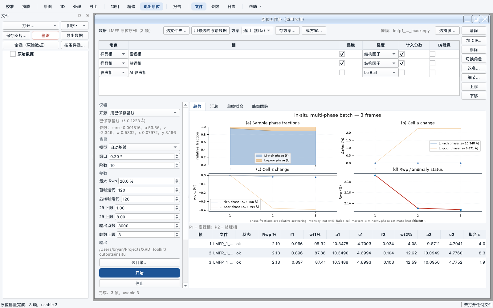
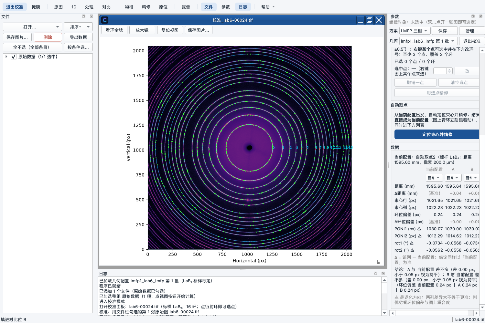
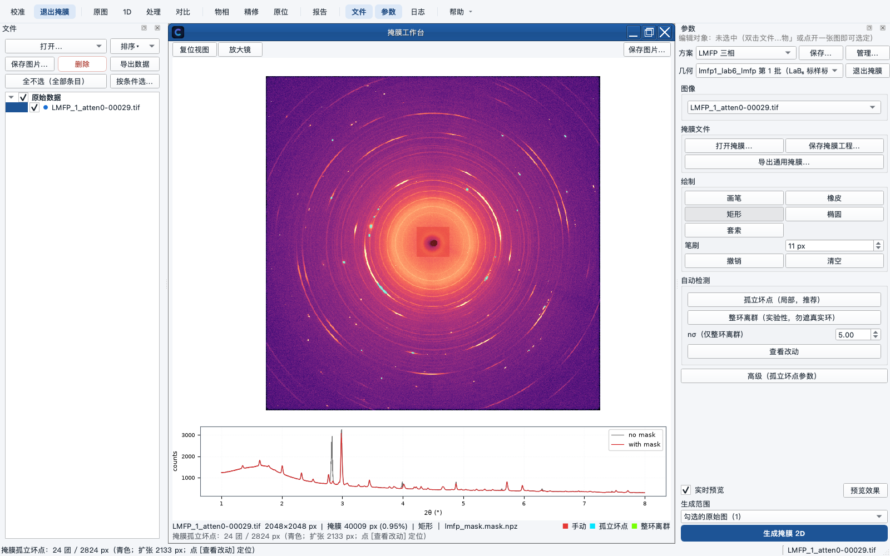
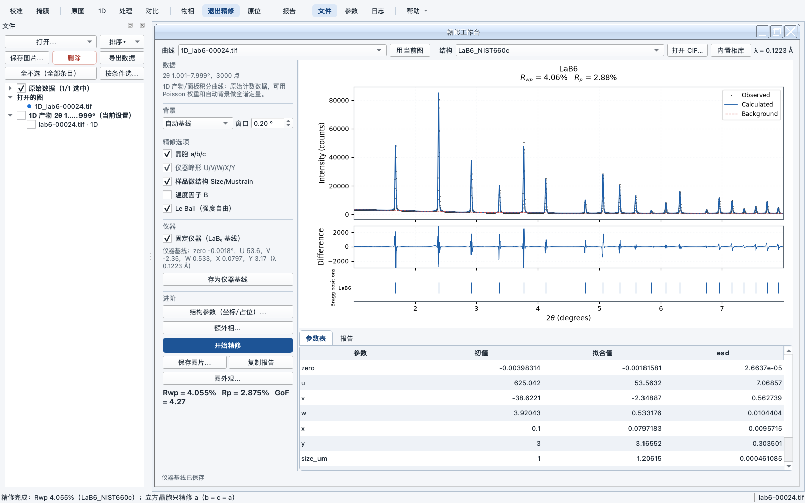

# XRD Toolkit

XRD 衍射图像处理工具箱：读取 `.tif` / `.edf` / `.cbf` 二维衍射数据，用标样做
几何校准（默认 LaB₆，内置 CeO₂、Si 等常用标样），积分成标准 1D 粉末谱，
再做寻峰、单峰/全谱峰形拟合、物相筛选、Le Bail/结构精修、CIF 理论谱模拟
和通用多相原位批量。同一套引擎驱动 PySide6 桌面界面与命令行脚本。

[English README](../README.md) · [试用者上手图文](使用说明.html)
（程序内：帮助 → 使用说明，快捷键 F1）· [长文档](NOTES.zh-CN.md) ·
[更新记录](../CHANGELOG.md) · [引用](../CITATION.cff) ·
[展示页](https://xyyzzc3.github.io/xrd_toolkit/)



## 能做什么

- **2D → 校准后的 1D**：用 LaB₆（默认）、CeO₂、Si 等内置标样做几何精修；
  支持偏心束、部分环和 36 扇区方位均匀性分析；每次校准报告环位偏差、
  完整环数和逐环晶格常数离散度。
- **积分前掩膜**：画笔/橡皮遮 beamstop、模块缝和坏点，或自动检测孤立坏点；
  预览掩膜前后 1D；保存 `.mask.npz` / `.npy` / `.edf` 和可追溯的「掩膜 2D」。
- **1D 分析**：空扫相减、滑窗自动基线 + 手动锚点、平滑/裁剪、稳健寻峰、
  单峰拟合（Gaussian / Lorentzian / pseudo-Voigt / split-Pearson VII）、
  Scherrer 与 Williamson–Hall（可接 LaB₆ 仪器基线）。
- **物相筛选与晶胞**：观测峰对内置 41 张精选相库或自选 CIF 目录打分，
  周期表点选元素过滤、多相叠加；七晶系峰位晶胞精修，同时修 2θ 零位。
- **全谱拟合**：Thompson–Cox–Hastings 峰形 + Caglioti/Lorentzian 峰宽，
  Le Bail 或结构精修，额外相、原子坐标/占位、仪器基线、晶态相 wt%。
- **原位多相批量**：原位页默认是通用相表（任意 CIF、角色、结构因子/Le Bail、
  是否计入分数）；LMFP 是内置方案。方案可存/载为 JSON，背景模型/窗口和
  仪器来源可选，结果表默认紧凑列；四视图：趋势 / 汇总 / 单帧拟合 / 峰窗跟踪。
- **报告与方案**：一键生成自包含 HTML 报告；项目方案打包几何、第二相、
  原位目录/掩膜、相库和处理设置。
- **桌面 + CLI**：校准、掩膜、1D、处理/对比、物相/精修/原位工作台和报告
  共用一个引擎；脚本覆盖校准、积分、模拟和拟合作业。

## 下载即用

**最新版本**——GitHub Actions 构建的三平台独立应用（链接自动指向最新 Release）：

| 你的电脑 | 下载 |
|---|---|
| Windows 10/11 | [XRD-Toolkit-windows.zip](https://github.com/xyyzzc3/xrd_toolkit/releases/latest/download/XRD-Toolkit-windows.zip) |
| Mac（苹果芯片 M1…M4） | [XRD-Toolkit-macos-apple-silicon.zip](https://github.com/xyyzzc3/xrd_toolkit/releases/latest/download/XRD-Toolkit-macos-apple-silicon.zip) |
| Mac（Intel 处理器） | [XRD-Toolkit-macos-intel.zip](https://github.com/xyyzzc3/xrd_toolkit/releases/latest/download/XRD-Toolkit-macos-intel.zip) |

解压 → 双击。应用没有系统签名，第一次打开会被拦一下（Windows：更多信息 →
仍要运行；Mac：右键 → 打开）。图文步骤见 [《使用说明》](使用说明.html)
（zip 里也带一份，程序内 帮助 → 使用说明）。要求 macOS 13 起 / Windows 10 起；
下载约 150 MB，解压约 340 MB。

## 快速上手

1. **打开**——`[打开…]` 选 `.tif` / `.edf` / `.cbf` 图像（整个文件夹也行）
2. **校准与掩膜（可选）**——在 `[校准]` 用标样标几何或导入 pyFAI `.poni`；
   用 `[掩膜]` 遮掉 beamstop 阴影、模块缝和固定坏点
3. **出图**——勾上文件 → `[1D]` → `[出图（勾选文件）]`
4. **导出**——`[导出数据]` → 两列 txt / `.chi` / 全部数据总表

内置几何覆盖第一条 LMFP 批次；数据已经校准且干净时可跳过第 2 步。
界面是中文，图和导出数据用英文标签。

## 原位工作台

原位页默认是通用多相页面：任意 CIF 列表，逐相设角色、晶胞/强度模型和是否
计入样品分数；LMFP 三相方案（富锂 / 贫锂 / Al 参考）只是内置方案，选中即
就地填好。方案保存/载入为 JSON，每相可设 B、尺寸、应变、初始晶胞、晶胞
范围和颜色。批量支持双起点稳健拟合、种子重锁和异常标记；本机 81 帧约
3.5 分钟。报告里的原位汇总图和峰窗图按当前方案画；GSAS-II 对照脚本
`scripts/gsas2_insitu_crosscheck.py` 比较晶胞与相分数趋势。详见
《使用说明》第 11 节和 [NOTES.zh-CN.md](NOTES.zh-CN.md) 的
「LMFP 原位三相批量」节。

## 截图

<table>
  <tr>
    <td align="center" width="33%">
      <br>
      <sub>校准工作台：当前几何、对比位与引擎指标</sub>
    </td>
    <td align="center" width="33%">
      <br>
      <sub>掩膜工作台：画笔/自动检测与掩膜前后 1D</sub>
    </td>
    <td align="center" width="33%">
      <br>
      <sub>精修工作台：全谱拟合、仪器基线与参数表</sub>
    </td>
  </tr>
</table>

更多截图、拟合图和模拟图：[展示页](https://xyyzzc3.github.io/xrd_toolkit/) ·
[`showcase/`](../showcase/)。

## 从源码安装

<details>
<summary>环境、命令与 CLI 示例</summary>

```bash
conda env create -f environment.yml    # 一次
conda activate XRD_Toolkit_Environment
pip install -e .                       # numpy / scipy / matplotlib / fabio / pyFAI / PySide6 / pymatgen
python -m xrd_toolkit.gui              # 桌面界面
```

```bash
# 校准 + 积分单张图
python scripts/calibrate_integrate.py --file data/xxx.tif --wavelength 0.1223 --pixel 200 --dist0 1600
# 已有几何直接积分，或做扇区/瀑布分析
python scripts/integrate_pattern.py --file data/xxx.tif
python scripts/sector_waterfall.py --file data/xxx.tif --n-sectors 36
# 从 CIF 模拟理论谱
python scripts/simulate_xrd.py data/structures/Si_9008565.cif outputs/sim_Si.png
# 拟合 LaB6 标样（Le Bail 峰形 + 布拉格刻度）
python scripts/simulate_study.py fit
```

样例数据不在仓库里——用 `--file` 指向自己的图。脚本产物和缓存落在
`outputs/`（gitignored）；仓库只带代码、参考 CIF 和标样示例。
</details>

## 测试与目录

<details>
<summary>测试命令与源码树</summary>

```bash
python scripts/run_tests.py            # 全量，带看门狗
python scripts/run_tests.py --fast     # 单测 + 静态守卫
python scripts/run_tests.py --jobs 8   # GUI 套件分进程
python scripts/check_gui.py            # 真数据界面链路探针
```

合成图单测覆盖校准/积分、背景估计、分阶段缓存和界面接线；GUI 集成测试
用真实画布事件。

```
src/xrd_toolkit/   core · services · simulation · gui
scripts/           分析 CLI + 自检工具
packaging/         PyInstaller spec、图标、constraints
tests/             单元 + GUI 集成测试
data/structures/   参考 CIF（tracked）；data/*.tif 是本机样例
showcase/          README、说明书和网站用的精选图
docs/              说明书、长文档、中文 README
```
</details>

## 状态

**v0.2.1**（2026-11-19）是最新版本。本版落地了通用原位页、可存/载方案、
背景/仪器来源、紧凑结果表、初始晶胞和按方案生成的原位报告图。下一步是
可配置的原位晶胞轴/峰窗视图、原位批量的更深结构选项，以及 ML 辅助的
物相/峰形分类（故意放最后）。实验验证由同步辐射 LaB₆ + LMFP 工作覆盖；
实验室光源与 Si 标样数据仍是独立的数据任务。

## 数据与隐私

所有计算都在**本机**完成：程序不联网、不上传数据、没有使用统计。科研工具
的结果取决于几何标定和参数选择，**发表/交付前请人工复核**关键数值。本程序
采用 MIT 许可；第三方组件的许可全文随包（程序内 帮助 → 关于）和
[`packaging/THIRD_PARTY_NOTICES.txt`](../packaging/THIRD_PARTY_NOTICES.txt)。

## 作者

边晨泽（Chenze Bian）——香港城市大学物理系，物理学与数据建模及量子技术
硕士 · [GitHub](https://github.com/xyyzzc3)

## 许可

[MIT](../LICENSE)
