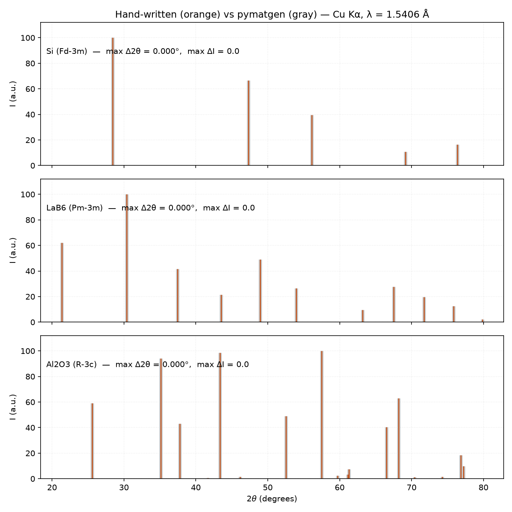
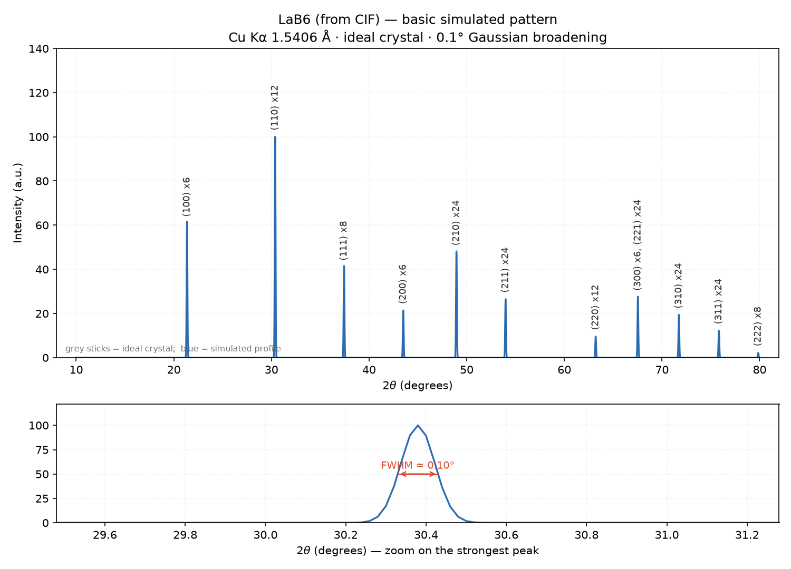
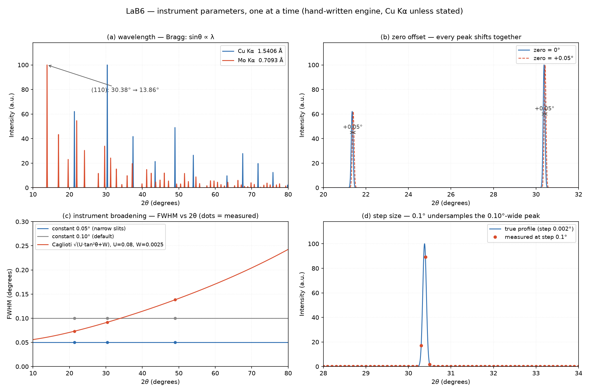
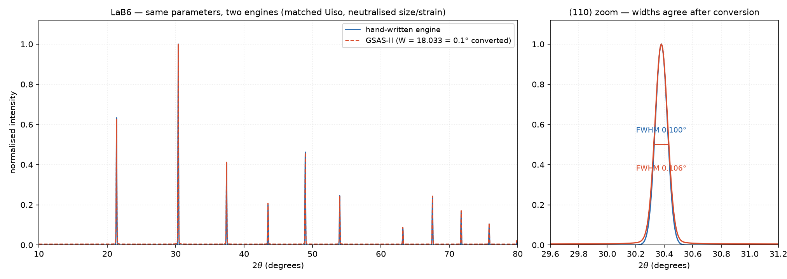

# Week 7 Report — Chenze Bian

> 本周任务（RY04）：**接近真实的 XRD 模拟**——为下周的"优化/精修"打基础。
> 本报告按任务文档的周报模板逐节填写；每个任务完成即写入对应小节。
> 支撑材料都在本仓库：复现命令见各节，脚本 `scripts/simulate_study.py`、
> `scripts/gsas2_crosscheck.py`，全部图在 `showcase/simulation/`。

---

## 1. 工具选择

**使用了什么工具？为什么选它？**

| 工具 | 安装方式 | 为什么用它 |
|---|---|---|
| **自研模拟模块**（`xrd_toolkit.simulation`，主工具） | 本课题仓库自带（`pip install -e .`） | 第 6 周产出的手写实现（布拉格 + 结构因子 + LP），本周扩展了仪器峰形、温度因子、择优取向；每行公式可解释，且已封装成"可调用函数"`simulate_pattern(参数) → 图谱`——正是下周做优化需要的形式 |
| **pymatgen `XRDCalculator`**（对照 A） | `pip install 'xrd-toolkit[simulation]'` | 业界通用参考实现，用于"对答案" |
| **GSAS-II**（对照 B，下周主力） | `conda create -n gsas2 -c briantoby -c conda-forge gsas2pkg python=3.13` | 工业级精修引擎；任务二起用于交叉验证，下周"优化"阶段的主力工具 |

**是否探索了其他工具？对比如何？**

- 任务建议的 Pysimxrd 未采用（轻量但只有正向模拟、没有精修出口）；最终选"自研 + pymatgen + GSAS-II"的组合。
- **自研 vs pymatgen**：Si / LaB₆ / Al₂O₃ 三个材料、同波长逐峰比对，**最大 Δ2θ = 0.000°、强度偏差 0.0**——手写物理与参考实现完全一致：



- **自研 vs GSAS-II**：见 §2 末尾的对拍（峰位 0.000°、峰宽差 +6~7%，并借对拍定位了 GSAS-II 的两个口径陷阱，见 §5）。

## 2. 模拟结果

### 基础模拟



- 材料/条件：LaB₆（`data/structures/LaB6_1000055.cif`）× Cu Kα 1.5406 Å × 10–80°；理想晶体 + 常数 0.1° 高斯展宽。
- **10°–80° 内 11 根反射（≥1% 强度）**，最强峰 **(110) 在 30.38°**（多重性 ×12，与 LaB₆ 标准卡片一致）。
- 图下半部放大最强峰、标出实测 FWHM ≈ 0.10°——模拟谱是带峰形的连续曲线。
- 关键代码（`scripts/simulate_study.py basic` 一键复现）：

```python
from xrd_toolkit.simulation import load_structure, simulate_pattern
structure = load_structure("data/structures/LaB6_1000055.cif")
tth, curve, peaks, is_hex = simulate_pattern(
    structure, two_theta_range=(10.0, 80.0), step_deg=0.02)
```

### 加入仪器参数后



| 参数 | 设置方式（代码） | 图谱变化（实测数字） |
|---|---|---|
| **X 射线波长** | `simulate_pattern(wavelength=…)`：Cu Kα 1.5406 Å / Mo Kα 0.7093 Å | 峰位按 sinθ∝λ 整体移动：**(110) 30.380° → 13.857°**（脚本内布拉格公式现算的预测 = 13.857°，零偏差）；同一窗口内可见峰数增多 |
| **零点偏移** | `zero_deg=0.05`（仪器角度零点） | **每个峰等量平移 +0.050°**，峰间距不变——与"几何偏了"的判别特征 |
| **仪器展宽** | `u, v, w`（Caglioti：Γ²=U·tan²θ+V·tanθ+W）、`x, y`（洛伦兹混合）；对照三条件：常数 0.05° / 常数 0.10° / Caglioti (U=0.08, W=0.0025) | 常数条件 FWHM 全程恒定（0.050°/0.100°）；**Caglioti：0.092°(30.4°) → 0.226°(75.8°)**，随 tanθ 增长；图上实测点逐点落在公式曲线上 |
| **2θ 范围与步长** | `two_theta_range=(10,80)`、`step_deg`（对比 0.005° 与 0.1°） | 步长 0.1° 时 0.10° 宽的峰只落 **~2 个有效点**（欠采样测不住峰形）；经验要求 步长 ≲ 峰宽/5 |

**GSAS-II 双引擎对拍**（同参数：W=18.033 ↔ w=0.01 换算、Zero 同设、Uiso 对齐、微结构中性和）：



- **5 根主峰 Δ2θ 全部 = 0.000°**；
- 峰宽：自研 0.100° vs GSAS-II 0.106°（+6~7%）；
- 零点 +0.05° 实测位移：自研 +0.050° / GSAS-II +0.047°（在 0.005° 网格分辨率之内）。

### 加入样品参数后

（任务三进行中：晶粒尺寸 50 nm / 微观应变 / 热振动（Debye-Waller）/ 择优取向——完成后填入本表。）

## 3. 模拟 vs 实验对比

（任务四进行中：实验数据 = 第三周处理的 `lab6-00024.tif` 一维谱；完成后填入对比图与差异分析。）

## 4. 下周优化准备

- **模拟函数已封装好？** 是：`simulate_pattern(结构, 波长/零点/展宽/尺寸/应变/B因子/取向/范围步长) → (2θ 网格, 强度曲线, 峰表)`——一组参数进、一条谱出，正是最小二乘需要的输入输出形式（`src/xrd_toolkit/simulation/profile.py`）。
- **还缺什么？** ① 微结构参数（尺寸/应变/B/取向）本周待任务三逐个验证；② 精修的目标函数（Rwp/Rp/χ²）与最小二乘循环尚未编写；③ 与实验的强度对齐（用标样定仪器参数）在任务四完成；④ 预备了另一条路：直接用 GSAS-II 的 scriptable 做精修（参数名、单位换算表已备好）。

## 5. 遇到的问题与解决方案

| 问题 | 解决方案 |
|---|---|
| GSAS-II 装不上：conda 求解失败（最新构建只认 Python 3.13）；装好后模块也不在常规位置 | 用 `python=3.13` 建独立环境；import 走 `from GSASII import GSASIIscriptable`（源码目录加进 sys.path）；驱动脚本按 `sys.prefix` 自动定位环境 |
| GSAS-II 的峰宽参数填了"照我们习惯"的 0.01，峰几乎不展宽 | 读源码 + 标定实验查明：GSAS-II 的 U/V/W 单位是**百分度²的方差**（σ=√sig/100、FWHM=2.355σ）、X/Y 是百分度洛伦兹宽度；换算 **W=1803.3×w** 并实测验证（目标 0.1° → 实出 0.106°） |
| GSAS-II 把仪器参数全设 0，模拟谱仍有 0.026–0.058° 的峰宽 | 查明是**新物相自带的默认微结构**（晶粒 1 µm + 微应变 0.1%）；模拟前显式中性化（尺寸→∞、应变=0），已固化进对拍脚本 |
| 对拍时强度对不上 | CIF 里的 Uiso 会被 GSAS-II 自动使用（La 0.0086、B 0.0090 Ų）；给自研引擎喂等价 B=8π²·Uiso 后两边一致 |
| 测试里"预期比值"对不上（温度因子/织构的逐峰校验） | 峰表归一化到最强峰 = 100%，做比值必须按归一化后的口径算（减去最强峰的 s²）——数据口径陷阱，已写进测试注释 |
| 布拉格预测值初版是写死的常数，且 (110) 一度误写成 (1,1,1) | 改成脚本内**从 CIF 晶格现算**（d_spacing + 布拉格公式）：预测 13.857° 与模拟实测完全一致——"数字要现算、要复算" |

## 6. 下周计划

- 本周收尾：完成任务三（微结构参数）与任务四（模拟 vs 实验、1–2 页报告）；
- 下周进入**优化（精修）**：以 LaB₆ 实验谱为目标，先跑通一轮参数优化（GSAS-II scriptable 或自研最小二乘），报告 **Rwp / Rp / χ²** 指标；
- 预习：最小二乘精修原理 + 教材《X-Ray Diffraction Crystallography》Rietveld 章节。

---

## 附：本周提交清单对照

- [x] 基础模拟代码 + 图谱截图（§2 基础模拟）
- [x] 加入仪器参数后的模拟代码 + 图谱（§2 仪器参数）
- [ ] 加入样品参数后的模拟代码 + 图谱（任务三）
- [ ] 模拟与实验图谱的对比图（至少 1 组）（任务四）
- [ ] 简短的模拟报告（本文件，任务四完成并补充 §3 后定稿）
- [ ] 所有代码推送到 GitHub（模块 / 脚本 / 图均已提交入库，推送随本周末收尾统一执行）
