# XRD Toolkit 使用说明（v0.2.0）

把二维 XRD 衍射图像（`.tif` / `.tiff` / `.edf` / `.cbf`）按标定好的几何
积分成 **1D（一维积分曲线）**，并继续做寻峰、峰形拟合与 W-H、物相筛选、
峰位晶胞精修、全谱精修、定量相分数和原位三相批量。导出的两列 txt /
`.chi` / CSV 可直接导入 Excel、Origin，或用于论文作图与分析。

> 下面按顺序跟着做即可，每一步末尾的**确认**做到了再往下走。
> 每节最后的**「这一节还能做什么」**收纳右键菜单、导出与修改细节；
> 软件更新后如与本文不符，以界面为准。

## 1. 安装并打开软件

| 你的电脑 | 下载 |
|---|---|
| Windows 10 / 11 | [`XRD-Toolkit-windows.zip`](https://github.com/xyyzzc3/xrd_toolkit/releases/latest/download/XRD-Toolkit-windows.zip) |
| Mac（苹果芯片：M1/M2/M3/M4…） | [`XRD-Toolkit-macos-apple-silicon.zip`](https://github.com/xyyzzc3/xrd_toolkit/releases/latest/download/XRD-Toolkit-macos-apple-silicon.zip) |
| Mac（Intel 处理器） | [`XRD-Toolkit-macos-intel.zip`](https://github.com/xyyzzc3/xrd_toolkit/releases/latest/download/XRD-Toolkit-macos-intel.zip) |

（链接指向 GitHub 的**最新发布**；打不开时直接在浏览器里访问
`github.com/xyyzzc3/xrd_toolkit/releases` 手动选。）

如不确定 Mac 的芯片类型：点左上角苹果菜单 →「关于本机」，看「芯片」一行。

**Windows**：解压 zip → 进入 `XRD Toolkit` 文件夹 → 双击 `XRD Toolkit.exe`
→ 首次出现蓝色"Windows 已保护你的电脑"提示时点 **更多信息 → 仍要运行**。
（若没有"更多信息"按钮：右键 `XRD Toolkit.exe` → 属性 → 勾选「解除锁定」→
确定 → 再运行。）

**Mac**：解压 → 得到 `XRD Toolkit.app` → **第一次需右键点它 → 选「打开」**
→ 弹窗里再点一次「打开」。此后双击即可。

> 第一次启动会多花十几秒（系统安全检查 + 首次建立字体缓存）。
> 软件未做系统签名，被系统拦截一次属于预期现象。

**确认**：看到主窗口——左边「文件」区（先空着）、中间绘图区（也空着）；
**右边参数面板此刻是收起的**，选中文件或打开一张图后会自动出现；
顶上一行是工具栏：

`[校准][Mask] │ [原图] [1D] [处理] [对比] │ [物相][精修][原位] │ [文件] [参数] [日志] │ [帮助▾]`

左边一组是设置（校准 / Mask），中间四个是日常循环，右边三个是分析工作台
（精修 / 物相 / 原位）；点一个入口 = 参数面板翻到那一页，三个工作台会把
中央换成专用界面、并收起参数/日志坞。`[文件] [参数] [日志]` 是三个坞的
显示开关，`[帮助]` 里是使用说明（F1）和关于。

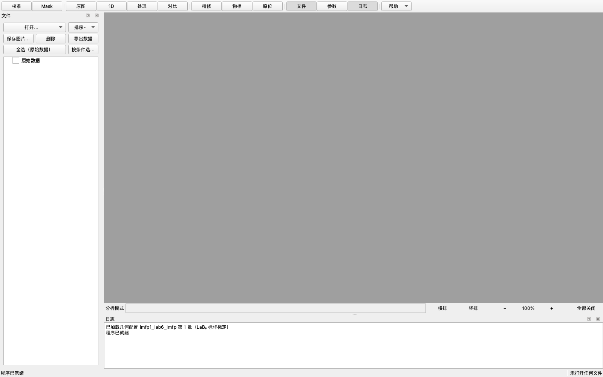

## 2. 导入数据

1. 左上「文件」区点 `[打开…]` → 选「打开文件…」（可多选）或「打开文件夹…」
   （整个目录一次导入）。菜单底部的「最近打开」可以快速再开上次用过的。
   **确认**：文件列表里出现你的文件名。
2. 勾选要处理的文件：点条目行最左边的对号框（勾一组就点组那一行）。

> 提示：**双击一个原始条目 = 打开它本身的 2D（二维原始图像）**（零计算、秒开）；
> 要 1D / 剖面 / 瀑布就点顶部的对应按钮（见第 4、5 节）。

**这一节还能做什么**

- **拖文件夹直接进窗口**：与「打开文件夹…」同效。
- **勾选的几种手势**：点条目行 = 勾上这一条；点对号方块 = 勾上/取消；
  点组行 = 整组勾上；`[全选（原始数据）]` / `[全不选（全部条目）]` /
  `[按条件选…]`（范围、间隔、名字过滤，带实时计数）。
- **`[排序▾]`**：改「原始数据」的排列方式——「导入顺序」（默认，每次打开
  软件都回到它）/「名称」（自然顺序：名字里的数字按数值比，`…-00029`
  排在 `…-00100` 前）/「修改时间」（最新的在最上面）。各产物分组的行序
  跟着走，勾选与高亮不动。注意：`[按条件选…]` 的"第 N 个"按**当前显示
  的顺序**数。
- **右键菜单**（对不同的行内容不同）：
  - 原始条目：`打开 1D 图（文件名）`、`从文件栏移除（硬盘上的文件不动）`；
  - 产物条目：`打开 1D 图`、`删除这一条产物`、`导出这一条（txt / chi）`；
  - 组行：`打开整组 1D 图（N 张）`、`删除这一组产物（N 条）`、
    `导出这一组（txt / chi / CSV）`；
  - 空白处 /「原始数据」组：`打开勾选的 N 张图` 与 `打开整组图`——都是
    **子菜单选视图**（1D / 2D / 剖面 / 瀑布），**没有张数上限**（超过
    25 张先弹确认：每张约 15 MB）；另有 `删除所有缓存…`（见第 12 节）。
- **重复导入同一个文件**会弹询问：保留原条目 / 改名后加入 / 这次不加。
  选"改名后加入"会有两条条目，但同一份数据**只算一遍**——批量出图时
  重复的那条**整条跳过**（只开一张图、只存一份产物），批完成的张数就是
  不重复的文件数，日志里会写明；要看重复的那条：**双击它单独开**
  （1D 从产物缓存秒开）。

## 3. 几何配置——积分准不准由它决定

**几何不对，积分出来的峰位整体就是偏的**——所以先确定几何，再出 1D。
你的几何来源是哪种：

| 情况 | 做什么 |
|---|---|
| 处理**本实验室第 1 批**数据 | 软件内置了它的标定 `lmfp1_lab6`，**确认**参数面板顶部「几何配置」那一行选的是它即可 |
| 别人给了 `.poni` 文件 | 参数面板 `[加载几何…]` 直接导入 |
| **新批次**、或动过探测器 | 需要自己标定一次（只做一次，整批通用）——按下面 4 步 |

**自己标定——先自动，不理想再手动（只做一次，整批通用）**：

1. 拍一张标样图，按第 2 节导入并勾选。标样默认是 LaB₆；进入 `[校准]` 后，
   可在页顶的「标样」下拉框里换成 CeO₂、Si、α-Al₂O₃ 等常用标样（请按
   证书选到具体 SRM 变体）。
2. 点顶部 `[校准]`。**确认**：中央出现标样图；图上青色的一圈圈是**当前
   几何**画出的理论环，数据区的表在页面下方。环数默认按「完整落在图像
   内的环数」自动算（LaB₆ 在当前几何下是 16），可在「标样」那一行右边
   的「环数」里改。
3. **先自动**：点 `[定位束心并精修]`，等日志出现「完成」。
   **确认**：数据区的「环位偏差」小于 1 px（越小越好）、「完整环」达到
   所选环数（LaB₆ 默认 16/16；这两项才是判好坏的，拟合残差不算数）。
4. **看青环跟图上真实环贴不贴**——自动结果不理想时（某处青环明显压着
   峰的一侧、或几圈都不重合），改手动：
   - **直接在中央图上点衍射环**（不用先开什么开关）——点哪都行，软件
     自动吸附最近的环（±0.5°），落下的点带环号；右侧「手动选点」区实
     时显示已选几个点、覆盖几个环；
   - **至少 3 个点、覆盖 2 个环**（覆盖越广越稳），点完按 `[用选点精修]`；
   - 点错了：**右键某个点**可选中它、并在下方改它认的环号（软件认错环
     时就这么改）；或 `[撤销一点]` / `[清空选点]` 重来。
   - **环号怎么看**：每圈青环标着它认的环号（0、1、2…从里往外）。如果
     一个环号横跨了两个明显不同半径的圈，说明距离尺度不对——手动精修
     会自动在几档距离上重判环号并选最好的一档，日志里会写明。
5. 采纳与保存：跑完的结果**自动成为当前配置**（青环立刻跟着动）；满意后
   点 `[保存为配置]`，在「条目名称」里起个名字（如 `batch2_lab6`）。
   **确认**：参数面板顶部的「几何配置」一行能选到新名字。

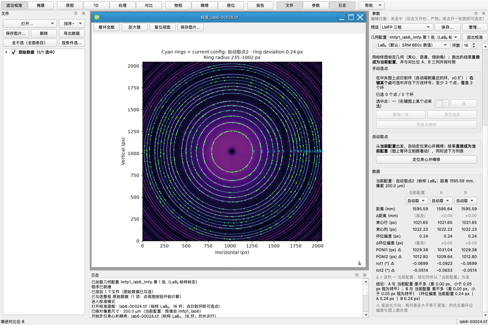

**校准页的「数据」框怎么读**（页面向下滚到底）

- **三列**：**当前配置**（正在用的那份几何）+ 两个对比位 **A**、**B**。
  每次跑出来的结果（自动取点1、手动选点1…）**直接成为当前配置**，同时
  进累积列表；想比较两份结果，就在 A、B 列顶上的下拉框里各选一份——
  手动选过的列会被"钉住"，之后的新结果不再覆盖它。
- **判好坏只看「环位偏差」**（标 ⚠ 的行与它近简并，数字差得多不等于更
  准）；「Δ」行 = 该列 − 当前配置；**结论行**把 A、B 分别与当前配置比
  一遍，好多少/差多少都写出来，日志里同样有一份。

**这一节还能做什么（校准页）**

- **改用别人/以前的几何**：`[加载几何…]`（import `.poni`）、
  `[编辑当前配置…]`（从某条目预填或手输）。
- **放大看细节**：中央图上方的 `[放大镜]` 点亮后——左键拖 = 框选放大、
  滚轮 = 缩放；`[复位视图]`（或鼠标停在校准图上按 **Home 键**）= 回到
  最初的视野——只清缩放、不翻 `[看环全貌]` 那个开关。不点亮时点图选点照旧。
- **这一步的"导出"＝`[保存几何…]`**：把当前几何存成 `.poni` 文件，
  可以发给别人、或用别的软件。

## 4. 原图（2D 二维图像 / 剖面 / 瀑布）

1. 在文件栏勾选文件（第 2 节）。
2. 点顶部 `[原图]`，再点 `[2D]` / `[剖面]` / `[瀑布]` 中的一个——
   **点一下 = 对勾选文件立即出图**。想换类型就点另一个按钮。
   **确认**：中央出现图面板；勾选超过 25 项时**一张都不弹**（防爆图——
   2D/剖面/瀑布一次开太多会又卡又吃内存；想一张张全开就右键文件栏 →
   `打开勾选的 N 张图` → 选 2D/剖面/瀑布，或减少勾选分批看。日志里写明）。
3. 三种视图的参数在右侧分三节（2D 视图 / 剖面 / 瀑布），**改完立刻生效**；
   `[恢复默认]` 一键复位全部显示参数。

**这一节还能做什么**

- **每张图面板顶上一行按钮**（所有视图通用）：
  `[复位视图]`（回到这张图最初的视野）、`[放大镜]`（点亮 = 滚轮缩放、
  左键拖框选放大；不点亮 = 滚轮滚动、左键拖动平移）、
  `[外观…]`（改标题、轴标签、纵轴线性/对数、图边距；对比图还有渐变色系）、
  `[保存图片…]`、`[弹出]`（独立窗口）、`[关闭]`；
  **拖动这一行 = 移动面板，双击 = 占满绘图区**。

    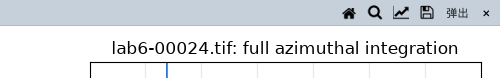

- **调整面板大小**（所有视图通用，含校准图）：把鼠标移到面板的**边或角**
  上——光标变成双向箭头——按住左键拖即可拉伸；**右下角有个 ▙ 小把手**，
  就是提示这里能抓。拖过的大小这张面板会一直保持（[横排]/[竖排] 重排也
  不改尺寸）；关掉再打开 = 回到默认大小。
- **这一步的"导出"＝`[保存图片…]`**：把图另存为 PNG / TIF（可选分辨率），
  存的就是当前画面（含缩放）。数据导出见第 5、6 节。
- 鼠标在曲线上移动：绘图区横带实时显示该点读数（2θ / 强度或距离，悬停
  对比图还会报曲线名）。
- **文件栏里的「打开的图」组**：列出当前开着的每张图——单击 / 双击 = 提到
  最前面并成为「编辑对象」；右键 = `提到最前面` / `关闭这一张图
  （数据与产物都不动）`。

## 5. Mask 工作台——先把探测器问题遮掉

Mask 的做法是：**在 2D→1D 积分之前**把 beamstop、模块缝、坏点遮掉，
并生成一条「Mask 后的 2D」数据；之后再用它做 1D、对比、处理。坏点不会
被改写，只是不参与方位角平均。

**什么时候要 Mask**

- 探测器有**固定坏点/热像素团**：会在 1D 上抬起背景或制造假峰；
- **beamstop / 模块缝 / 探测器边缘**：会压低低角强度；
- 明显的固定寄生散射斑点。

**不要遮真实衍射环**（包括 Al 基片的峰）：整条环被遮掉，等于把这个
2θ 的真实强度删掉，1D 上会出现坑，拟合变好是假象。基片峰应当按第二相
建模，Mask 只处理探测器问题。

判断口诀：坏点在**像素坐标**上固定、面积小、跨帧逐位相同；真实环在
**2θ** 上固定、跨方位角连续。

**不要**用 `[整环离群（实验性，勿遮真实环）]` 去遮真实衍射环：它会把强环的方位起伏
当成坏点（真实 LMFP 帧上会沿环误标约 18k px）。它只作实验性参考。

**打开工作台**

1. 先在文件栏导入并勾选原始数据（Mask 只认文件栏里的原始图）。
2. 点工具栏 `[Mask]`（在 `[校准]` 右边）：中央绘图区换成 Mask 工作台，
   **参数坞和日志坞自动收起**，把地方让给画布；工作台会载入勾选的第一张。
   **确认**：顶部出现「Mask 工作台」，状态行显示文件名、尺寸、mask 像素数。
3. 顶部「图像」下拉可以换图；**换图会按图名载入该图的 mask**（本会话内
   改过的先记在内存里 → 已保存的配方 → 该图的 Mask 2D；都没有就清空）。
   `[载入勾选图像]` 可重新载入当前勾选的图。
4. 再点一次 `[退出 Mask]`（或关闭工作台的 ×，或按 Esc）回到分析模式，
   参数坞/日志坞恢复成进入前的样子。

工作台底部有一行消息（最近一次自动检测/配方/生成的结果）+ 状态行
（文件名、尺寸、mask 像素数/百分比、当前工具、缩放倍数）。

**画 mask 与看大图**

- **画笔 / 橡皮**：按住左键拖；笔刷大小在「笔刷 xx px」里调。
- **矩形**：拖出一个矩形，松开后整块遮掉。
- **撤销 / 清空**：就在画笔工具旁边；撤销最多 12 步。
- **孤立坏点（局部，推荐）**：15×15 局部中值 + 小连通域，专抓孤立亮团/
  坏点簇，不碰真实衍射环（生产路径）。默认还会从芯向外**扩 3 px 到光晕**
  （高级里可调），否则只遮住亮斑中心、1D 上仍会留尖峰。
- **整环离群（实验性，勿遮真实环）**：按径向环带找离群像素（与 GSAS-II
  的自动 spot mask 同一思路）；真实环的强弧段/织构（如 Al 基片）会被
  误标，点按钮会先弹一次确认框，跑完要用橡皮/撤销修。
- **nσ（仅整环离群）**：整环离群的阈值，越小越激进（标得越多）；孤立
  坏点检测不用这个值。
- **高级（孤立坏点参数）**：窗口 15×15、亮斑倍数 8×、面积上限 300 px、
  峰值下限 20 000 counts、扩张 3 px。默认按当前 LMFP 面板调过，换探测器/
  增益要重调。扩张只吃比背景亮的光晕，不吃远处背景/大亮区。

**看大图**：点亮 `[放大镜]` 后，滚轮以光标为中心缩放（每格 10%）、
左键拖 = 框选放大；熄灭后左键回到画笔。中键（Mac 触控板用 ⌥ 或 Shift +
左键）拖动平移；`[复位视图]`（或 **Home** 键，与主窗口一致）一键复位。
状态栏在放大时显示「缩放 N.N×」。

遮罩永远是全分辨率，只有显示会按视图降采样（块内取最大 / 任一），
缩到全图时孤立坏点也不会被平均掉。

图中半透明色块 = 将被遮掉的像素，颜色标出来源：

| 颜色 | 来源 |
|---|---|
| 红 | 画笔 / 矩形（手动） |
| 青 | 孤立坏点（局部） |
| 绿 | 整环离群（实验性） |

自动检测跑完会记下新增的像素：点 `[查看改动]` 会在 **96×96 的上下文**
里用红框标出改动（重复点按依次看各处），不再把 1 个像素放大到极限。
下方的 1D 预览默认**实时更新**（`[实时预览]` 勾选；关掉后点
`[预览效果]` 手动刷新）——灰线是无 mask、红线是当前 mask，真峰不动、
假峰消失，才说明这次自动检测合理。**确认**：预览里目标坏点造成的假峰
消失、真实峰高度基本不变。

**生成「Mask 后的 2D」**

先选生成范围：

| 范围 | 作用 |
|---|---|
| 勾选的 N 个文件（默认） | 给文件栏里勾选的每个原始图各生成一条（同探测器、同形状） |
| 当前图像 | 只给工作台里这张图生成一条 Mask 2D（下拉里可换） |

点 `[生成 Mask 2D]`。生成后：

- 文件栏出现 **「Mask 后的 2D」** 组，条目名形如
  `LMFP_1-00029.tif · Mask2D（配方文件名）`；
- 同一张图 + 同一 mask 重复生成会复用同一条，不会堆重复条目；
- 生成后 mask 没再改，按钮会变成「已生成（无改动）」并置灰，改一笔就恢复可点；
- **原始图不会被改写**，mask 像素仍是原值；Mask 2D 只是"原图 + mask"的
  引用/小 manifest（`<缓存>/masked2d/*.mask2d.npz`），不复制 16 MB 像素；
- **生成成功后，文件栏里用到的原始数据会自动取消勾选**（"新产物 = 勾选
  清零"的既有规矩）；要再生成一次，先重新勾上；范围会自动回到「当前图像」。
- 配方没导出时，Mask 2D 条目标「**未导出配方**」——mask 本身已经内嵌在
  Mask 2D 里，不是没保存；做成 1D / 处理产物后，名字里不再带这个尾巴。

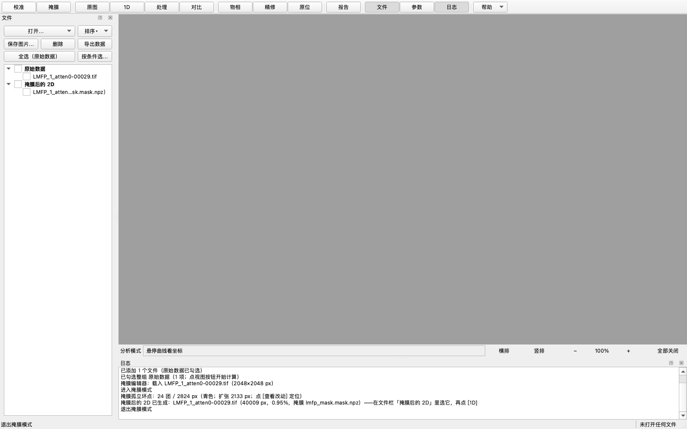

**用 Mask 2D 做 2D / 1D**

- **双击**「Mask 后的 2D」条目 = 打开 2D 面板（原始像素 + mask 叠加）；
- **右键 → `[打开 1D 图]`** = 按这份 mask 积分，1D 产物挂在同一条目下；
- 遮罩与未遮罩的 1D 是**两个不同的源**，可以同时存在、并排对比；
- 对比 / 热图 / 批量处理里，Mask 2D 和原始数据一样可勾选、可出图。

> 标定的环检测仍然用**原图**，不套 mask；mask 只作用于 2D→1D 积分。

**配方与通用掩膜**

Mask 分两种文件，概念与「处理」页的配方一致：

- `[导出配方…]`：存成 `.mask.npz`，包含 mask、**来源分层**（哪块是
  手动/孤立坏点/整环离群）和元数据（来源图、形状、几何名、程序版本）。
  默认路径 `outputs/masks/<几何名>_mask.mask.npz`；
- `[导入配方…]`：读回 `.mask.npz`，来源配色原样恢复；也能读
  `.npy/.edf`（那种读回来统一按手动显示）；
- `[导出通用掩膜…]`：另存 `.npy/.edf`，给 pyFAI-drawmask 等外部工具用，
  只有 bool 数组、没有来源信息。

导出配方/通用掩膜都**不会自动生成** Mask 2D；要再点 `[生成 Mask 2D]`。
保存后重新生成同一 raw+mask：只更新文件栏显示标签（用配方文件名），
**不重算已有 1D 缓存**。

**导出与注意**

- **导出 1D**：文件头会写 Mask 溯源，例如
  `# mask: sha 1a2b3c4d, 6561 px`；CSV 每列明细也带。
- **导出 Mask 2D 数据**：右键「Mask 后的 2D」→
  `[导出 Mask 2D 数据（.npz：image + mask）…]`。产物自包含：

```python
import numpy as np
z = np.load("xxx_mask2d.npz")
image = z["image"]   # 原始像素（float）
mask  = z["mask"]    # bool；True = 被遮掉
meta  = z["meta"]    # JSON：原始图路径、mask 哈希、像素数、标签
```

坏点仍是 mask，**不填 0/NaN**；换机器、没有原始图也能用。

- Mask 2D 产物在**缓存目录**里（`<缓存>/masked2d/`）；`[删除所有缓存]`
  会连它一起清掉。
- 右键删除 Mask 2D（单条/整组）会**连带清掉它名下的 1D/处理产物缓存**；
  原始图与 mask 文件不动。
- mask 形状必须与图像一致；换成不同尺寸/几何的图会报尺寸不一致，
  需要对那张图重新应用/清除 mask。
- 空 mask 不会生成产物（避免一条"什么都没遮"的假数据）。
- mask 是**像素级**的，不保存"圆/多边形"这类形状定义；跨软件复用时
  用导出的通用掩膜或 Mask 2D 数据。

**常见问题**

**Q：mask 后预览曲线几乎没变？**
A：如果遮的是 beamstop/束心附近，它在 1–8° 积分里贡献很小。把矩形画到
范围内的坏点团上，看下方实时预览（或点 `[预览效果]`）的对比；确认
合理后再 `[生成 Mask 2D]`。

**Q：为什么不能等 1D 出来再扣？**
A：方位角积分把每个 2θ 环带里的像素做平均；坏点/beamstop 一旦进入平均，
1D 曲线已经错了。Mask 必须在积分前生效。

**Q：为什么标定页没有用 mask？**
A：标定是找环/定几何，不是积分；mask 只保护 2D→1D 的强度平均。标定仍用原图。

**Q：能给整批 81 帧一次生成吗？**
A：可以。先在代表性图上画好 mask，把生成范围切到「勾选的 N 个文件」，
在文件栏勾选整批原始图，再点 `[生成 Mask 2D]`。同一张 mask 会生成到
每张图上，1D 再各自计算。

**Q：为什么在 LaB₆ 标样上点 [孤立坏点] 会把第一个峰遮掉？**
A：标样的衍射是**斑点状**——每一颗真实衍射斑点又小又亮，和"孤立亮团"
在单张图里几乎一样，自动检测会把它们当成坏点（实测 2 千多团，连
第一个峰整环一起遮）。现在检测结果超过 200 团或全图 0.5% 像素时，
软件会先弹确认框并建议取消。标样请**共享样品帧的坏点坐标**：在样品上
`[导出配方…]`，打开标样后 `[导入配方…]`，再 `[生成 Mask 2D]`；不要在
标样上重新点自动检测。

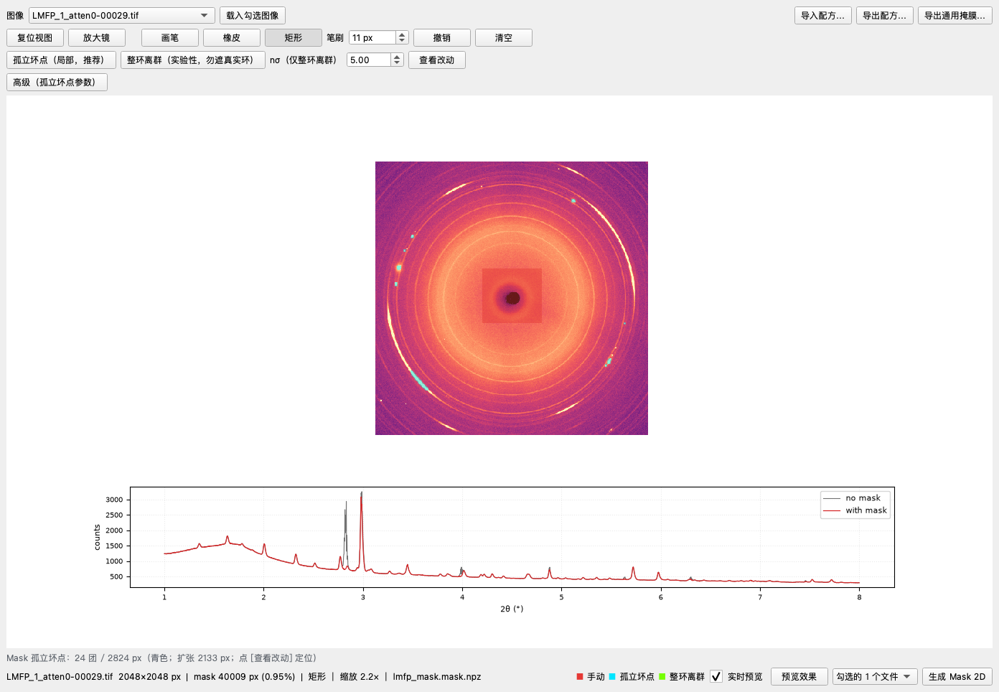

## 6. 1D（一维积分曲线）——积分出谱（最常用的一步）

1. 在文件栏勾选文件。点顶部 `[1D]`，再点 1D 页「数据与出图」小节的
   `[出图（已勾选 N 项）]`。**确认**：中央画出曲线，窗口标题形如
   `1D_文件名`；日志出现「积分完成」。
2. 2θ 范围与点数在右侧参数面板顶部那一行；改了要点
   `[重算这张图]` 才生效。**确认**：日志再次出现「积分完成」。

**寻峰（1D 页）**

- 勾上「寻峰并显示峰位」：当前曲线上出现 2θ 标签，页面下方列出峰表
  （2θ / d / FWHM / 面积；峰高在行悬停里）；取消勾选就全部隐藏。
- **标签会避让**：只标放得下的峰（峰表里仍然列全，双击峰表放大后
  标签会补齐）；放不下就跳过，**不做纵向错层，所以没有长引线**。
  有标签的峰文字直接悬在峰顶、不画线；只有没标签的峰留 4 px 短线。
  峰太高时纵轴自动留出头顶空间。
- 密集区没标到的峰，把鼠标移到附近：读数会**吸附到最近峰**，显示这根峰的 2θ / FWHM / 峰高（不再同时报鼠标点坐标，避免两个 2θ 打架）。
- 「显著度」越高越只留明显的峰（默认 5σ）；「最小峰距」防止一根峰被拆成
  两根；「最小 FWHM」可以滤掉很窄的噪声尖（0 = 不过滤）；「最多根数」
  按高度取最强的若干根。滚轮/箭头的步长：显著度 0.1，峰距/FWHM 0.001°。
- 峰表点表头可按任意列升/降序排序；右键「复制选中行 / 复制全部」，
  制表符分隔，直接粘进 Excel。峰表直接接在「寻峰并显示峰位」下面，
  并在滚动区里占满剩余高度（窗口化/全屏一致）；行多时表内滚动。
- 这些参数**每张图各记各的**，改完立刻重画；峰表里双击一行 = 把视图
  缩放到那根峰。
- 寻峰按**当前画出来的曲线**做（扣背景 / 平滑 / 裁剪之后），只显示、
  不改数据、不写产物。重叠严重的谱，单峰 FWHM 只作参考；定量请用全谱
  拟合的 Size / Mustrain。

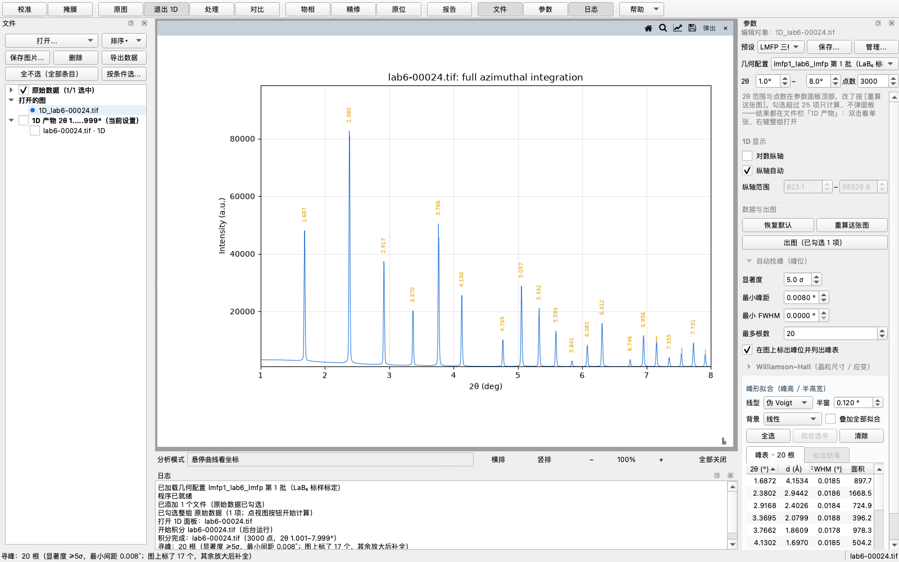

**峰形拟合与 Williamson–Hall**

1. **W-H 卡片现在一直可见**（不用先点寻峰才发现它）。没峰时点 W-H 卡片
   里的 `[去寻峰]`——等同于勾「寻峰并显示峰位」；峰表出现后支持
   **Ctrl/Cmd 多选**（Shift 连选）。`[全选]` 选全部峰，再点
   `[拟合选中]` 就等于原来的“全部拟合”。
2. 在「峰形拟合」小节选：线型（伪 Voigt / 高斯 / 洛伦兹 / 分裂
   Pearson VII）、半窗（默认 0.12°）、局部背景（无 / 线性 / 二次）。
3. 点 `[拟合选中]`。**确认**：自动切到「拟合结果」标签页，图上默认叠出
   选中峰的拟合曲线（紫红虚线）；失败的行会在日志里点名。
   峰表右键也有「拟合选中」；`[清除]` 清空全部结果（W-H 一起清）。
4. 「拟合结果」表：第一列 `W-H` 勾选（默认全选，参与 W-H），后面是
   2θ / FWHM / 面积 / Rwp（η/m 在行悬停里）。右键可复制拟合行、复制
   W-H 结果，或「删除选中拟合」。勾「叠加全部拟合」会把所有拟合曲线都画上。
5. **W-H 卡片**（常显；空态会写“① 去寻峰 → ② 选峰 → ③ 拟合选中”）：
   勾选参与的峰 ≥3 根后自动算 Williamson–Hall，显示
   `D`（晶粒尺寸，nm）、`ε`（微应变）、“参与 N/M 根”和警告。
   - 公式是 (βcosθ)² = (Kλ/D)² + (4ε)² sin²θ 的线性拟合；截距 ≤ 0 或
     斜率 < 0 时对应量显示「不可辨识」，并给出黄色警告。
   - **W-H 只能混合同一个相的峰**：把别的相/坏峰的 `W-H` 勾去掉，数字会
     重算（参与 N/M 根）。混合物里“全部拟合 → W-H”没有物理意义。
   - 数字块下面还有一行 **Scherrer**：用同一批勾选峰逐峰算
     D = Kλ/(βcosθ)（K=0.9），显示范围/中位/参与根数；仪器宽度与 W-H
     同口径。仪器为 0 时会注明“未扣仪器，D 为下限”。
   - 「仪器」下拉可选 **常数 FWHM** 或 **LaB₆ 基线**。基线来自 `[精修]`
     工作台：精修一张 LaB₆ 标样后点 `[存为仪器基线]`；选它时按
     zero/U/V/W/X/Y 逐峰算仪器宽度（与命令行 `--instrument-from` 同口径）。
     没保存基线或波长对不上时，会自动退回常数并在“参与 N/M 根”后面写明原因。
   - `[查看 W-H 图]` 直接在窗口里看：参与点实心、排除点灰色空心、
     拟合线、D/ε/R²；`[保存 W-H 图…]` 出 PNG/PDF。
6. **确认**：`D` / `ε` / `参与 N/M 根` 出现；改线型、半窗或背景会清空旧
   结果；**换曲线/重新积分也会自动清空**（旧数字不会留在表里）。

**注意**：W-H 要求各峰彼此孤立、窗口里没有邻峰，而且**只能混合同一个相
的峰**。重叠严重的谱（如 LMFP 7.5° 附近）单峰 FWHM 只作参考；定量请用
`[精修]` 的全谱 Size/Mustrain。仪器展宽用 LaB₆ 基线比常数近似准；只有一次
标样拟合、没有基线时才用常数。

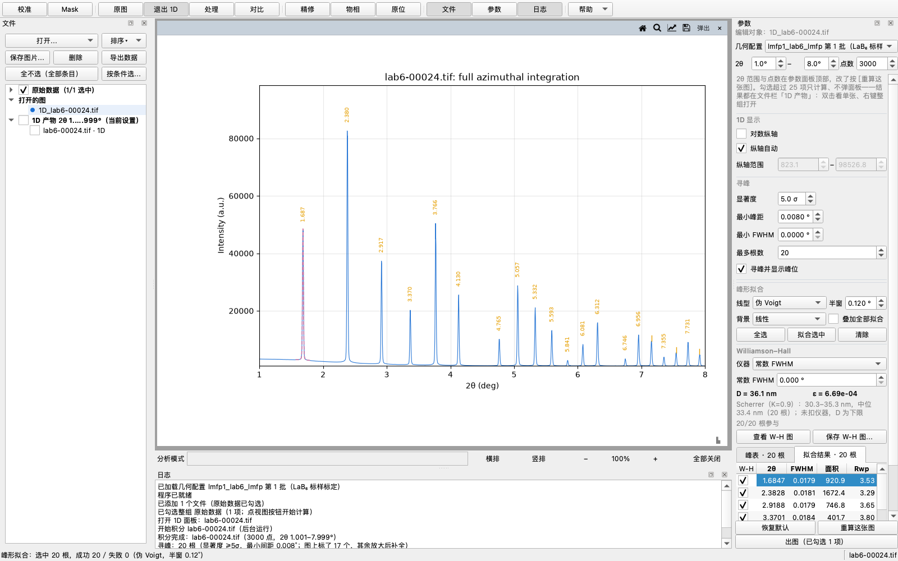

**导出拟合与 W-H 结果**

- **拟合结果数值**：「拟合结果」表右键 → `[复制选中行]` / `[复制全部]`，
  制表符分隔（W-H 勾选、2θ、FWHM、面积、Rwp），直接粘进 Excel。
- **W-H 摘要**：「拟合结果」表右键 → `[复制 W-H 结果]`，复制一段文本：
  D、ε（附百分比）、参与 N/M 根、仪器来源、R²、警告，以及参与峰的
  2θ / FWHM / sin²θ / (βcosθ)² / 面积 / Rwp 表。
- **W-H 图**：`[查看 W-H 图]` 预览（参与/排除点、拟合线、D/ε/R²）；
  `[保存 W-H 图…]` 存 PNG/PDF。
- W-H 没有单独的数值文件导出；留档用「复制 W-H 结果」+ 保存图就够了。

**导出 1D 曲线数据（不是 W-H 结果）**

点文件区 `[导出数据]` → 选输出目录 → 弹导出对话框（各选项作用如下）：

| 对话框选项 | 含义 |
|---|---|
| **名称** | 留空 = `数据类型-样品-时间`，如 `原始-LMFP_1-2026-10-23_235500`（标样写在文件头）；填了就用填的名字（`/ \ : * ? " < > |` 会替换成 `-`） |
| **文件后缀** | `.txt`（两列文本，Excel/Origin 通用）或 `.chi`（同格式、给部分软件） |
| **同时生成全部数据总表** | 勾选 ≥2 条时可用（默认勾）：多出一张 `名称_全部数据.csv`，每个文件一列强度 |
| **导出处理后的曲线（背景/平滑/裁剪）** | **默认不勾 = 导出原始积分结果**；勾上 = 按「处理」页的当前设置，把扣过背景 / 平滑 / 裁剪后的曲线导出去。**只对「原始数据」条目生效**，「1D 产物」「处理产物」条目原样导出。两个注意：① 扣背景后出现负值是正常的（噪声地板）；② 如果「处理」页三项都没开，勾了也等于没处理——文件里会照实标 `Raw`、日志里也会说明" |

**确认**：得到文件——单条 = 一个以导出名命名的 `.txt`；多条 = 新建以
导出名命名的文件夹（内含每条一个 `txt/` 和一张 `名称_全部数据.csv`）。
默认导出名是 `数据类型-样品-时间`；在「名称」里自己填就用你的。
**同名文件不会被覆盖**，自动加序号（`_2`、`_3`），日志写明。

**这一节还能做什么**

- 右键条目 → `导出这一条（txt / chi）`；右键组行 → `导出这一组（txt / chi / CSV）`
  （同一个导出对话框）。
- 超过 25 张没弹出面板：1D 只计算不弹面板（结果在文件栏「1D 产物」组，
  双击看单张）；原图（2D/剖面/瀑布）一张都不弹——用 [热图]/[对比]
  看整批，或右键文件栏 → `打开勾选的 N 张图` → 选视图一次全开
  （每张约 15 MB，先弹确认），或减少勾选分批看。

## 7. 处理——背景扣除、平滑与裁剪

处理的对象是「编辑对象」那张图：先在文件栏**双击一条「1D 产物」**选定它。

1. 点顶部 `[处理]`。
2. **背景扣除**（最常用）：模式选「**自动基线（推荐）**」，窗口保持 0.2°。
   **确认**：图上出现扣过背景的曲线。
   - **自动和手动可以结合用**：选「自动基线」定形状，再 `[拾取锚点]` 在
     图上点几处"只有背景"的位置（避开峰）——基线会**经过这些点**，等于
     "自动的形状 + 你点的点做校正"；覆盖范围写在下方的配方行里。
   - 「手动锚点」= 完全靠你点的点推基线，适合宽鼓包样品；
   - 「空扫相减」最干净（需要拍过空扫图并选进来）；
   - 负值会保留（噪声本底是真实的）——这是有意设计。
3. **平滑**：默认 Savitzky–Golay、窗口 0.10°，对峰形保留最好；窗口别取到
   峰宽量级，否则会削峰。
4. **裁剪**：把强度极高、压低其余信号的强峰挖空——填起止（如 2.5–2.6°）
   → `[添加]`，可以加好几段。
5. 整批套用：在文件栏勾选要处理的文件 → `[存成产物（已勾选 N 项）]`。
   **确认**：文件栏出现「处理产物」分组。

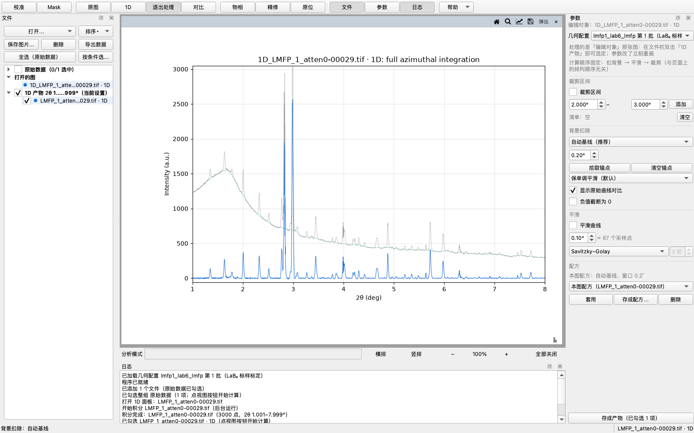

**导出（就在这一步）**

处理产物用**同一个导出流程**：勾选它 → 点 `[导出数据]`（或右键
`导出这一条 / 这一组`）。对它来说，导出对话框里"导出处理后的曲线"那个
勾**勾不勾都一样**——它本身就是处理后的数据（文件里标 `Processed`，
并在表头写明跑过哪条处理链）。

**这一节还能做什么**

- **配方**：`[存成配方…]` 把当前这套处理设置存成一份配方（存的是**设置**，
  不是数据）。之后在"本图配方"下拉里**选一份** → 点 `[套用]`，就把它
  用到当前「编辑对象」那张图上（按了才动，打开面板不会自动套用）；
  锚点位置共用、强度按目标文件重新取。
- **数据 vs 设置的区分**：`[存成产物（已勾选 N 项）]` 存的是**数据**（进
  「处理产物」组，能去对比/热图/导出）；`[存成配方…]` 存的是**设置**。

## 8. 对比（含热图）

1. 勾选 2 条以上曲线（原始数据 / 1D 产物 / 处理产物都行；下面这张图用的
   是**自动扣完背景的处理产物**）→ 点顶部 `[对比]`。**确认**：多条曲线
   叠在一张图里。**注意：对比只叠已经算好的曲线**——勾的原始数据里
   有还没出过 1D 的，会被拦下、不现场积分（日志里会点名是哪几个）；
   先点一次 `[1D]` 把它们出过图，再来对比。
2. 条数多的时候（几十张），在右侧「对比」页勾 `[堆叠显示]`——曲线上下
   错开排，一眼看清每一条；再勾 `[显示数据名]` 会有纵轴样品名（两个
   开关**默认都关着**，认线也可以看悬停读数）。
3. **热图**：回到 `[对比]` 页点 `[出热图]`——整批拼成一张 2θ × 样品的
   强度图（同样只拼已经算好的曲线，拦下的规则与 [对比] 一致）；
   **点某一行 = 在对比面板里显示/隐藏该样品曲线**。行名按默认
   不显示；要看样品短名，在下半页「热图显示」小节勾它自己的
   `[显示数据名]`（与上面「对比显示」那把各管各的，勾哪边只动哪边的图）。

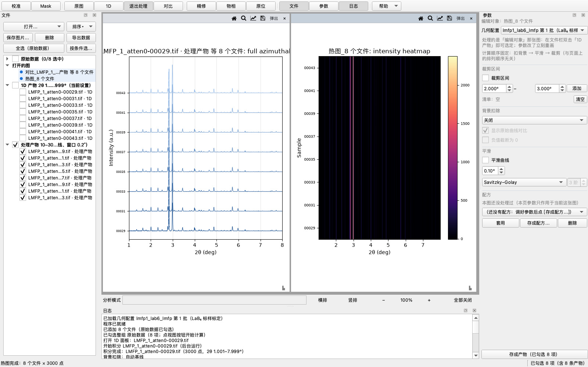

**导出（就在这一步）**

- **数据**：勾选参与对比的条目 → `[导出数据]`（同第 6 节流程）；
- **图**：面板标题行的 `[保存图片…]`。

**这一节还能做什么**：归一化（不归一化 / 全局最强峰 / 指定数据）、
渐变色系（蓝 / 绿 / 橙 / 紫 / 灰：按文件名尾号从深到浅；彩虹：瀑布同款
顺序色，深紫到黄、不循环，不堆叠平铺时相邻曲线更好认；经典色：期刊
常用的 Okabe–Ito 八色串色、色盲友好，超过八条每轮压暗一档）、
堆叠显示 + 手动行距——都在「对比」页，改完立刻生效；
**先调好、再出图也行**：还没出图时改的参数会记着，出图时按它起步
（中途点开别的图则放弃）；换**单张图**的色系在面板标题栏的 `[外观…]` 里；
**缩看某一段 2θ**：用「视图 2θ」框（对比与热图各有一对）填起止，
图立刻裁到那一段（只改窗口、不重算）。
**堆叠里的缩放归堆叠、平铺的归平铺**：在堆叠视图里滚轮/拖动的
位置单独记着，取消堆叠后回到你在平铺时的视图（`[复位视图]` 也各
回各的——堆叠时回整个堆叠、平铺时回平铺最初的样子）。
**曲线多了颜色也能对得上号**：**曲线的颜色按文件名尾号排**（编号最小
的拿最深色，比如 00029 最深、00189 最浅——跟文件栏怎么排无关，编号
才是样品身份）。要看"哪个颜色是哪条数据"，在「对比」页勾上 **`[显示
色标]`**（默认关）：图上出现一块横色标——渐变条，左端是尾号最小的、
右端是最大的（各带短名）；**放图的哪个角**在面板标题栏的 `[外观…]`
里选（右上/左上/右下/左下，默认右上角）；那行说明文字默认"颜色按
文件名尾号顺序"，也在 `[外观…]` 里可以改成你自己的说法（清空 =
不画这行字）。

## 9. 物相工作台——这张图里有哪些相

物相筛选做的是**峰位匹配**：拿观测峰位去和相库里每张 CIF 的理论峰位比，
按 coverage（观测峰被覆盖的比例）+ 0.2 × purity（理论峰被匹配的比例）
打分；晶胞在 0.96–1.05 之间粗扫，兼容固溶体的小幅变化。强度只用来挑
理论强峰，不参与相似度——计算强度受织构影响，定性阶段信不过。

1. 先在 1D 页算出一条曲线；已经有的 1D 面板、以及文件栏里的「1D 产物」
   都会出现在工作台的曲线下拉里（产物不必先双击打开面板，选中时直接读
   缓存）。也可以 `[打开 1D…]` 直接读两列文本（GUI 导出的 txt 可直接用），
   不必先在 1D 页出图。
2. 点工具栏 `[物相]`。**确认**：中央换成「物相工作台」，参数坞/日志坞收起。
3. 选曲线（下拉里选；`[用当前图]` 取焦点那张——焦点不是 1D 时，若下拉
   只有一条就直接选它，否则会提示在下拉里选），选相库目录：默认
   `data/structures`，也可以 `[选目录…]` 指向自己的 CIF 库。当前项目
   预设里 `Al_metal.cif` 不参与主相候选（只作集流体第二相）。
4. **元素过滤**（可选）：填允许元素表（当前 LMFP 示例：`Li Mn Fe P O`；
   留空 = 不过滤），只保留元素全部落在表里的相；大库先筛一层会快很多。
5. **寻峰参数**：显著度（默认 5σ）、最小峰距（0.008°）；匹配容差默认
   0.040°，是理论峰与观测峰允许的最大偏差。
6. 点 `[开始筛相]`。**确认**：状态行显示「筛相完成：N 个候选，观测峰 M 根」，
   下方候选表按 score 从高到低列出。
7. 读表：`score` 越高越像；`coverage` 是观测峰被覆盖的比例，`purity` 是
   理论峰被匹配的比例，`scale` 是晶胞缩放（0.99 ≈ 晶胞比 CIF 小 1%）。
   点一行，该相的理论峰位会叠在观测曲线上；按住 Ctrl/Cmd 多选，可同时
   叠多个相（每个相一种颜色，图例里对得上号）。
8. `[峰位精修晶胞]`：用观测峰位对选中的 CIF 做**峰位级晶胞精修**，七个晶系
   都支持（立方只留 a；四方/六方留 a,c；单斜留一个非直角；三斜全放开），
   同时精修 2θ 零位。**确认**：弹出报告，含 a/b/c/α/β/γ（带 esd）、零位、
   匹配根数、RMS 与逐峰 hkl；报告只用于检查/交接，**不写回 CIF 或候选**，
   可 `[复制报告]` / `[保存报告…]`。
9. `[送去精修]` 把当前曲线和选中的 CIF 带进精修工作台，两边下拉框都预选好；
   `[导出到默认位置]` 把候选表写成 CSV（顶部注释含曲线、相库、元素、波长与
   时间），直接写到默认输出目录，不弹保存框；写不进去会在状态行提示。
   右键候选表可复制选中行/全部（制表符分隔）。

**这一节还能做什么**

- 换曲线后旧候选会自动清空（避免把 A 图的相送到 B 图）；换相库同理。
- 文件曲线（`[打开 1D…]` 读进来的）没有对应的 1D 面板，不能直接
  `[送去精修]`，会明确提示。
- 候选表支持 Ctrl/Cmd 多选，选的相越多，重叠的峰位越容易看出"谁多认了
  一根峰"。

**边界**：只做峰位匹配，不从零指标化——完全不认识的相（没有晶胞初值）
仍需先找到一张相近的 CIF；`[峰位精修晶胞]` 也需要这张 CIF 的晶胞不至于差太远
（匹配容差内）。相分数/强度不参与打分，`score` 不是"含量"；大相库
（几千张 CIF）会明显变慢，建议先按元素筛成一个子目录。

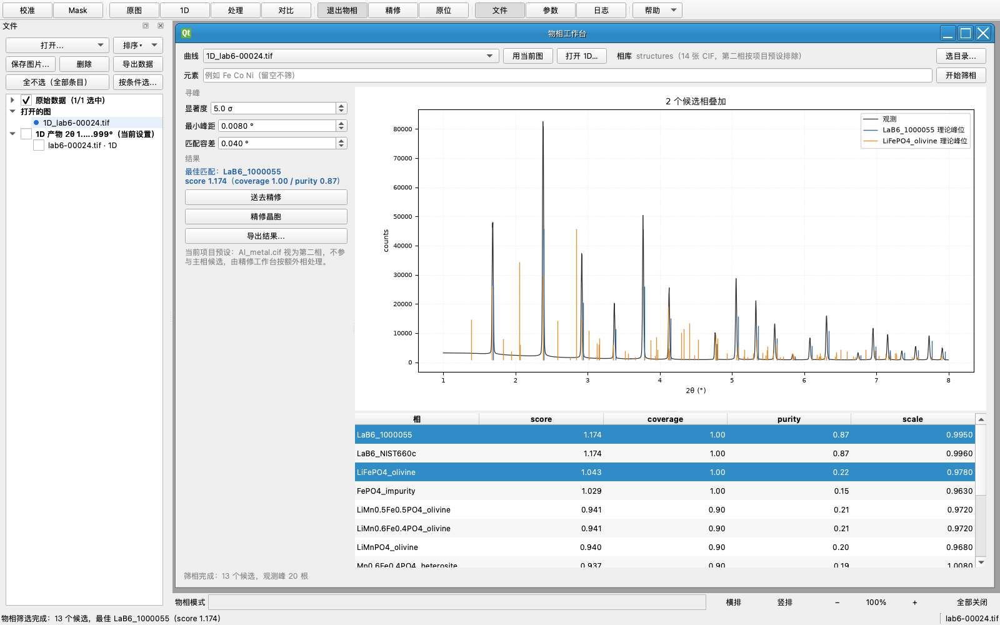

## 10. 精修工作台——全谱拟合

全谱精修用的是**整条曲线**：观测 / 计算 / 背景 / 差值一起看，Rwp 是
加权残差。默认对主相做结构精修（晶胞、峰形、微结构、温度因子），也可以
切到 Le Bail（强度自由）只看峰形与晶胞。

1. 先在 1D 页算出一条曲线；点工具栏 `[精修]`。**确认**：中央换成
   「精修工作台」，参数坞/日志坞收起。
2. 顶部选曲线（`[用当前图]`）与结构 CIF：默认列出 `data/structures`，
   也可 `[打开 CIF…]`。右侧显示当前波长 λ。
3. 选背景：默认「自动基线」+ 窗口 0.20°；也可以选「无」。精修用的是
   这条 1D 曲线的**积分数据**，背景由工作台自己估计，不会叠加处理页的
   扣背景结果。
4. 勾精修项：
   - **晶胞 a/b/c**：按晶系自动裁剪——立方只精修 a（b = c = a），
     非正交晶系会跳过并在状态行说明；全谱引擎只支持正交/立方。
     六方/单斜/三斜请先用物相工作台的 `[峰位精修晶胞]`（峰位级，七个晶系）。
   - **仪器峰形 U/V/W/X/Y**：Caglioti 与 Lorentzian 峰宽项。
   - **样品微结构 Size/Mustrain**：晶粒尺寸与微应变。
   - **温度因子 B**：从 CIF 的 Uiso 起步。
   - **Le Bail（强度自由）**：每条峰的强度单独解出，不看结构因子；
     适合只看峰形与晶胞。Le Bail 下 B 不可用。
5. 点 `[开始精修]`。**确认**：Rwp/Rp 出现；三联图（观测 / 计算 / 背景）
   + obs−calc 差值 + 布拉格刻度；「参数表」有初值/拟合值/esd，「报告」
   有完整文本。多相时参数表末尾会多出 `wt% <相>` 行（Rietveld 重量分数，
   只对拟合模型里的晶态相；非晶/未知相不参与分母），报告里也有定量表。
6. **额外相**（如 Al 集流体）：`[加 CIF…]` 选一张，默认勾「额外相强度
   自由（Le Bail）」——Al 箔织构强，峰强交给数据。**确认**：图上多一行
   布拉格刻度（标签是相名），参数表里出现 `Al:scale`。
7. **仪器基线**（想固定仪器时用）：先精修一张 LaB₆ → `[存为仪器基线]`；
   之后精修样品时勾「固定仪器」，zero/U/V/W/X/Y 就固定住，只精修样品
   本身。**确认**：仪器基线行显示五参数与波长；「仪器峰形」勾选自动置灰。
   基线来自另一个波长时会拒绝应用并在状态行提示。存下的基线在本次运行内
   也会出现在 1D 页 W-H 的「仪器」下拉里（`LaB₆ 基线`）。
8. **采纳为图面板**：把这次结果开成一张普通 1D 图（观测 + 计算 + 背景 +
   布拉格刻度，处理链默认关），之后可以保存、参与对比、导出。叠加按曲线
   指纹匹配；换了数据就静默不画。
   `[保存图片…]` 出 PNG/PDF，`[复制报告]` 直接贴走。

**这一节还能做什么**

- 参数表右键复制选中行/全部（TSV）；报告区可直接选中复制。
- 额外相可加多张；每张默认逐反射强度自由，也可以取消这个勾让结构因子
  参与。
- 精修结果不写产物；要参与对比/导出就 `[采纳为图面板]`。

**边界**：界面目前是"一个主相 + 若干额外相"，多主相还没开；原子坐标/
占位率精修引擎支持但界面没放；仪器基线只在当前窗口内有效，关程序就没了；
Rwp 默认把仪器、微结构、背景节点都放开了，和命令行里固定仪器的 4.24%
不能直接比。

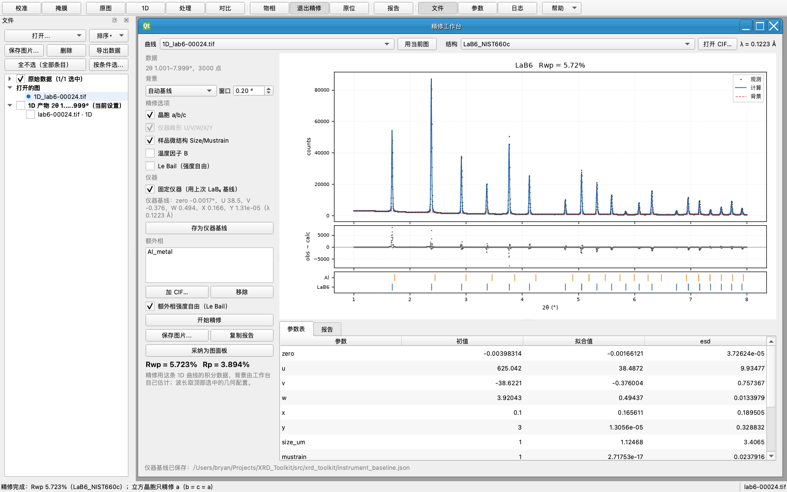

## 11. 原位工作台——逐帧三相批量（LMFP 项目预设）

> 这一章是 **LMFP 项目预设**：三相模型（富锂 / 贫锂 / Al）、默认帧目录、
> mask 和 LaB₆ 要求都是这套数据的配置；换数据时在对应下拉/按钮里换。
> 通用多相版本不在 v0.2.0 范围内。

三相模型：**富锂 LMFP**（主相，晶胞 a/b/c 自由）、**贫锂 heterosite**
（额外相，晶胞自由）、**Al 集流体**（立方，a 固定 4.061 Å；峰强逐反射
自由）。相分数是**相对散射强度分数**：

    A_p = scale_p × Σ(table.inten_p) × norm_p / 100
    f_rich = A_rich / (A_rich + A_poor)

Al 只作参考、不参与 LMFP 分数。`f_rich` 是**相对散射强度分数**，看趋势用。
表里另有 `wt rich%` / `wt poor%`（Rietveld 重量分数，只对晶态相；Al 单列、
不进两相分母）和 `wt_al`（CSV 列，含 Al 的全相分数）；两种口径不要混着
引用。CSV 与 `fit_summary.txt` 都带 wt 列。

1. 选帧目录：默认 `~/Data/XRD/lmfpdata`，也可以 `[选文件夹…]`。顶部会写
   「N 帧」。建议先把「帧数上限」填 3 跑通流程，再放开。
2. 三相结构：富锂 / 贫锂 / Al 三张 CIF，默认在 `data/structures`；`[换…]`
   可换。
3. **LaB₆ 标样图**：`[换…]` 选一张自己的 LaB₆ 标样帧（用来定仪器峰形）。
   打包版不再带仓库样例，必须由你提供；没有它 `[开始]` 会提示。
4. **mask**：默认 `outputs/masks/lmfp1_lab6_mask.npy`（只在 LMFP 几何下
   自动带），可以 `[选 mask…]` 或 `[清除]`。热像素不遮会让 Rwp 明显变差。
5. 参数：最大 Rwp（默认 20%）、首帧迭代（120）、后续帧迭代（40）、
   2θ 范围（1–8°）、输出点数（3000）；输出目录默认 `outputs/insitu`。
   每帧从「上一帧种子」和「CIF 端元」各算一次（双起点），取 Rwp 更低者；
   约 15–20 s/帧，81 帧约 20–25 分钟。
6. 点 `[开始]`。**确认**：状态行先显示「准备中（读结构 + LaB₆ 定仪器）」，
   随后变成「第 i/N 帧：文件名」；表里逐行出现结果，右侧视图同步更新。
7. 表列：帧 / 文件 / 状态 / Rwp / f_rich / wt rich% / wt poor% /
   两相 a、c / 拟合耗时；状态
   `ok`（严格收敛）、`ok_soft`（优化器退出标志失败但 Rwp/相分数合格）、
   `high_rwp(x%)`、`cell_jump`、`no_phase_signal`、`error: ...`。
   `high_rwp`/`error` 标红，其余非 `ok` 标黄——都不中断，下一帧仍用上一个
   好种子。
8. 右侧四个标签页：
   - **趋势**：相分数（富锂/贫锂，带 f_rich 的 esd）、rich 晶胞、
     poor 晶胞、Rwp；晶胞面板只有该相占多数（≥50%）时才画实心点，
     淡色是 minority 估计，不作为结构证据；
   - **汇总**：相分数 + 状态标记（`ok` / `ok_soft` / `cell_jump` 等）、
     两相晶胞误差棒、Rwp/Rp，底色按 f_rich 最低点分充/放电段；
     晶胞点同样只在相占多数时实心；
   - **单帧拟合**：**双击表格任意一行**看这一帧的观测/计算/背景 + 残差 +
     每相布拉格刻度；表格右键也有「查看这一帧拟合 / 保存这一帧拟合图… /
     复制这一帧报告」；
   - **模型无关**：(200) 双峰的强度加权质心与总面积，和批量的 f_poor
     独立对照；只用已经拟合成功的帧，不重新读图。
9. `[停止]` 在当前帧算完后停，已完成的帧保留。结束时写
   `insitu_fit.csv` 与 `fit_summary.txt`。`[保存当前图…]` 保存当前标签页，
   按脚本同尺寸重画后再存（报告可直接用）；单帧拟合另有
   `[复制这一帧报告]`。

**这一节还能做什么**

- 结果表右键复制选中行/全部。
- 跑完可以先看趋势/汇总，再决定是否放开全部帧；异常帧不会中断整批。
- 第一帧用 120 次迭代充分收敛，后续帧双起点；晶胞跳变后连续 2 帧落在
  同一个新晶胞时重锁种子，避免两相区一直用旧种子。
- 两相共存区（某相 <50%）的晶胞会被多数相拉偏；相变看 f_rich 和模型
  无关 (200) 质心，晶胞只引用相占多数时的值。

**边界**：`f_rich` 不是 wt%；`wt_rich/wt_poor` 只对拟合模型里的晶态相
（Al 单列），非晶/未知相不参与。相变/放电段可能出现 `ok_soft`（正常）；
双起点约 15–20 s/帧（81 帧约 20–25 分钟）；LaB₆ 标样帧必须与数据同一
几何/波长；打包版不再带仓库样例图。单帧拟合的曲线只在当前会话保留，关
程序后要重跑才能再看；GSAS-II 对照仍是独立脚本。

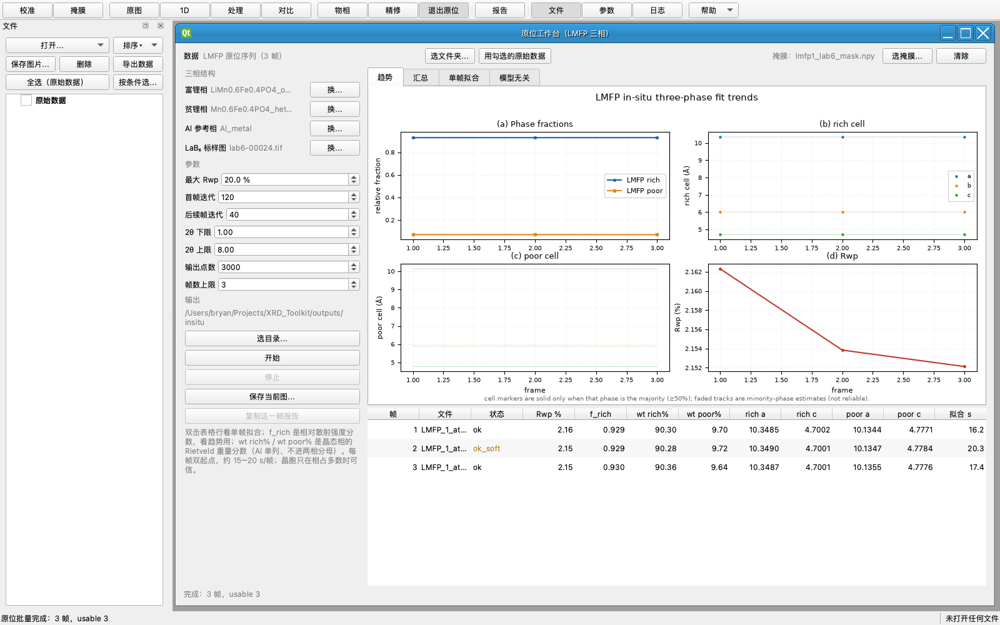

## 12. 缓存与"第二次打开"

**缓存是什么**：所有算过的 1D 结果都存在本机 `XRD_Toolkit/_stage` 里。

- **`_stage` 可以删**（右键文件栏空白处 →「删除所有缓存…」，点一下即删，
  日志里会告诉你删了几个）：删了不发生错误，只是下次点 `[1D]` 要重新算、
  慢一点；适合清理磁盘空间。
- **不建议删**：`config_user.json`（你的标定配置——删了要重新校准）；
  导出好的数据文件（你自己管理）。
- 「最近打开」记录（`recent.json`）随便删，只是少了快捷入口。

**第二次打开同一批数据会发生什么**：

- 软件**不记忆文件栏**——重开是空的，要重新 `[打开…]` 导入（或用
  「最近打开」）；
- 导入后，**已经算过的「1D 产物」会自动列出来**（缓存还在），
  **不用重算**；
- 但**勾选是空的**，要重新勾选——点 `[1D]` 时日志会写"复用 N 条"，秒出；
- 改了 2θ 范围或点数再出图 = 按新参数**另算一份**，旧产物**不会消失**，
  文件栏里两份并存（组名带各自的参数）；
- 处理过的图同理：处理产物留在「处理产物」组里，重新导入后照常可见。

## 13. 文件都在哪

所有东西都在 **`个人文件夹/XRD_Toolkit`**（Windows 是 `文档\XRD_Toolkit`），
导出对话框显示的也是这个路径：

- **导出的数据**：由你自己指定目录；单条 = 一个文件，多条 = 一个以
  导出名命名的文件夹（默认 `数据类型-样品-时间`，见第 6 节）；
- **`_stage`**：计算缓存（可删，见第 12 节）；
- **`config_user.json`**：你的标定配置（别删）；
- **`recent.json`**：最近打开记录（随便删）；
- **`crash-watch.txt`**：程序出错时的现场记录（报错时发给开发者用，
  里面可能含本机文件路径，对外分享前可以先看一眼）。

## 常见问题

| 现象 | 怎么办 |
|---|---|
| 双击没反应 / 提示"已损坏" | Mac：右键 → 打开（第 1 节）；Windows：更多信息 → 仍要运行 |
| 第一次打开很慢 | 正常，正在建立字体缓存 |
| 软件里什么都没有 | 先 `[打开…]` 导入图像，再勾选文件，再出图（第 2、5 节） |
| 点 `[出图（已勾选 N 项）]` 没反应 | 检查文件行最左边的对号框是否勾上——只画勾选的条目 |
| 点 `[出对比]` / `[出热图]` 被拦下（日志写"还没有 1D 曲线"） | 对比与热图只画**已经算好的**曲线——先点 `[1D]` 把日志点名的几个文件出过图，再回来对比（第 8 节） |
| 峰位整体偏、环不圆 | 几何配置不对——回到第 3 节重新确定几何 |
| 曲线噪声大 / 背景高 | `[处理]` 页做背景扣除与平滑（第 7 节） |
| 导出文件里出现了负值 | 扣过背景是正常的（噪声地板）；想要原始强度就**不勾**
"导出处理后的曲线"（第 6 节） |
| 想清理缓存释放空间 | 文件栏右键 →「删除所有缓存…」，点一下即删（导出和配置不受影响，第 12 节） |
| 程序出错 | 把 `个人文件夹/XRD_Toolkit/crash-watch.txt` 与界面截图发给开发者 |

## 数据、隐私与许可

- **所有计算都在你自己的电脑上完成**：软件不联网、不上传任何数据、没有
  使用统计（遥测）。实验数据不出本机。
- `crash-watch.txt` 是崩溃现场记录，**可能包含本机文件路径**；对外分享前
  可以先自己打开查看。
- 免责：本软件是科研工具，结果取决于几何标定与参数选择，**发表或交付前
  请人工复核**关键数值。
- 许可：本软件采用 MIT 许可；随附的第三方组件（Qt/PySide6、pyFAI、NumPy、
  SciPy、Matplotlib 等）各自的许可全文见随包文件 `THIRD_PARTY_NOTICES.txt`。
- 引用：论文引用本软件时，请参照软件仓库中的 `CITATION.cff`。
